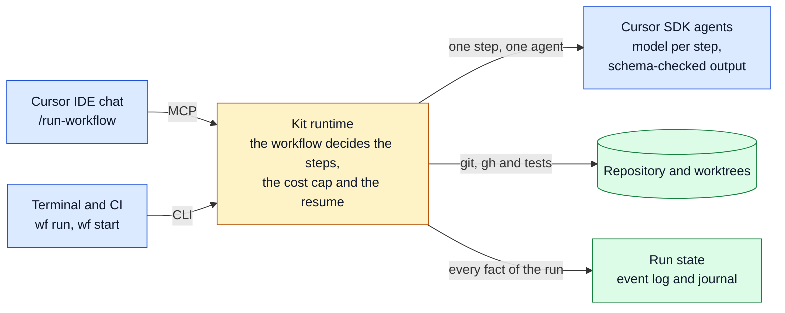

# Cursor Workflows Starter Kit

> Português: [README.md](README.md). **The documentation is a book in Brazilian Portuguese**, indexed in [docs/README.md](docs/README.md). This page is the English hub.

**Deterministic** agent workflows on the [Cursor SDK](https://cursor.com/docs/sdk/typescript) (`@cursor/sdk`), called
from the Cursor IDE chat (through MCP), from the terminal and from CI (through a CLI).

> **Status: pre-release 0.2.0.** Verified against the real API in one environment (Premium plan, `@cursor/sdk@1.3.1`,
> Linux x64 on WSL2). The Cursor IDE has not been tested yet. Step agents run tools without asking for approval: read
> [SECURITY.md](SECURITY.md) before use. Evidence and pending items: [8.2 · Local verifications](docs/research/verificacoes-locais.md).

## The problem

When a chat agent drives a process with several steps, the agent decides what runs next. It can skip a step without
telling you, use a large model for everything, spend with no ceiling and not know how to pick up where it stopped.
Cursor ships no runtime that takes that control away from the model. More in [1.1 · O problema](docs/vision/01-o-problema.md).

## The idea

A workflow is a TypeScript file. **Code** decides the order, the branches, the model of each step and when to stop; the
model only runs small tasks whose answer is validated against a schema. The flow finishes completely or fails in the
open, and an interrupted run resumes where it stopped. The idea comes from Claude Code's *workflows*, from n8n and from
the mattpocock skills: [1.2 · A ideia e as referências](docs/vision/02-a-ideia-e-as-referencias.md).



## Quick start

Requires Node 22.13 or newer, a paid Cursor plan, `git` and an authenticated `gh`.

```bash
npm ci
npm run wf -- login          # browser login; usage bills YOUR account
npm run models               # model IDs available to you
npm run wf -- run implement-issue --cwd /path/to/test-repo --args '{"issue":1}' --max-cents 100 --max-tokens 300000
```

Always pass both caps. In the Cursor IDE, enable the `workflows` MCP server and type `/run-workflow implement-issue 123`
([2.1 §6](docs/usage/01-instalacao.md#6-habilitar-no-cursor-ide)). The caps: [2.2 §3](docs/usage/02-configuracao-inicial.md#3-teto-de-custo).

## What you get

| Piece | What it does | Where to read |
|---|---|---|
| Runtime | `ctx.agent`, `parallel`, `pipeline` and `phase`; model and retries per step; schema-validated output; cost cap | [3.1 · Arquitetura](docs/internals/01-arquitetura.md) |
| Resume and event log | The journal avoids redoing finished steps; every fact of a run goes to one log per run | [6.1 · Referência de eventos](docs/reference/events.md) |
| MCP server and `wf` CLI | `start_workflow`, `wait_workflow` and friends; `wf run`, `start`, `status`, `jobs`, `stats` | [2.3 · Invocação](docs/usage/03-invocacao-no-cursor-ide.md) |
| Skills | `run-workflow`, `cursor-workflow-authoring` and `skill-to-workflow` | [4.1](docs/authoring/01-escrevendo-workflows.md) and [4.2](docs/authoring/02-convertendo-skills-e-subagents.md) |
| `implement-issue` | Example workflow: TDD slice by slice, a three-axis review, a PR with evidence | [4.2](docs/authoring/02-convertendo-skills-e-subagents.md) |
| Metrics and dashboard | Cost, tokens and efficiency in a local SQLite; a localhost dashboard | [5.3 · Observabilidade](docs/operating/03-observabilidade.md) |

## Keep reading

- **Use it:** [2.1 · Instalação](docs/usage/01-instalacao.md), then [5.1 · Governança e custos](docs/operating/01-governanca-e-custos.md).
- **Write workflows:** [4.1 · Escrevendo workflows](docs/authoring/01-escrevendo-workflows.md).
- **Change the kit:** [9.1 · Contribuindo](docs/contributing/01-contribuindo.md) and the [decisions (ADRs, in English)](docs/README.md#parte-7--decisões-adrs).
- **Outside the book:** [Security](SECURITY.md) · [Changes](CHANGELOG.md) · [License](LICENSE): MIT for the code and the
  docs; `@cursor/sdk` is proprietary and subject to [Cursor's Terms of Service](https://cursor.com/terms-of-service).
