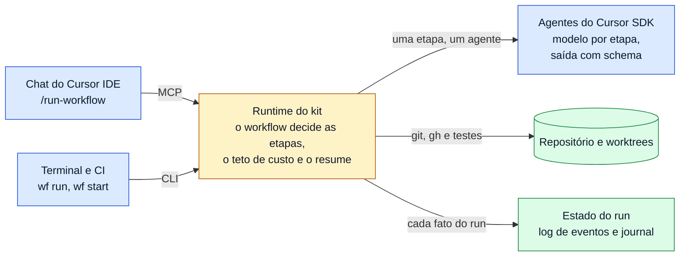

# Cursor Workflows Starter Kit

> English: [README.en.md](README.en.md). A documentação é um livro em pt-BR, com índice em [docs/README.md](docs/README.md).

Workflows de agentes **determinísticos** sobre o [Cursor SDK](https://cursor.com/docs/sdk/typescript) (`@cursor/sdk`),
chamados do chat do Cursor IDE (via MCP), do terminal e de CI (via CLI).

> **Status: pré-release 0.2.0.** Verificado contra a API real num único ambiente (plano Premium, `@cursor/sdk@1.3.1`,
> Linux x64 em WSL2). O Cursor IDE ainda não foi testado. Os agentes das etapas executam tools sem pedir aprovação:
> leia [SECURITY.md](SECURITY.md) antes de usar. Evidência e pendências: [8.2 · Verificações locais](docs/research/verificacoes-locais.md).

## O problema

Quando o agente de um chat conduz um processo de várias etapas, é ele quem decide o que roda a seguir. Pode pular um
passo sem avisar, usar um modelo grande para tudo, gastar sem teto e não saber retomar de onde parou. O Cursor não traz
um runtime que tire essa condução do modelo. Mais em [1.1 · O problema](docs/vision/01-o-problema.md).

## A ideia

Um workflow é um arquivo TypeScript. O **código** decide a ordem, os ramos, o modelo de cada etapa e a hora de parar; o
modelo só executa tarefas pequenas, com resposta validada por schema. O fluxo termina por inteiro ou falha às claras, e
um run interrompido retoma de onde parou. A ideia vem dos *workflows* do Claude Code, do n8n e das skills de mattpocock:
[1.2 · A ideia e as referências](docs/vision/02-a-ideia-e-as-referencias.md).



## Começo rápido

Requisitos: Node 22.13 ou mais novo, um plano pago do Cursor, `git` e `gh` autenticado.

```bash
npm ci
npm run wf -- login          # login no navegador; o uso fica na SUA conta
npm run models               # IDs de modelo liberados para você
npm run wf -- run implement-issue --cwd /caminho/do/repo-de-teste --args '{"issue":1}' --max-cents 100 --max-tokens 300000
```

Passe sempre os dois tetos. No Cursor IDE, habilite o MCP server `workflows` e digite `/run-workflow implement-issue 123`
([2.1 §6](docs/usage/01-instalacao.md#6-habilitar-no-cursor-ide)). Os tetos: [2.2 §3](docs/usage/02-configuracao-inicial.md#3-teto-de-custo).

## O que você leva

| Peça | O que faz | Onde ler |
|---|---|---|
| Runtime | `ctx.agent`, `parallel`, `pipeline` e `phase`; modelo e retries por etapa; saída validada por schema; teto de custo | [3.1 · Arquitetura](docs/internals/01-arquitetura.md) |
| Resume e log de eventos | O journal evita refazer etapas prontas; cada fato do run fica em um log por run | [6.1 · Referência de eventos](docs/reference/events.md) |
| MCP server e CLI `wf` | `start_workflow`, `wait_workflow` e companhia; `wf run`, `start`, `status`, `jobs`, `stats` | [2.3 · Invocação](docs/usage/03-invocacao-no-cursor-ide.md) |
| Skills | `run-workflow`, `cursor-workflow-authoring` e `skill-to-workflow` | [4.1](docs/authoring/01-escrevendo-workflows.md) e [4.2](docs/authoring/02-convertendo-skills-e-subagents.md) |
| `implement-issue` | Workflow de exemplo: TDD fatia a fatia, review em três eixos, PR com evidência | [4.2](docs/authoring/02-convertendo-skills-e-subagents.md) |
| Métricas e dashboard | Custo, tokens e eficiência num SQLite local; dashboard em localhost | [5.3 · Observabilidade](docs/operating/03-observabilidade.md) |

## Para continuar

- **Usar:** [2.1 · Instalação](docs/usage/01-instalacao.md), depois [5.1 · Governança e custos](docs/operating/01-governanca-e-custos.md).
- **Escrever workflows:** [4.1 · Escrevendo workflows](docs/authoring/01-escrevendo-workflows.md).
- **Mudar o kit:** [9.1 · Contribuindo](docs/contributing/01-contribuindo.md) e as [decisões (ADRs)](docs/README.md#parte-7--decisões-adrs).
- **Fora do livro:** [Segurança](SECURITY.md) · [Mudanças](CHANGELOG.md) · [Licença](LICENSE): MIT para o código e a
  documentação; o `@cursor/sdk` é proprietário e segue os [Termos do Cursor](https://cursor.com/terms-of-service).
