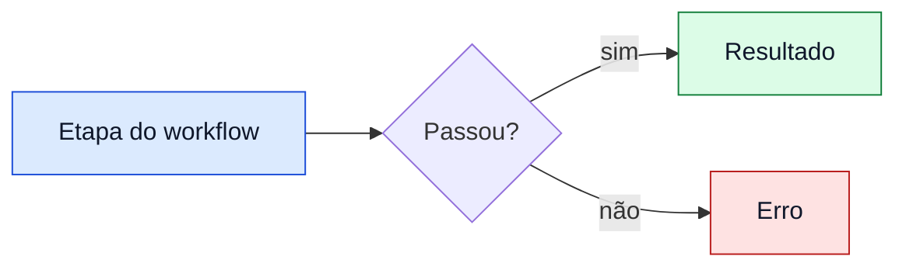
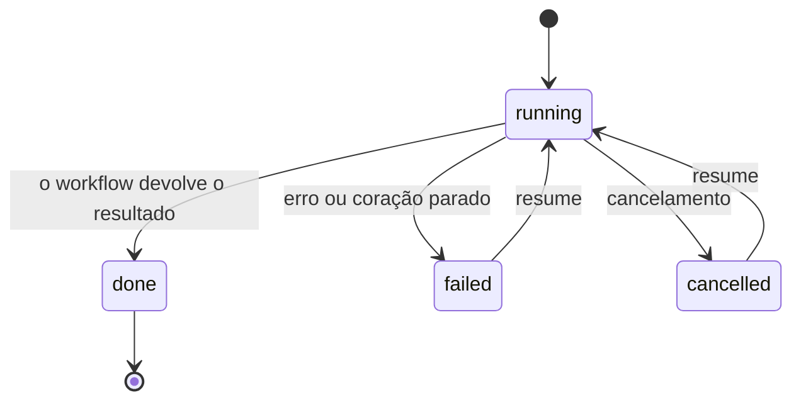

# 9.3 · Convenções de diagramas

Os diagramas do livro e do README são blocos de código com a linguagem `mermaid`, que o GitHub desenha no navegador. Eles
aparecem em tema claro e em tema escuro, e o autor não escolhe o tema do leitor. As regras abaixo mantêm o diagrama legível nos
dois e mantêm as páginas sem movimento.

## Cores: `classDef` neutras ao tema

- Pinte com `classDef` e aplique com `:::classe`. Não use `style` nó a nó, nem `%%{init: {"theme": ...}}`: o GitHub
  escolhe o tema, e uma cor fixa no tema errado some.
- Em cada `classDef`, defina `fill`, `stroke` **e** `color` (o texto). Com os três explícitos, o nó tem a sua própria
  cor de fundo e continua legível sobre fundo branco e sobre fundo preto.
- Use fundos de tom médio a claro e texto escuro, nunca branco puro nem preto puro como fundo. Os pares abaixo passam nos
  dois temas:

| Classe | `fill` | `stroke` | `color` |
|---|---|---|---|
| Etapa ou ação | `#dbeafe` | `#1d4ed8` | `#0f172a` |
| Resultado ou sucesso | `#dcfce7` | `#15803d` | `#0f172a` |
| Atenção | `#fef3c7` | `#b45309` | `#0f172a` |
| Erro | `#fee2e2` | `#b91c1c` | `#0f172a` |

- Setas, rótulos de seta e fundos de `subgraph` são desenhados com as cores do tema: não os redefina.
- Não passe a informação só pela cor. O texto do nó diz o que ele é, e a cor só agrupa.

## Sem animação

Nada se move numa página renderizada no GitHub. Não use animação de aresta (`e1@{ animate: true }`,
`animation: fast`), `stroke-dasharray` com `animation` em `linkStyle` nem qualquer CSS com `@keyframes`. Setas
tracejadas (`-.->`) são estáticas e podem ser usadas para dizer "opcional" ou "fallback".

## Máquinas de estado: `stateDiagram-v2`

Estados e transições (o ciclo de vida de um job, de uma etapa, de um run) usam `stateDiagram-v2`, nunca `stateDiagram`
(a sintaxe antiga) nem um `flowchart` imitando estados. Dê a cada transição o evento que a causa quando ele existir.

## Boas práticas

- Um diagrama por ideia, com no máximo cerca de 15 nós. Se passar disso, divida.
- Direção `LR` para fluxos que se leem como frase, `TB` para camadas.
- Ponha o rótulo entre aspas quando tiver parênteses, `:`, `<`, `>` ou barras: `A["Agent.create({model})"]`. Use ` `
  para quebrar a linha e `&lt;` para um `<` literal.
- Rótulos em pt-BR, com identificadores de código (`ctx.agent`, `journal.jsonl`) como estão no código. No `README.en.md` e
  nos ADRs, que são em inglês, os rótulos também são em inglês.
- Legenda e texto explicativo ficam fora do diagrama, em Markdown.

## Verificação

Um erro de sintaxe no Mermaid não aparece no `npm test`: o GitHub só mostra "Unable to render" quando alguém abre a
página. Por isso o CI tem um job `mermaid` que renderiza todos os blocos do repositório com o `@mermaid-js/mermaid-cli`
e reprova o PR no primeiro erro de sintaxe, com o arquivo e a linha do bloco.

- O job roda **só no GitHub Actions**. O `mermaid-cli` usa um Chromium headless, que trava quando rodado localmente
  (visto no WSL2) e pesa demais para entrar nas dependências de todo `npm ci`.
- Localmente, `npm run docs:mermaid -- --list` lista os blocos que o job vai renderizar (arquivo, linha, tipo de
  diagrama). Para ver o desenho, cole o bloco em [mermaid.live](https://mermaid.live).
- Os blocos desta página também passam pelo job.

---

[← Anterior: 9.2 · Convenções do livro](02-convencoes-do-livro.md) · [Índice](../README.md) · [Próximo: 9.4 · Scripts do mantenedor →](04-scripts-do-mantenedor.md)
