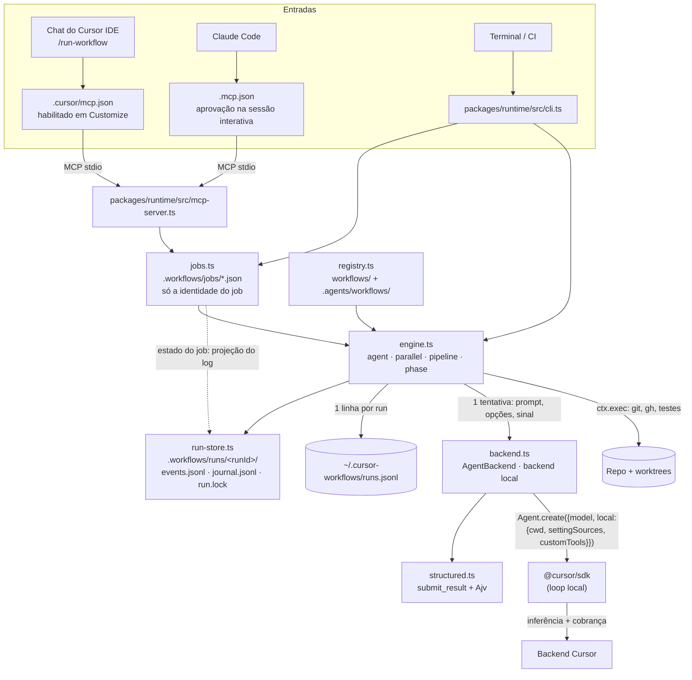
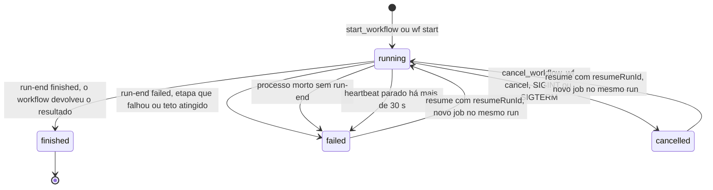

# 3.1 · Arquitetura

## Visão geral



## Ciclo de uma etapa (`ctx.agent`)

O motor decide o que roda e quando (journal, tetos, tentativas, tempo, cancelamento, log de eventos). Quem roda cada
tentativa é um `AgentBackend` ([O `AgentBackend`](#o-agentbackend-quem-roda-a-tentativa)): os passos 4 a 7 e 10 abaixo
são o que o backend local faz numa tentativa.

0. **Antes do run:** `args` são validados contra `meta.argsSchema` (Ajv), e o ambiente recebe
   `WF_INSIDE_WORKFLOW=1`. O shell das etapas herda a marca (medido em 2026-11-11), e o CLI recusa `run`/`start`
   com ela. Os servidores do `.cursor/mcp.json` **não** herdam, porque o SDK não repassa o ambiente a eles; por
   isso o passo 4 encobre o servidor `workflows`.
1. **Chave do journal:** `sha256(prompt + {model, schema, cwd, tools, agents, settingSources})` mais o número da
   ocorrência.
   - Se a chave já estiver no journal, devolve o resultado salvo sem chamar a API.
   - Com `memo: true` (só etapas de leitura), consulta também `.workflows/memo/`, com chave na etapa e no estado do
     repositório (HEAD + mudanças locais + arquivos novos). Um acerto vale entre runs diferentes.
2. **Validação local:** etapa sem modelo, ou com `schema` cuja raiz não é `type: "object"`, falha antes de criar
   o agente.
3. **Teto** (antes de cada tentativa): se `spentCents ≥ maxCents` ou `spentTokens ≥ maxTokens`, lança
   `BudgetExceededError`.
   - `spentCents` soma, por tentativa, o maior entre `rawCostCents` (custo bruto) e `chargedCents` (cobrado). Só o
     cobrado não basta: ele é 0 para uso incluído no plano, BYOK e créditos
     [DOC](https://cursor.com/docs/sdk/typescript#agentgetusage) (acesso em 2026-11-11), e o teto nunca dispararia
     no uso do plano.
   - Em uso cobrado por request (planos legados e alguns Enterprise por request), `rawCostCents` vale 0
     [DOC](https://cursor.com/docs/sdk/typescript#agentgetusage). Aí o teto em centavos fica cego e só
     `--max-tokens` / `WF_MAX_TOKENS` protege. Configure sempre os dois tetos.
   - O gasto é do run, não da execução: ao abrir o run, o engine o recompõe a partir do log de eventos (todas as
     execuções anteriores, tentativas que falharam inclusive), então um resume nunca recomeça do zero. `--max-cents` e
     `--max-tokens` num resume são o novo teto **total**; com o mesmo teto, o resume para no mesmo ponto.
   - Os tetos de tokens também valem durante a tentativa, no fim de cada turno (`turn-ended`, passo 7): o engine soma os
     turnos das tentativas em andamento ao gasto já registrado. Se o total passa de `maxTokens`, cancela o run do
     agente de **todas** as etapas ativas e o run termina com o `BudgetExceededError` (nenhuma etapa nova começa, e o
     `run-end` espera as canceladas fecharem a conta). Se a etapa passa do próprio `maxTokensPerStep` (todas as
     tentativas dela somadas), só ela é cancelada e falha com `StepBudgetError`, que não é fatal. A tentativa cortada
     fecha com `errorKind: "budget"` e não é repetida. A ultrapassagem é de no máximo um turno por etapa ativa.
     Antes disso, medido em 2026-11-11: uma etapa começou abaixo de `--max-tokens 300000` e o run fechou em 344 mil
     ([8.2 §9](../research/verificacoes-locais.md)).
4. **Agente novo:** `Agent.create` com o modelo da etapa, a allowlist de tools, os subagents e MCP servers
   inline, o sandbox (se pedido) e `settingSources: ["project","team","mdm"]`.
   - Com `schema`, registra a custom tool `submit_result` e garante `"mcp"` na allowlist.
   - Quando a etapa carrega camadas de arquivo (`project`, `user`, `plugins` ou `all`), registra também um MCP
     inline `workflows` (ou `WF_MCP_SERVER_NAME`) sem tools, `packages/runtime/src/runtime/nested-mcp-guard.mjs`. Ele vence o
     servidor de mesmo nome do `.cursor/mcp.json`, e a etapa não vê `start_workflow` (medido em 2026-11-11; ver
     [2.2 §5](../usage/02-configuracao-inicial.md#5-contexto-do-projeto-nos-agentes)).
   - O SDK valida o modelo contra o catálogo da conta; um ID inválido faz a etapa falhar ("Cannot use this
     model"). A tabela de erros do SDK põe `model.id` inválido em `ConfigurationError` e manda conferir o ID com
     `Cursor.models.list()`, que lista os modelos liberados para a conta e o time da API key
     [DOC](https://cursor.com/docs/sdk/typescript#errors) [DOC](https://cursor.com/docs/sdk/typescript#cursormodelslist).
   - No plano Free, o `Agent.create` já falha com `UnknownAgentError` `plan_required` (403): a validação local do
     modelo consulta o catálogo (`GET /v1/models`), bloqueado no Free (medido em 2026-11-11,
     [8.2 §4](../research/verificacoes-locais.md)).
5. **Run:** `send(prompt)` (tolera `AgentBusyError` com espera curta; nenhum apareceu nas 3 etapas com schema
   medidas em 2026-11-11) e `wait()` com timeout. Ao estourar o timeout, o engine **aguarda** `run.cancel()` antes
   de seguir, para a próxima tentativa não editar o mesmo cwd em paralelo.
6. **Schema:** se a run terminou e o agente não chamou `submit_result` com JSON válido, o engine reenvia o
   pedido na mesma conversa (`schemaRetries`, default 2). O Ajv valida dentro do `execute()`, e o erro volta para
   o modelo corrigir. Medido em 2026-11-11 ([8.2 §7](../research/verificacoes-locais.md)): o
   `submit_result` aparece e é chamado, e uma submissão inválida foi corrigida dentro do mesmo turno (2 chamadas,
   `schemaReprompts: 0`). O re-prompt do engine não foi exercitado ao vivo, porque o modelo chamou `submit_result`
   até num prompt que pedia só texto; ele está coberto só pelos testes offline.
7. **Custo:** `agent.getUsage()` lê o custo e os tokens por tipo (input, output, cache read, cache write), também
   quando a tentativa falha ou estoura o tempo, e tenta de novo se o custo ainda não chegou. O custo pode levar um
   momento para assentar depois do fim da run, e `cost` fica ausente até lá
   [DOC](https://cursor.com/docs/sdk/typescript#agentgetusage). Cada tentativa soma o maior entre bruto e cobrado
   em `spentCents`, e só o cobrado em `chargedCents`; `RunOutcome`, o estado do job e `ctx.budget` expõem os
   dois. O resultado do run traz `usage.cacheHitRatio` = cache read ÷ input (medido: `inputTokens` já inclui cache
   read e cache write; ver [5.2 §3](../operating/02-custos-e-cache.md#3-medir-antes-de-otimizar)).
   - Se o `getUsage()` responde sem `cost` (custo ainda não assentado), os tokens vêm dele e o teto de tokens
     conta a tentativa. O teto em centavos não a conta, e o engine emite `warning` ("custo da tentativa ainda não
     reportado ...").
   - Se o `getUsage()` falha, os tokens vêm da soma dos eventos `turn-ended` da tentativa, e o teto de tokens
     continua valendo. O custo fica desconhecido: o teto em centavos não conta a tentativa, e o engine emite
     `warning` ("getUsage() failed (...)"). Isso acontece, por exemplo, com `403 feature_unavailable`
     (`UnknownAgentError` com `code === "feature_unavailable"`): o uso de agentes locais é liberado por conta
     [DOC](https://cursor.com/docs/sdk/typescript#agentgetusage). Nesse caso o engine não tenta de novo. Turno sem
     uso reportado, como o de uma run cancelada antes de fechar o turno, fica fora da soma
     [DOC](https://cursor.com/docs/sdk/typescript#token-usage) (ver [5.3](../operating/03-observabilidade.md)).
   - Num Premium, em 2026-11-11, foi o caso de toda chamada, inclusive do `Agent.getUsage(agentId)` estático
     depois do descarte. Os tokens dos `turn-ended` bateram com os de `RunResult.usage`
     ([8.2 §5–6](../research/verificacoes-locais.md)).
8. **Sucesso:** grava no journal e devolve o valor.
9. **Falha** (status `error`/`cancelled`, timeout, schema não entregue): repete até `retries` (default 1) com
   um agente novo e então lança `StepFailedError`. `RateLimitError` cobre o limite de rajada e o teto mensal de uso
   do plano ("Usage limit exceeded"); o SDK marca `isRetryable: true` nos casos transitórios
   [DOC](https://cursor.com/docs/sdk/typescript#errors). O retentável espera com backoff exponencial; o não
   retentável (teto do plano) vira `BudgetExceededError`.
   - Com `revertOnRetry: true` na chamada, antes de cada nova tentativa de uma etapa que pode escrever o motor põe o `cwd`
     de volta como estava no começo da etapa (o mesmo desfazer do cancelamento, a partir do snapshot que a etapa já tirou),
     e o `step-end` da tentativa que falhou leva `reverted: true`. Fora de um repositório git o desfazer não é possível: a
     nova tentativa roda mesmo assim, com um `warning`. É opt-in porque o desfazer restaura o diretório inteiro: duas
     etapas escrevendo no mesmo diretório ao mesmo tempo perderiam arquivos uma da outra.
   - Falha por teto de tokens (`errorKind: "budget"`, passo 3) não é repetida: o run do agente já foi cancelado e outra
     tentativa só gastaria mais.
   - Erro de conta (`plan_required`) não é repetido: vira `AccountAccessError`, que encerra o run na primeira
     tentativa, inclusive dentro de `parallel`/`pipeline`.
   - A doc não liga a nenhuma classe de erro do SDK os limites de gasto de time, de membro ou de service account.
     O de service account tem erro próprio, "Service account spend limit reached"
     [DOC](https://cursor.com/docs/account/enterprise/service-accounts).
10. **Descarte:** o agente é fechado com `await agent[Symbol.asyncDispose]()`, como no cookbook oficial.
11. **Métricas:** cada tentativa emite `step-start`, `turn` (um por evento de turno do backend) e `step-end` (tokens, `raw_cents`,
    passos, tool calls, tipo de erro e `resolvedModel`, o ID que o Cursor resolveu). O recorder grava no SQLite do usuário. Falha ao gravar vira `warning`,
    nunca falha do workflow (ver [5.3](../operating/03-observabilidade.md)).
12. **Conteúdo:** o texto do prompt, o que o agente disse (uma mensagem por turno), cada chamada de tool e a saída dos
    comandos de shell vão para o log de eventos como eventos `content`, e só para ele: nem o recorder, nem os ouvintes
    de `onEvent`, nem o estado do job os recebem. Antes de gravar, o engine troca por `[REDACTED]` os formatos
    conhecidos de segredo e o valor de toda variável de ambiente com KEY, TOKEN, SECRET ou PASSWORD no nome; depois corta
    cada texto em 32768 caracteres. Ao iniciar um run, o `text` dos runs do repositório fora da retenção (os últimos 30
    runs ou 14 dias) é apagado; o resto do log fica.

## Comandos do workflow (`ctx.exec`)

Os comandos que o workflow roda por conta própria (testes, `git`, `gh`) passam por `ctx.exec(comando, args, { label, timeoutMs })`.
Nenhum fica numa chamada síncrona, que congelaria o processo do job: o sinal de cancelamento esperaria atrás dela, nada
poderia estourar o tempo dela e a saída dela ficaria invisível.

1. **Nó do run.** A chamada vira um nó, com `stepId`, `parentId` e `groupId` como uma etapa de agente: o `exec-start` abre,
   o `exec-end` fecha ([6.1](../reference/events.md#exec-start)). O `stepId` (`x-…`) deriva do comando, dos argumentos e do
   cwd, mais o número da ocorrência, então um resume numera os comandos do mesmo jeito. O comando **não** entra no
   journal: o resume o roda de novo.
2. **Processo assíncrono, num grupo de processos próprio.** Sem shell e sem stdin. A saída chega em pedaços, e o motor a
   grava no log como eventos `content` (`command-output`, com `stream` `stdout` ou `stderr`) enquanto o comando roda,
   em linhas inteiras: o motor redige cada pedaço sozinho, e um segredo partido entre duas leituras do pipe escaparia
   da redação. Um bloco de chave privada espera pela linha `END` antes de ser gravado, e um lote maior que um evento é
   cortado entre linhas. Valem a mesma redação, o mesmo corte de 32768 caracteres por evento e a mesma retenção do
   conteúdo de um agente. O log guarda no máximo 262144 caracteres da saída de um comando (`outputTruncated` no
   `exec-end` avisa quando passa disso); o workflow recebe o fim dela, 32768 caracteres, em `tail`. A linha de comando (programa, argumentos e cwd)
   é conteúdo: vai num `content` do tipo `tool-call`, e o `exec-start` leva só o nome do programa.
3. **Tempo.** O comando morre no `timeoutMs` da chamada ou, sem ele, no `execTimeoutMs` do workflow na configuração
   (padrão: 10 minutos, [6.2](../reference/config.md)): `SIGTERM` ao grupo inteiro e, dois segundos depois, `SIGKILL`.
   O resultado (`ok`, `exitCode`, `timedOut`, `tail`, `error`) volta ao workflow, que decide o que fazer; código de saída
   diferente de zero, tempo estourado e programa que não inicia não lançam erro. O comando não tem stdin nem terminal
   de controle (processo em sessão própria): um `git push` que pediria credenciais falha na hora, em vez de esperar.
   Um processo que o comando deixou rodando, segurando a saída depois de ele sair, é morto um segundo depois.
4. **Cancelamento.** O cancelamento do run mata o grupo do comando, fecha o nó como `cancelled`, e a chamada lança
   `RunCancelledError`: o workflow não segue. O run espera o comando parar antes de gravar o `run-end`. Um segundo sinal
   (que sai do processo na hora) mata antes todos os comandos que ainda rodam.

## O `AgentBackend`: quem roda a tentativa

O motor não sabe onde o agente roda: cada tentativa de uma etapa passa por um `AgentBackend`
(`packages/runtime/src/runtime/backend.ts`). Há dois, um por location. O local (`Agent.create` com as opções `local` do
SDK) é o padrão. O de nuvem (`backend-cloud.ts`, [ADR-0006](../adr/0006-cloud-steps-as-built.md)) cria o agente
com as opções `cloud` contra um snapshot do worktree. O motor escolhe o backend pela location da etapa, a do papel na
configuração; `RunOptions.backend` substitui o da location dele. Os dois rodam a tentativa por `runAttempt` (o mesmo cuidado
com abortos, cancelamento e uso).

```ts
interface AgentBackend {
  readonly location: "local" | "cloud";
  run(prompt: string, options: StepOptions, signal: AbortSignal, onEvent: (e: AttemptEvent) => void): Promise<AttemptResult>;
}
```

| Parte | O que carrega |
|---|---|
| `prompt` e `options` (`StepOptions`) | O prompt e as opções da etapa já resolvidas: nome, modelo, `cwd`, tools, subagents, MCP servers, camadas de configuração, sandbox (com o teto `requireSandbox` aplicado), `writes` (a etapa pode alterar arquivos), `schema` e `schemaRetries`, e `reattach` (o agente na nuvem que uma tentativa interrompida deixou rodando) |
| `signal` | O interruptor da tentativa. O motor o aborta por todo motivo que encerra a tentativa antes da hora e põe o motivo em `signal.reason`: o cancelamento do run (`RunCancelledError`), o `timeoutMs` da etapa e o teto de tokens que passou. O backend cancela o run do agente em andamento, espera ele parar, lê o uso que a tentativa deixou, descarta o agente e devolve `aborted` com esse motivo |
| `onEvent` | O que acontece durante a tentativa, em ordem: `agent` (o agente existe, com a branch de snapshot de onde ele parte, na nuvem), `text`, `step`, `tool-call`, `tool-output`, `summary`, `reprompt`, `warning` e `turn`. O motor conta, grava o conteúdo no log e, a cada `turn`, aplica os tetos de tokens ao vivo: pode abortar o `signal` de dentro do callback, e o backend cancela na hora |
| `AttemptResult` | `outcome` (`finished` com o valor, `run-error`, `schema`, `aborted`, ou `error` classificado como `account`, `usage-limit`, `rate-limit` ou `other`), o `agentId`, o modelo resolvido e a leitura do uso (o relatório do agente, ou o motivo de não ter conseguido lê-lo) |

O contrato, além da tabela:

- A promise de `run` resolve com um `AttemptResult` em todo fim de tentativa, falha incluída. Rejeitar é bug do backend: o
  motor trata como falha da tentativa, sem cobrança.
- O teto de tokens nunca abandona uma criação em andamento: o motor segura o aborto do teto até o backend dizer que o
  agente existe (`agent`, ou qualquer evento depois dele), e então o aplica. O agente que existe é parado, o uso dele é
  lido e o custo conta. O cancelamento do run e o `timeoutMs` abortam a criação na hora, e o agente que chega tarde é
  descartado.
- A saída estruturada é do backend. O local registra a custom tool `submit_result` (e garante `"mcp"` na allowlist) e
  reenvia o pedido na mesma conversa até o schema ser satisfeito; o motor só recebe o valor validado e os eventos
  `reprompt`. O de nuvem entrega o mesmo contrato com um bloco JSON final: o prompt traz o schema e pede, no fim da
  resposta, um bloco de código `json`; o último bloco é validado com o Ajv e um bloco ausente ou inválido volta ao agente
  como follow-up, dentro dos `schemaRetries` da etapa. Com `resultVia: "artifact"` no papel, o prompt pede o arquivo
  `result.json` nos artefatos do agente e o backend o baixa depois de cada resposta (`listArtifacts`, `downloadArtifact`),
  com a mesma validação e os mesmos follow-ups.
- O backend de nuvem não manda custom tools, allowlist de tools nem camadas de configuração (o cloud agent as recusa ou
  ignora; o backend avisa das camadas com um `warning`). Antes de criar o agente ele empurra um snapshot do worktree
  (`cloud-snapshot.ts`: o estado em disco, não commitado inclusive, sem tocar no índice nem na `HEAD` do usuário, e sem
  `.workflows/`) para uma branch `wf/cloud-snapshot/<run>/<id>` do remote `cloud.remote` (padrão `origin`) e a apaga quando
  a tentativa termina, de qualquer jeito que termine. Um cancelamento ou um timeout que chega com o push em andamento não o
  corta: um remote que já tem os objetos aceita a branch depois que o cliente sumiu, e um push morto deixaria uma branch que
  ninguém conhece. O push termina (o limite de rede o limita), e a limpeza da tentativa apaga a branch, então um cancelamento
  nesse instante espera o push. Uma branch que ficou para trás (um crash, um `kill -9`, um remote que recusou apagar) é
  varrida pelo `wf gc` (`planSnapshots`, em `workflows/implement-issue/gc.ts`), que liga o nome da branch ao run por
  `snapshotBranchSegment` (`cloud-snapshot.ts`); as regras estão em [5.1](../operating/01-governanca-e-custos.md). O `warning` não conta como "o agente existe": o teto de tokens segue esperando o evento
  `agent`.
- Uma etapa na nuvem não usa o memo. A que escreve (`writes: true`) roda ali também, desde que o papel não seja declarado
  `read-only`: o agente trabalha na própria branch de snapshot (`workOnCurrentBranch`) e commita nela, e, quando o run
  termina com sucesso, `bringBack` (`cloud-snapshot.ts`) busca a branch e avança o worktree até ela, antes de apagar o
  snapshot. É um fast-forward ou nada: ele recusa, sem mudar nada, quando a branch do agente não contém mais o snapshot, quando
  a branch local andou, quando os arquivos já não são o que foi empurrado ou quando o agente adiciona um arquivo onde o worktree
  tem um que o git ignora; a etapa então falha, mesmo com `retries` sobrando (`AttemptResult.final`: outra tentativa pagaria um
  agente novo), sem nada a desfazer: o motor não aplica a ela o `revertOnRetry` nem o do cancelamento (só `touchedWorktree` faz o motor reverter uma etapa na nuvem). Se
  o avanço falha depois de mexer no índice e nos arquivos, o backend marca `AttemptResult.touchedWorktree` e o motor devolve o
  worktree ao snapshot que tirou antes da etapa. O commit do snapshot só existe quando o worktree tinha mudanças (senão o
  snapshot é o próprio `HEAD`) e o log o guarda em `cloud-agent.snapshot.commit`, para o resume conferir o worktree contra
  ele.
- **O agente na nuvem sobrevive ao processo.** O evento `agent` do backend leva também a branch de snapshot de que o agente
  parte (e `reattached`, quando é um agente retomado). O motor o grava no log como `cloud-agent` na hora, antes de a etapa
  terminar. Num resume, `RunStore.interruptedCloud` lista as etapas na nuvem com um `cloud-agent` sem `step-end` (a
  projeção `interruptedCloudSteps`), e a primeira tentativa de cada uma recebe `StepOptions.reattach`: o backend de nuvem
  retoma o agente pelo id (`Agent.resume`), acha o run que estava em andamento (`Agent.listRuns`: o que ainda roda, senão o
  mais novo) e espera por ele, sem reenviar o prompt; um run que terminou enquanto ninguém olhava entrega a resposta na hora, e
  um resultado inválido recebe o follow-up de sempre, no agente retomado. Ao reanexar, o motor fecha no log a tentativa morta (um
  `step-end` sem cobrança, `errorKind: "exception"`) e tira do orçamento os tokens dos turnos que ela tinha reportado, porque
  a tentativa que reanexa paga o uso inteiro do agente. A branch de snapshot que o crash deixou é apagada no fim. O motor só fecha
  a tentativa morta quando a nova tem um agente (o evento `agent`): se a nuvem não responde em nenhuma tentativa, nada se fecha, e
  o próximo resume ainda vê a etapa como interrompida. Um agente que a nuvem não conhece mais (404: a primeira mensagem não
  chegou, ou ele foi apagado) é trocado por um novo, com um aviso, e a tentativa morta fecha com os tokens que seus turnos tinham
  reportado (eram gasto de verdade); qualquer outra falha ao alcançá-lo (`AttemptResult.reattachFailed`) falha só a tentativa, e a
  seguinte tenta reanexar de novo: criar outro agente seria pagar duas vezes. Um run reanexado não tem o stream: o log não guarda o que o agente fez enquanto nenhum processo olhava (só a resposta
  final dele entra, como uma mensagem do agente: `converse` a emite como `text`), e os tetos de tokens ao vivo só atuam
  quando o run termina (o `warning` da reanexação diz isso).
- **Cancelar e o limite de espera.** Cancelar o run aborta o `signal` da tentativa, e `runAttempt` cancela o run em andamento
  na nuvem e espera ele parar, o reanexado inclusive; um cancelamento que chega enquanto o backend procura o agente
  interrompido dá uma breve espera pela lista e cancela o run que ela trouxer. Um run cujo processo já morreu não tem
  `signal` a abortar, e o cancelamento por fora (`wf cancel`, o botão do dashboard) não chama a API da Cursor: para parar o
  agente dele, retome o run e cancele. A busca do agente também não varre o log atrás de agentes de etapas que o resume
  não executa. O cliente do SDK desiste de esperar um run da nuvem depois de duas horas
  (`wait()` devolve `error` com "Timed out waiting for the cloud run to finish.", e aquele handle fica falho, embora o run
  continue lá). O backend de nuvem não trata um `error` assim como o fim da etapa: pergunta à nuvem (`Agent.getRun`) e, se o
  run ainda roda (ou já terminou), espera de novo por ele. Só um run que a própria nuvem diz ter falhado é um erro; quem limita
  uma etapa longa é o `timeoutMs` dela.
- Os testes trocam o SDK (`packages/runtime/test/fake-sdk.ts`) ou o próprio backend (`RunOptions.backend`). Os testes do
  motor com o SDK falso passam pelo backend local, e os de `backend.test.ts` usam um backend de mentira para provar que
  tetos ao vivo, cancelamento e tempo funcionam pela interface.

## Ciclo de vida de um job

Um job é uma execução de um run, num processo destacado. O status que `wait_workflow`, `get_workflow_status` e
`wf status` devolvem é projetado do log de eventos do run e do heartbeat do registro do job:



- `running` dura enquanto o log não tem o `run-end` da execução e o heartbeat está fresco.
- Um job recusado antes de o run começar (args inválidos, configuração inválida, run já em execução) aparece como
  `failed`, com o motivo.
- Com o heartbeat parado, o processo pode estar vivo e segurando o lock do run. Um resume recebe `already running` até
  `cancel_workflow` encerrar o processo com `SIGKILL`.
- O resume não repete as etapas que estão no journal, e o gasto parte do que o log já registra.

## O que o runtime garante

| Garantia | Mecanismo |
|---|---|
| Toda etapa do código roda, na ordem do código | O fluxo é TypeScript; não há "o modelo decidiu pular" |
| Etapa concluída tem saída no formato esperado | `submit_result` + Ajv + re-prompt; senão a etapa falha |
| Falha é explícita | `agent()` lança erro. `parallel`/`pipeline` transformam a falha de um item em `null` e registram `warning`, mas o teto de custo e o erro de conta (`plan_required`) sempre abortam |
| O modelo de cada etapa é o do código ou o que a configuração pôs no papel dela, e um ID não liberado falha | Validação do SDK contra o catálogo da conta. A configuração em camadas (código < arquivo global < arquivo do repositório < ambiente < flag < override do chat) troca modelo, tempo e tentativas por papel; os tetos do arquivo global limitam tudo e só podem ser apertados. O `run-start` grava a configuração efetiva e a origem de cada valor ([6.2 · Referência de configuração](../reference/config.md)) |
| Teto de gasto (não é gasto máximo) | Teto por run (centavos e tokens), teto de tokens por etapa e `RateLimitError`. Os de tokens valem a cada turno, durante a etapa: o run do agente é cancelado no turno que passa do teto, e a ultrapassagem é de no máximo um turno por etapa ativa. Um turno do SDK pode ser o laço inteiro do agente, então o `timeoutMs` da tentativa (criação do agente, envio e re-prompts dividem esse tempo) segue sendo o freio dentro dele (antes do teto ao vivo: 344 mil tokens com `--max-tokens 300000`, [8.2 §9](../research/verificacoes-locais.md)). O teto em centavos, checado antes de cada tentativa, depende do custo do `getUsage()`: em uso cobrado por request (passo 3) e quando o `getUsage()` falha (passo 7), só o de tokens vale, contado pelos eventos `turn-ended` |
| Retomar sem repetir etapas | Journal + `runId` gravado no job desde o início |
| Um run sobrevive a reinício do Cursor e do MCP server | Todo job roda em um processo destacado (`spawnJob`, nova sessão, sem pipe com quem o iniciou); o MCP server e o CLI só iniciam, leem o estado e pedem o cancelamento ([ADR-0003](../adr/0003-detached-jobs.md)) |
| Um run que caiu aparece como `failed`, com o `runId` para retomar | O processo do job atualiza um heartbeat no registro do job (a cada 5 s, por uma thread própria: uma chamada síncrona longa não o atrasa). Processo morto, ou heartbeat parado há mais de 30 s, projeta `failed` |
| Cancelar para os agentes, desfaz a etapa que escrevia e deixa o run retomável | `cancel_workflow` e `wf cancel` mandam `SIGTERM` ao processo do job (só se a linha de comando dele leva o id do job); `SIGINT` e `SIGTERM` no processo fazem o mesmo, e um segundo sinal sai na hora; um processo travado (vivo, sem heartbeat) é encerrado com `SIGKILL`, sem desfazer a etapa, e o run segue retomável. Um comando de `ctx.exec` não segura o sinal: o motor mata o comando e o run termina. Uma chamada síncrona em andamento (um workflow que roda comandos sem `ctx.exec`; o `implement-issue` roda todos os dele por `ctx.exec`) adia o tratamento do sinal até terminar: `wf cancel` espera até 30 s e avisa que o processo ainda está encerrando. O motor cancela os agentes ativos, desfaz o diretório da etapa que escrevia, grava o `run-end` com `status: cancelled` e solta o lock. A etapa cancelada não entra no journal, e o gasto dela fica no orçamento |
| A etapa cancelada não deixa edições pela metade | Antes de uma etapa que pode escrever, o motor registra os arquivos do diretório dela (os que o git não ignora) e o índice, byte a byte, sem filtros do git (`core.autocrlf`, `.gitattributes`, LFS) e sem mexer no índice. No cancelamento, o que a etapa criou é apagado, o que mudou ou apagou volta, e o índice volta. Não são desfeitos: commits que a etapa fez, arquivos fora do diretório dela e arquivos ignorados. Duas etapas escrevendo no mesmo diretório ao mesmo tempo voltam cada uma ao próprio ponto de partida, então o resultado não é preciso. Fora de um repositório git nada é desfeito, e o log traz um `warning` dizendo isso |
| O orçamento acumula entre resumes | O gasto parte do que o log do run já registra (tentativas que falharam inclusive), e o teto de um resume é o novo teto total |
| O estado de um job tem uma só fonte | O registro do job (`.workflows/jobs/<jobId>.json`) guarda só id do job, id do run, pid e heartbeat. Status, fase, últimas linhas, gasto e resultado são projetados do log de eventos a cada leitura (`wf status`, `wf jobs`, `get_workflow_status`, `wait_workflow`). Não há arquivo de estado para ficar pela metade, e as linhas de `recent` são resumos de uma linha, nunca texto de prompt ou de saída |
| O conteúdo das etapas fica só no log local, sem segredos, por tempo limitado | Eventos `content` + redação antes da gravação + retenção ao iniciar o run (ver passo 12). O banco de métricas e os exports dele nunca recebem conteúdo |
| Um comando do workflow não trava o processo nem fica sem limite de tempo, e a saída dele aparece no log | `ctx.exec`: processo assíncrono com `timeoutMs`, saída em eventos `content`, um nó (`exec-start`/`exec-end`) por chamada; ver "Comandos do workflow" acima. Um teste do repositório reprova chamadas síncronas (`execFileSync`, `execSync`, `spawnSync`) nos arquivos de workflow |
| Todo evento do run fica registrado, e a estrutura do run dá para refazer só com o log | Log de eventos por run (`events.jsonl`): `v`, `ts` e `runId` em todo evento; `stepId`, `parentId` e `groupId` nas etapas; `group-start`/`group-end` em `parallel` e `pipeline`. Campos em [6.1 · Referência de eventos](../reference/events.md), gerada do tipo |
| Uma queda no meio de uma gravação não impede o resume | Log e journal em JSON Lines: a última linha incompleta é ignorada, e a seguinte começa em linha nova. Os demais arquivos de estado (job, memo, progresso do workflow) são trocados por inteiro (arquivo temporário + `rename`) |
| Um run não roda duas vezes ao mesmo tempo | `run.lock` no diretório do run: o segundo processo é recusado com `already running`; o lock de um processo que morreu é retomado |
| Um recurso do repositório (uma issue) não tem dois runs ao mesmo tempo | Lock nomeado no run store (`acquireNamedLock`: `.workflows/locks/<nome>.lock`, mesmo mecanismo do `run.lock`, com o id do run que o tem). O `implement-issue` trava `issue-<n>` do começo ao fim do run: o segundo run volta `status: "issue-locked"` com `activeRunId`, sem criar branch, worktree nem agente. O lock de um processo que morreu é retomado |
| Retomar um run com o workflow alterado não passa em silêncio | O `workflowHash` do `run-start` é comparado ao da execução anterior; mudou, o log recebe um `warning` |
| Os runs de todos os repositórios são encontráveis | Cada run novo acrescenta uma linha (id, repositório, workflow, início) a `~/.cursor-workflows/runs.jsonl` (`WF_HOME` muda o diretório) |
| Workflow não dispara workflow por acidente | MCP inline `workflows` sem tools nas etapas, que encobre o do `.cursor/mcp.json` (passo 4), + `WF_INSIDE_WORKFLOW` herdado pelo shell, com recusa no CLI. Medido em 2026-11-11: sem o inline, a etapa via `start_workflow`; com ele, só `FetchMcpResource` e `submit_result`. Não é fronteira de segurança (ver abaixo) |

## O que ele não garante

- **Qualidade da etapa.** Um modelo pequeno pode entregar um JSON válido e errado. Por isso as verificações
  objetivas (testes, lint, diff) ficam no código, e as etapas críticas ganham review.
- **Determinismo do modelo.** Dois runs podem gerar código diferente. O determinismo está no *processo*.
- **Que o modelo que rodou é o pedido.** `RunResult.model` traz o ID resolvido (alias `composer` →
  `composer-2.5`, medido), gravado como `resolvedModel`. Com `default` (Auto), volta `default`, sem o modelo que o
  Router escolheu. Se uma substituição por política do admin, do lado do servidor, aparece ali não foi testado
  (conta pessoal).
- **Isolamento de segurança.** Por padrão, as runs locais executam tools (shell, edit, write) sem aprovação
  [DOC](https://cursor.com/docs/sdk/typescript#quickstart-approves-tool-calls-automatically), e o sandbox do SDK
  vem desligado [DOC](https://cursor.com/docs/sdk/typescript#sandbox-options). Custom tools, como `submit_result`,
  nunca pedem aprovação; regras de deny e o sandbox ainda valem para elas
  [DOC](https://cursor.com/docs/sdk/typescript#custom-tools). Medido em 2026-11-11: uma etapa de correção editou
  um arquivo fora do repositório ([8.2 §9](../research/verificacoes-locais.md)). A regra de escopo
  nas instruções das etapas que escrevem é só um pedido no prompt, e o sandbox não foi testado neste kit. Veja
  [5.1 · Governança](../operating/01-governanca-e-custos.md#segurança).
- **Gasto máximo.** O teto é checado antes de cada tentativa, e uma tentativa só é limitada pelo `timeoutMs` dela.
  Uma etapa pode passar do teto sozinha (passo 3; [2.2 §3](../usage/02-configuracao-inicial.md#3-teto-de-custo)).
- **Barreira contra recursão.** A guarda do passo 4 e o `WF_INSIDE_WORKFLOW` evitam o disparo acidental. Uma etapa
  com `shell` ainda pode contorná-los, por exemplo rodando o CLI sem a variável.
- **Notar a queda de um job no mesmo instante.** O job cujo processo morreu aparece como `failed` com o `runId` na
  próxima consulta, e o que parou de dar sinal de vida (processo travado, parado, ou um pid reaproveitado), depois de
  30 s sem heartbeat. Relance com `start_workflow {resumeRunId}` ou `wf start --resume <runId>`; o journal evita
  refazer o que já terminou. O log do processo fica em `.workflows/jobs/<jobId>.log`. Um processo travado que ainda
  existe segura o lock do run: a retomada é recusada (`already running`) até ele ser encerrado.
- **Imunidade a promises rejeitadas do SDK.** O cookbook avisa que o SDK dispara promises não aguardadas na
  inicialização. O kit instala `unhandledRejection` (registra e segue) e `uncaughtException` (grava um `run-end`
  `failed` com o motivo no log de cada run em execução, o que faz os jobs aparecerem como `failed`, e sai).
- **Pausar para perguntar ao humano.** Igual ao Claude Code: divida em dois workflows ou receba a decisão por
  `args`.

## Diferenças deliberadas em relação ao Claude Code

| Tema | Claude Code | Este kit | Motivo |
|---|---|---|---|
| Sandbox do script | Ambiente isolado: sem acesso direto a filesystem e shell, sem `import()`; `Date.now()`, `Math.random()` e `new Date()` sem argumento lançam erro [DOC](https://code.claude.com/docs/en/workflows) | Node completo | Permite `git`, `gh` e testes no próprio workflow, sem gastar tokens. Em troca, a disciplina de determinismo é sua |
| Chave de resume | Maior prefixo inalterado na ordem de início [DOC](https://code.claude.com/docs/en/workflows#which-agents-run-again) | Hash de prompt e opções + ocorrência | `pipeline` muda a ordem de conclusão; o hash tolera isso |
| `agent()` com falha | Devolve `null` só se você interromper o agente ou num erro de API irrecuperável; schema contraditório, validação que falha 5 vezes e agente travado em todas as tentativas lançam erro ([DOC](https://code.claude.com/docs/en/workflows)) | **Lança erro** | "Garantir execução completa": falha precisa ser visível. Em `parallel`/`pipeline` vira `null`, como no Claude Code |
| Concorrência | 16 por padrão, ajustável [DOC](https://code.claude.com/docs/en/workflows#behavior-and-limits) | 4 (configurável) | O Cursor não documenta o rate limit por usuário |

---

[← Anterior: 2.3 · Invocação no Cursor IDE (e no Claude Code)](../usage/03-invocacao-no-cursor-ide.md) · [Índice](../README.md) · [Próximo: 4.1 · Escrevendo workflows →](../authoring/01-escrevendo-workflows.md)
