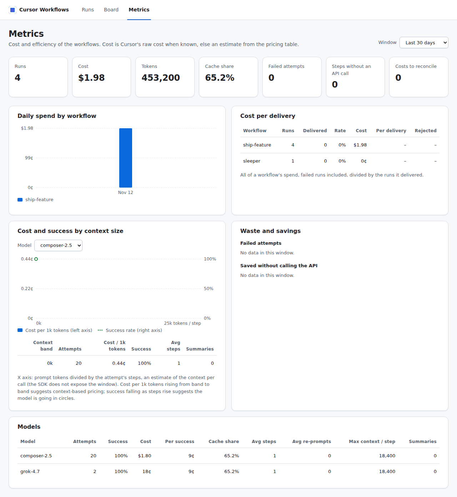

# 5.3 · Observabilidade: custo, tokens, contexto e eficiência

Todo run grava suas métricas num **banco SQLite local, por usuário**: `~/.cursor-workflows/metrics.db`. A partir
dele você tem `wf stats` no terminal, um **dashboard em localhost** e um export CSV/JSON para consolidar no time.

O objetivo é responder com dados:

- quanto custa cada workflow, cada modelo e cada esforço;
- quanto custa uma **entrega** (não uma chamada);
- a partir de que tamanho de contexto o custo sobe ou o modelo passa a girar sem entregar;
- onde está o desperdício: retries, re-prompts, falhas.

> **Marcas de confiança:** [PKG] = lido no `@cursor/sdk@1.3.1`; [DOC] = doc oficial do Cursor, com link para a
> página (acesso em 2026-11-11); [TESTE] = medido contra a API real em 2026-11-11
> ([8.2](../research/verificacoes-locais.md)); [I] = inferência; [S] = resumo de busca.

## 1. Começo rápido

```bash
npm run wf -- run implement-issue --cwd ../meu-repo --args '{"issue":12}'   # grava métricas automaticamente
npm run stats                         # resumo dos últimos 30 dias no terminal
npm run dash                          # http://127.0.0.1:4317
npm run wf -- metrics export --days 90 --format csv --out ./metrics-export   # anonimizado por padrão
npm run wf -- metrics reconcile       # completa custos que o Cursor reportou com atraso
npm run wf -- metrics mark <runId> rejected   # veredito humano (ex.: PR recusado)
sqlite3 ~/.cursor-workflows/metrics.db 'SELECT * FROM v_model_summary'      # análise livre
```

Configuração por variáveis de ambiente:

| Variável | Efeito |
|---|---|
| `WF_METRICS=off` | Desliga a gravação. O `node:sqlite` nem é carregado |
| `WF_METRICS_DB` | Muda o caminho do banco |
| `WF_DASH_PORT` | Porta do dashboard (default 4317) |
| `WF_DASH_AUTOSTART=off` | O `start_workflow` não inicia o dashboard (veja a [seção 5](#5-dashboard)) |

## 2. O que é medido, e o que não dá para medir

| Medida | Fonte | Observação |
|---|---|---|
| Tokens por tentativa: input, output, cache read, cache write, raciocínio | `agent.getUsage()` [PKG]; se ele falha, soma dos eventos `turn-ended` da tentativa | Fonte da verdade da tentativa. Na soma dos `turn-ended`, turno sem uso reportado fica de fora [DOC](https://cursor.com/docs/sdk/typescript#token-usage). A soma dos `turn-ended` deu os mesmos números de `RunResult.usage` [TESTE](../research/verificacoes-locais.md). `input` já inclui cache read e cache write, e total = input + output [TESTE](../research/verificacoes-locais.md) |
| **Custo bruto** (`raw_cents`) | `getUsage().cost.rawCostCents` [PKG] | Custo de tokens do modelo **sem descontos** [DOC](https://cursor.com/docs/sdk/typescript#agentgetusage). É o **sinal principal** de eficiência quando vem, com limites: vale **0 em uso cobrado por request** (planos legados por request e alguns Enterprise por request) [DOC](https://cursor.com/docs/sdk/typescript#agentgetusage); fica vazio (NULL) quando o `getUsage()` falha, como no `403 feature_unavailable` de agentes locais, e aí `v_attempts` cai na estimativa da tabela `pricing` (`cost_source`, §3). Foi o caso de toda tentativa num Premium [TESTE](../research/verificacoes-locais.md). Que ele fica acima de 0 no uso incluído no plano é inferência, a doc não diz isso [I] |
| Custo cobrado (`charged_cents`) | `getUsage().cost.chargedCents` [PKG] | **0 para uso incluído no plano**, BYOK e créditos [DOC](https://cursor.com/docs/sdk/typescript#agentgetusage). Por isso não é o sinal principal |
| Custo por grupo de uso do Cursor | `getUsage().runs[]` → `usage_runs` [PKG] | Guardado como veio. **Não** é ligado aos turnos por posição, porque não há id em comum |
| Turnos, passos, tool calls por nome, compactações | `onDelta`: `turn-ended`, `step-completed`, `tool-call-started`, `summary-completed` [PKG] | `turn-ended` cobre **um turno inteiro do agente**, com vários passos. Um `step-completed` pode agrupar várias tools e várias chamadas ao modelo: 1 `send` que leu 4 arquivos gerou 4 tool calls, 2 `thinking-completed` e **1** `step-completed` [TESTE](../research/verificacoes-locais.md) |
| Re-prompts de schema, tentativas, tipo de erro, duração | runtime | `error_kind`: timeout, run-error, schema, rate-limit, budget (cancelada por passar do teto de tokens da etapa ou do run), cancelled, exception |
| Modelo e parâmetros | `ModelSelection` [DOC](https://cursor.com/docs/sdk/typescript#modelselection) | `model_key` = id + params ordenados, mais `max` quando há `maxMode` (ex.: `grok-4.7[reasoning_effort=high]`), então esforço e contexto viram "braços" distintos. O `maxMode` aparece nas [notas de versão do SDK](https://cursor.com/docs/release-notes/sdk), não na referência do `ModelSelection`. O banco grava o modelo **pedido**. O ID resolvido (`RunResult.model`: alias `composer` → `composer-2.5`; com `default`, o Auto, volta `default` [TESTE](../research/verificacoes-locais.md)) só sai no evento `step-end`, como `resolvedModel`, e não vai para o banco |
| Resultado do run | `result.status` do workflow + `ctx.metric()` | `outcome_class`: delivered, failed, error, cancelled, unknown |
| Versão do workflow | hash de `meta` + `defaults` + código de `run` | Compare só runs da mesma versão |

O teto de custo usa os dois campos: soma, por tentativa, o maior entre `rawCostCents` e `chargedCents` (ver
[3.1](../internals/01-arquitetura.md)). No uso cobrado por request o bruto é 0, então o teto em centavos fica cego e só
`--max-tokens` / `WF_MAX_TOKENS` protege. Configure sempre os dois tetos.

Em agentes locais, o `getUsage()` ainda está sendo liberado aos poucos, por conta. Até lá ele lança
`UnknownAgentError` com `code` `feature_unavailable` (HTTP 403), e a doc indica ler os tokens em `run.usage` /
`result.usage` e o custo no dashboard de uso, na tag SDK [DOC](https://cursor.com/docs/sdk/typescript#agentgetusage). O kit
soma os tokens dos eventos `turn-ended` da tentativa (deram os mesmos números de `RunResult.usage`
[TESTE](../research/verificacoes-locais.md)) e os conta no teto de tokens. O custo fica desconhecido: `raw_cents`
vazio, e o teto em centavos não conta a tentativa. Com `feature_unavailable`, o engine não tenta de novo e emite
um `warning` que começa com "getUsage() failed".

Isso acontece em plano pago: num Premium da The X Subscription, toda chamada ao `getUsage()` de agente local
deu `UnknownAgentError [feature_unavailable] This feature is not available for your account`, inclusive o
`Agent.getUsage(agentId)` estático depois do descarte [TESTE](../research/verificacoes-locais.md). Nessa conta todo
custo do banco é estimativa (`cost_source = estimate`, §3).

### A janela de contexto

O SDK **não informa** o tamanho da janela usado em cada chamada ao modelo. O que ele expõe é o uso **somado** do
turno, que inclui todos os passos [PKG].

O kit usa como aproximação o `avg_prompt_per_step`: tokens de prompt (`prompt_tokens` = `input_tokens`, que já
inclui cache read e cache write [TESTE](../research/verificacoes-locais.md)) ÷ passos (`step-completed`) da
tentativa. Não é o contexto por chamada: um passo pode agrupar várias tools e várias chamadas ao modelo (medido: 4
leituras e 2 blocos de raciocínio num único passo [TESTE](../research/verificacoes-locais.md)). Então a média por
passo **superestima** o contexto de cada chamada.

As faixas de 25 mil tokens (`ctx_bucket_k`) usam essa medida. Trate-as como indicador grosseiro de faixa, não como
a janela usada.

### Faixas de preço por contexto

O Cursor publica duas faixas para o Claude Haiku 5.5, pelo número de tokens de input da requisição
[DOC](https://cursor.com/docs/models/claude-haiku-5-5) [DOC](https://cursor.com/docs/models-and-pricing#model-pricing):

| Faixa (por milhão de tokens) | Input | Cache write | Cache read | Output |
|---|---|---|---|---|
| Até 100 mil tokens de input | US$ 0,10 | US$ 0,125 | US$ 0,01 | US$ 0,50 |
| Acima de 100 mil (5×) | US$ 0,50 | US$ 0,625 | US$ 0,05 | US$ 2,50 |

O Cursor diz que modelos de terceiros saem pelo preço de lista da API do modelo
[DOC](https://cursor.com/docs/models-and-pricing#third-party-models). Se esses valores batem com a API da Anthropic,
a doc do Cursor não mostra: fica em aberto.

O plano muda a conta:

- **The X Subscription** (Premium e acima): as tarifas acima saem do crédito pré-pago
  [DOC](https://cursor.com/docs/models/claude-haiku-5-5). Plus e Free não incluem modelos de terceiros
  [DOC](https://cursor.com/docs/models-and-pricing#third-party-models). Sem crédito pré-pago, um modelo de terceiro
  falha como run com `status: "error"`: no Premium, `gpt-5.3-codex` deu "Codex 5.3 is not included in your weekly
  usage Buy credits or switch to a Grok model to continue." [TESTE](../research/verificacoes-locais.md);
- **planos legados** (Pro, Pro+, Ultra, Teams): o uso sai do pool **Other Models**, pelo preço da API
  [DOC](https://cursor.com/docs/account/pricing/legacy-cursor-plans);
- **planos legados por request:** o Haiku 5.5 exige Max Mode, cobrado pela tarifa da API + 20%
  [DOC](https://cursor.com/docs/models-and-pricing#max-mode);
- **Teams e Enterprise:** modelos de terceiros elegíveis somam a Cursor Token Rate de US$ 0,25/M. A regra isenta
  modelos com cache read estritamente abaixo de US$ 0,10/M em todas as faixas
  [DOC](https://cursor.com/docs/models-and-pricing#cursor-token-rate).
  Pelos preços acima, o Haiku 5.5 se encaixa, mas a doc não o cita nominalmente [I];
- **residência regional de dados:** +10% [DOC](https://cursor.com/docs/models-and-pricing#model-pricing).

O banco permite conferir empiricamente:

- `v_context_buckets` mostra o **custo bruto do Cursor por mil tokens** em cada faixa de contexto, por modelo;
- um salto de faixa para faixa é a evidência.

A view (e o painel 3 do dashboard) só usa tentativas com custo do Cursor (`cost_source = cursor`). Numa conta em
que o `getUsage()` dá `feature_unavailable`, como a testada, ela fica vazia.

## 3. Modelo de dados

```
runs (uma linha por execução; um resume = nova execução do mesmo run_id)
 ├── attempts (uma linha por tentativa de etapa; hits de journal/memo = linhas de custo zero com `cached`)
 │    ├── turns       (uso de cada turno do agente, com nº de passos)
 │    └── usage_runs  (grupos de uso como o Cursor reportou)
 └── metrics          (ctx.metric: tier, testes, achados de review, tamanho do diff…)
pricing (tarifas de referência, só para estimar quando o Cursor não reporta custo)
```

Regras que mantêm as somas corretas:

- **Tentativas são só inseridas, nunca atualizadas por soma.** Um run retomado vira nova execução, e somar as
  tentativas não conta duas vezes.
- **`cost_final = 0`** indica que o custo ainda não tinha chegado ao fim da etapa. O custo do Cursor pode levar
  um momento para assentar depois do fim da run, e o campo `cost` fica **ausente** (não 0) até lá
  [DOC](https://cursor.com/docs/sdk/typescript#agentgetusage). Rode `wf metrics reconcile`.
- **Origem do custo:** `v_attempts.cost_source` vale `cursor` (raw do Cursor), `estimate` (tabela `pricing`,
  aplicando a faixa pelo `avg_prompt_per_step`) ou `none`.
  - A estimativa cobra o input sem cache (`input − cache read − cache write`) pela tarifa de input, o cache read e o
    cache write pelas tarifas de cache, e o output pela de output. O input já inclui o cache
    [TESTE](../research/verificacoes-locais.md), por isso a subtração.
  - Como o `avg_prompt_per_step` superestima o contexto por chamada (§2), a estimativa pode aplicar a faixa de
    cima (acima de 100 mil tokens, no Haiku 5.5) cedo demais [I].
  - A tabela `pricing` casa o `model_id` **pedido** com um padrão GLOB (ex.: `*composer*2*5*`). Uma etapa que
    pede um alias (`composer`) ou o Auto (`default`, sem preço fixo) não casa e sai com `cost_source = none`. Só
    há linha para Composer 2.5, Grok 4.7 e Haiku, Sonnet e Opus 5.5: `composer-2`, por exemplo, também fica sem
    estimativa. Peça o ID completo de um desses, ou acrescente a linha na `pricing` (lido no código:
    `packages/runtime/src/observability/schema.ts`).
  - Num Premium, todas as tentativas dos testes saíram com `cost_source = estimate`
    [TESTE](../research/verificacoes-locais.md).

### Views prontas

| View | Pergunta que responde |
|---|---|
| `v_attempts` | Base enriquecida: `prompt_tokens` (= `input_tokens`, que já inclui o cache), `avg_prompt_per_step`, `ctx_bucket_k`, `cost_cents`, `cost_source` |
| `v_runs` | Custo e resultado por run lógico (todas as execuções somadas) |
| `v_workflow_summary` | **Custo por entrega**: todo o gasto, inclusive dos runs que falharam, ÷ entregas. Também taxa de entrega e rejeições humanas |
| `v_model_summary` | Por modelo e params: taxa de sucesso, custo por tentativa bem-sucedida, parcela em cache, passos, re-prompts, compactações |
| `v_context_buckets` | Por modelo e faixa de contexto: ¢/1k tokens, sucesso, passos, saída média |
| `v_savings` | Economia de journal e memo: hits × custo médio da mesma etapa quando rodou de verdade |
| `v_waste` | Custo das tentativas que falharam, por etapa e tipo de erro |
| `v_daily` | Gasto diário por workflow e modelo |
| `v_unreconciled` | Tentativas com custo ainda não consolidado |

## 4. Receitas de análise (SQL)

**A partir de que contexto o custo dispara?** Custo por mil tokens por faixa, para um modelo:

```sql
SELECT ctx_bucket_k, attempts, cents_per_1k_tokens, ok_rate, avg_steps
FROM v_context_buckets WHERE model_key LIKE 'claude-haiku%' ORDER BY ctx_bucket_k;
```

**Quando o modelo fica ineficiente** (mais gasto que entrega). Custo por tentativa bem-sucedida e passos, por faixa:

```sql
SELECT model_key, ctx_bucket_k, COUNT(*) n, ROUND(AVG(ok),2) ok_rate, ROUND(AVG(steps),1) steps,
       ROUND(SUM(cost_cents)/NULLIF(SUM(ok),0),2) cents_per_ok, SUM(summaries) compactions
FROM v_attempts WHERE cached IS NULL GROUP BY 1,2 ORDER BY 1,2;
```

Sinais de alerta:

- `cents_per_ok` subindo mais rápido que o tamanho do contexto;
- `ok_rate` caindo;
- `steps` e `compactions` subindo.

Nessa faixa vale dividir a etapa, reduzir o contexto (`settingSources`, `tools`) ou trocar o modelo.

**Esforço vale a pena?** Compare o mesmo modelo com params diferentes, **dentro do mesmo tier** (a dificuldade
confunde a comparação):

```sql
SELECT a.model_key, t.tier, COUNT(*) n, ROUND(AVG(a.ok),2) ok_rate, ROUND(AVG(a.cost_cents),2) avg_cents
FROM v_attempts a
JOIN (SELECT DISTINCT x.run_id, m.value_text tier FROM runs x JOIN metrics m ON m.exec_id = x.exec_id AND m.name = 'tier') t
  ON t.run_id = a.run_id
WHERE a.cached IS NULL AND a.label = 'implementar' GROUP BY 1,2 ORDER BY 2,1;
```

**Custo por entrega, por tier:**

```sql
SELECT t.tier, COUNT(*) runs, SUM(r.outcome_class='delivered') delivered,
       ROUND(SUM(r.cost_cents)/NULLIF(SUM(r.outcome_class='delivered'),0),2) cents_per_delivery
FROM v_runs r
JOIN (SELECT DISTINCT x.run_id, m.value_text tier FROM runs x JOIN metrics m ON m.exec_id = x.exec_id AND m.name = 'tier') t
  ON t.run_id = r.run_id                     -- DISTINCT: um run retomado emite o tier em cada execução
GROUP BY 1;
```

**Quanto o memo e o journal economizaram:** `SELECT * FROM v_savings;`

**O custo do Cursor bate com os grupos de uso?** O resumo `attribution` do `wf stats` compara a soma das
tentativas com a soma dos grupos de uso. Uma diferença grande (acima de cerca de 10%) indica uso não atribuído,
por exemplo de subagents ou de compactação.

## 5. Dashboard

O dashboard é um servidor local, um só por usuário, para os runs de **todos** os repositórios. Ele mora no pacote
`packages/dashboard/` (as dependências dele nunca entram no runtime) e lê dois lugares: o índice global de runs
(`~/.cursor-workflows/runs.jsonl`, que aponta o repositório de cada run) e, por run, o log de eventos
(`<repositório>/.workflows/runs/<runId>/events.jsonl`); mais o banco de métricas, em modo leitura. Ele nunca escreve nos
arquivos dos runs. A única ação dele é [cancelar um run](#cancelar-um-run-e-copiar-o-comando-de-resume), pelo mesmo caminho do
`wf cancel`.

**Como abrir.** O `start_workflow` garante que o dashboard está rodando (inicia um processo destacado se nada responde
na porta) e devolve `dashboardUrl`, o link da página do run, ao lado do `jobId`; a skill `run-workflow` abre o link no navegador embutido do
Cursor. Só um dashboard roda por porta, por mais `start_workflow` que cheguem juntos. `npm run dash` o inicia à mão. Se o
dashboard não consegue subir (porta ocupada por outro programa, pacote ausente na instalação), a resposta traz
`dashboardWarning` com o motivo e o job começa do mesmo jeito.

Para desligar o início automático, ponha `{"dashboard": {"autoStart": false}}` no arquivo global
(`~/.cursor-workflows/config.json`; no do repositório não tem efeito) ou exporte `WF_DASH_AUTOSTART=off` no `env` do
servidor `workflows`. Um dashboard que já está de pé continua sendo informado em `dashboardUrl`. O processo grava o pid
em `~/.cursor-workflows/dashboard.pid` e a saída em `dashboard.log`; `kill $(jq -r .pid ~/.cursor-workflows/dashboard.pid)`
o encerra.

**API JSON** (`GET`; a única ação é o `POST` de cancelar um run):

| Rota | Resposta |
|---|---|
| `/api/runs?limit=` | `{runs}`: os runs de todos os repositórios, do mais novo ao mais antigo (até 200, no máximo 1000), cada um com `status` (`running`, `finished`, `failed`, `cancelled` ou `missing`), `repo`, `workflow`, `phase`, `phases`, `outcome`, `card`, `startedAt`, `finishedAt`, `error`, `executions` e o gasto |
| `/api/board?limit=` | `{boards}`: um quadro por workflow, com as `columns` e os `cards` (um por run), cada card já na coluna do estado do run: veja [O quadro](#o-quadro-board) |
| `/api/runs/<runId>` | o mesmo run com `recent` (as últimas linhas de andamento), `result` e `usage` |
| `/api/runs/<runId>/events` | stream de eventos (SSE) do log do run, ao vivo: veja [Acompanhar um run ao vivo](#acompanhar-um-run-ao-vivo) |
| `/runs/<runId>` | a página do run: o grafo ao vivo, veja [Ver um run como grafo](#ver-um-run-como-grafo) (HTML, com o script e o estilo em `/assets/…`) |
| `/api/runs/<runId>/steps/<stepId>/content` | o conteúdo de uma etapa: prompt, mensagens do agente, chamadas de tool e saída de comandos |
| `/api/csrf` | `{csrfToken}`: o token que o `POST` de cancelar exige |
| `POST /api/runs/<runId>/cancel` | cancela o job que executa o run (cabeçalho `X-CSRF-Token`): veja [Cancelar um run](#cancelar-um-run-e-copiar-o-comando-de-resume) |
| `/api/summary?days=` | o resumo de métricas dos painéis abaixo |
| `/api/health` | `{app, pid}`: como quem chama sabe que é o dashboard que responde na porta |

O `status` de um run vem da projeção do log. Um run cuja execução não escreveu o `run-end` só é `running` enquanto um
processo segura o lock dele; sem processo, aparece como `failed`, com o comando para retomar. Numa máquina sem histórico
(sem índice de runs e sem banco de métricas) a API devolve listas vazias, e o banco passa a ser lido assim que o primeiro
run o cria, sem reiniciar o dashboard.

### Acompanhar um run ao vivo

`GET /api/runs/<runId>/events` é um stream de Server-Sent Events do log de eventos do run: primeiro o que já está no
log, depois cada evento no instante em que o run o acrescenta (o dashboard olha o arquivo a cada 200 ms). Cada mensagem
é um evento, no formato do log (`docs/reference/events.md`), e o `id` dela é o **número da linha** do evento no log,
contando de 1. Linhas em branco ou danificadas (a última linha de um processo que caiu) gastam um número e não são
enviadas, então um `id` nunca muda enquanto o log cresce, nem quando a retenção reescreve o log sem o texto do conteúdo.
Uma linha só é enviada quando está completa.

- **Retomar.** Informe o último `id` recebido no cabeçalho `Last-Event-ID` (o `EventSource` do navegador faz isso sozinho
  ao reconectar) ou em `?lastEventId=<n>` (o cabeçalho vence); o stream continua na linha seguinte. Sem nenhum dos dois,
  começa do início. Um valor que não é um número inteiro é `400`.
- **`?content=false`** deixa os eventos `content` (prompts, texto do agente, saída de comandos: o grosso do log) fora do
  stream. Os `id` continuam contando as linhas deles.
- **`?stepId=<stepId>`** deixa só os eventos daquela etapa (uma chamada de `agent()` ou um comando de `ctx.exec`): o
  `step-start`, os `turn`, o `content` e o `step-end` dela. Os `id` continuam sendo os números de linha do log inteiro.
- O stream não termina sozinho: um run retomado continua no mesmo log. Quem lê decide quando parar (o `run-end` do último
  `run-start` é o fim de uma execução) e fecha a conexão.
- Eventos de outra versão do esquema (`v` diferente) e de tipo desconhecido passam como estão, sem campo acrescentado nem
  removido: quem lê usa o `v` para interpretá-los.
- Um run que o índice não conhece é `404`. Logo depois do `start_workflow` o run ainda pode não estar no índice (o processo
  do run o registra ao começar): tente de novo.

`GET /api/runs/<runId>/steps/<stepId>/content` devolve `{runId, stepId, lastEventId, content}`: os eventos `content` da etapa
(uma chamada de `agent()` ou um comando de `ctx.exec`), na ordem do log e entre todas as tentativas e execuções (o
`attemptId` de cada um as separa). Cada item é o evento do log com o seu `id`; o `text` já saiu do log sem segredos
conhecidos (`[REDACTED]`), e o dashboard não o altera. Num run fora da retenção os itens continuam, com `chars` e sem
`text`. `lastEventId` é o `id` da última linha do log nesse instante. **O log ao vivo de uma etapa** é este endpoint mais um stream
aberto a partir dele: `/api/runs/<runId>/events?stepId=<stepId>&lastEventId=<lastEventId>` continua de onde a leitura parou,
sem lacuna e sem repetição, e só traz os eventos da etapa. Uma etapa sem conteúdo (servida do journal) devolve a lista
vazia; um run ou uma etapa que o log não tem é `404`.

Um log que o dashboard não consegue ler ou projetar (danificado, ou com eventos que o código não entende) deixa só aquele
run como `missing`, com o motivo em `error`; os outros runs e o stream de eventos dele continuam funcionando.

### Ver um run como grafo

`http://127.0.0.1:<porta>/runs/<runId>` desenha o run como um grafo que cresce enquanto os eventos chegam (a mesma tela serve
para um run em andamento e para um que já terminou):

- **Nós.** O começo do run, cada etapa de agente e cada comando de `ctx.exec`. Um `parallel` ou `pipeline` abre num nó
  (`parallel ×3`) e fecha num círculo, onde os ramos voltam a se juntar; o que vem depois do grupo continua desse círculo. O
  grafo sai só dos campos `stepId`, `parentId` e `groupId` dos eventos (veja a [referência de eventos](../reference/events.md)),
  então um nó aparece quando o `step-start` ou o `exec-start` dele chega.
- **Raias.** Cada fase (`ctx.phase`) é uma faixa, na ordem em que aparecem. Um nó fica na raia da fase que ele declara, ou
  numa raia mais adiante quando continua de um nó que já está lá: nenhuma aresta volta para uma raia anterior.
- **Estado.** Um nó em andamento pisca e a aresta que chega a ele se move; depois vira verde (ok), vermelho (falhou), âmbar
  (cancelado) ou cinza (servido do journal ou do memo, num resume). Se o run termina, ou o processo cai, com um nó ainda em
  andamento, o nó vira "interrompido" (tracejado) em vez de piscar para sempre.
- **Passar o mouse** sobre um nó mostra o modelo (ou o programa, num comando), onde rodou (`local`; os eventos de etapas na
  nuvem trarão `cloud`), as tentativas, os tokens, o custo, a duração e o tipo do erro (`timeout`, `rate-limit`…; num
  comando, `exit 2`, `timeout`…). Os números somam todas as tentativas e todas as execuções do run; o custo é o que o teto
  de custo conta (o maior entre o bruto e o cobrado).
- **Clicar** num nó (ou Enter nele) abre o [log da etapa](#o-log-de-uma-etapa) ao lado do grafo.
- **Replay.** Num run que não está em andamento, **Replay** reconstrói o grafo evento a evento, na ordem do log, com
  velocidade de 1× a 20×, pausa e uma barra para ir a qualquer ponto. O grafo de qualquer trecho do log é o mesmo que o
  run teria naquele instante, e o painel de log aberto mostra o log da etapa como ele estava naquele ponto (o replay anda
  pelos eventos que mudam o desenho: o log de uma etapa aparece inteiro quando ela termina; a barra deixa parar em
  qualquer evento).
- Um run grande (o `implement-issue` passa de 50 comandos) não cabe na tela em tamanho legível: a tela enquadra os últimos
  nós de um run em andamento, ou os primeiros de um que terminou, e **Fit View** mostra tudo.

A página lê a API: o stream `?content=false` do run (o conteúdo das etapas vem só do painel de log, que pede o de uma etapa
por vez), `GET /api/runs/<runId>` para o status e o repositório, que ela consulta a cada poucos segundos, e só age para
cancelar um run. Ela espera o run aparecer no índice
(logo depois do `start_workflow` ele ainda pode não estar), fecha o stream quando o run termina e o reabre se um resume o
põe de volta em andamento. Eventos de outra versão do esquema ou de tipo desconhecido são ignorados, não derrubam a tela.

### O log de uma etapa

Clicar num nó abre, ao lado do grafo, o log da etapa, montado só a partir dos eventos `content` dela:

- **Etapa de agente:** por tentativa, o prompt (um re-prompt aparece como outro bloco), o que o agente disse (escrito
  quando um turno termina), cada chamada de tool com os argumentos e, logo abaixo, a saída dela. Uma tool de MCP tem o título
  `mcp: <nome da tool>`.
- **Comando de `ctx.exec`:** a linha de comando (`$ git commit -m …`), o diretório e a saída, com `stdout` e `stderr`
  separados e na ordem em que chegaram.
- **Ao vivo.** Enquanto a etapa roda, o painel lê o conteúdo que já existe (`/api/runs/<runId>/steps/<stepId>/content`) e
  segue o resto pelo stream (`/events?stepId=<stepId>&lastEventId=<a última linha lida>`), sem lacuna e sem repetição.
  A vista acompanha o fim do log até o leitor subir a barra de rolagem; ao terminar a etapa, o painel lê o conteúdo mais uma
  vez e fecha o stream. Esc (ou o botão ×) fecha o painel.
- **Texto removido ou cortado.** Num run que passou pela retenção, o evento fica e o texto não: o painel diz que o texto
  foi removido (com o tamanho). Um conteúdo cortado em 32768 caracteres diz que está cortado.

O painel mostra tudo como texto, nunca como HTML: um log guarda o que um agente escreveu.

### Cancelar um run e copiar o comando de resume

No cabeçalho da página do run:

- **Cancel run** (só num run em andamento) pede uma confirmação ali mesmo e cancela pelo mesmo caminho do `wf cancel` e do
  `cancel_workflow` (`cancelJob`: `SIGTERM` ao processo do job, que cancela os agentes, desfaz a etapa de escrita em curso e
  escreve o fim do run como `cancelled`). O cartão vai para a coluna Cancelled quando o log o registra. Se o job demora mais
  do que a espera (20 s) para parar, a resposta diz que ele ainda está parando. Um run que não foi iniciado como job (`wf run`
  num terminal) não tem processo registrado para sinalizar: o dashboard responde `409` e diz para dar Ctrl-C naquele terminal.
- **Copy resume command** (num run `failed` ou `cancelled`) copia
  `wf start <workflow> --args '<args>' --resume <runId> --cwd <repositório>`, com os mesmos `--max-cents`, `--max-tokens` e
  `--overrides` do start. O registro do job da última execução (`.workflows/jobs/<jobId>.json`, campo `start`) guarda os
  args e os tetos com que o job foi iniciado, e o comando os repete: colado como está, retoma o run. Sem esse registro (um
  `wf run` num terminal, ou um job de uma versão antiga do kit) o dashboard só tem o hash dos args (`argsHash` do
  `run-start`), e o comando traz um marcador no lugar deles: colado sem edição, o `wf` recusa o `--args` (não é JSON) antes
  de iniciar qualquer coisa, em vez de retomar com outros args. A exceção são os args vazios, como os do `smoke`: o hash é o
  de `{}`, e o comando já sai com `--args '{}'`. Nesse caso um aviso ao lado do campo lembra de repor os tetos.
  O comando aparece num campo de texto, para copiar à mão quando o navegador não deixa escrever na área de transferência.

O cancelamento exige o token CSRF (veja [Segurança](#segurança-do-dashboard)): a página lê o token em `/api/csrf` a cada
cancelamento e o manda em `X-CSRF-Token`.

A página do run tem um app à parte (React, React Flow e elkjs), empacotado junto com o app principal quando o dashboard
sobe e guardado no mesmo cache por hash (veja [O app](#o-app)): `/assets/run.<hash>.js` e `.css`, com cache de um ano.

### O app

A página inicial (`/`) é um só app, em React, com três menus (o menu é o `#` do endereço: `#/runs`, `#/board`,
`#/metrics`; sem `#`, abre o Board):

- **Runs:** os runs de todos os repositórios, do mais novo ao mais antigo, com status, fase, duração e custo;
- **Board:** o quadro, descrito abaixo;
- **Metrics:** o painel de custo e eficiência, o mesmo de antes (a tela abaixo).

As duas páginas (o app e a página do run) são empacotadas com o esbuild **quando o dashboard sobe** (nenhum passo de
build para quem usa o kit), e o resultado fica guardado por hash do conteúdo em `~/.cursor-workflows/dashboard-cache/<hash>/`:
o hash cobre os arquivos de `packages/dashboard/app/` e `packages/dashboard/run-view/` e as versões do React, do React
Flow, do elkjs e do esbuild, então uma subida com os mesmos fontes só lê quatro arquivos, e qualquer mudança gera um build
novo (só o atual é mantido). O dashboard serve os scripts e as folhas de estilo ele mesmo (`/assets/app.<hash>.js`,
`/assets/run.<hash>.js` e os `.css`, com cache de um ano, porque o nome muda com o conteúdo). Se os fontes não compilam, o
dashboard não sobe e diz o motivo.



*Captura do painel Metrics com dados sintéticos (SDK falso), não com uso real.*

- **KPIs:** runs, custo, tokens, parcela em cache, tentativas falhas, etapas sem API, custos a reconciliar;
- **Painel 1:** gasto diário por workflow;
- **Painel 2:** custo por entrega;
- **Painel 3:** faixa de contexto × ¢/1k tokens × taxa de sucesso, por modelo;
- **Painel 4:** desperdício e economia;
- **Tabela de modelos.**

### O quadro (Board)

O Board é um kanban com **um quadro por workflow** (o do run mais novo primeiro) e um cartão por run. As colunas de um
quadro são as fases do workflow, na ordem em que ele as declara em `meta.phases` (o `run-start` do log as traz em
`phases`; um log de uma versão antiga, sem isso, usa as fases que os runs percorreram), e depois quatro colunas fixas. Um
workflow que não declara nem percorre fase alguma tem uma coluna só, `Running`. Cada run fica na coluna do seu estado:

| Estado do run | Coluna |
|---|---|
| rodando | a fase em que está (a primeira, antes de entrar em alguma) |
| terminou e o workflow devolveu `seams-proposed` ou `pending` | **Awaiting approval** |
| terminou entregue (`done`, `ok`…) ou com um resultado que não diz um status | **Done** |
| terminou com outro status (`tests-failed`, `baseline-red`…) | **Failed** |
| terminou com erro, estourou o teto, ou o processo morreu sem terminá-lo | **Failed** |
| cancelado | **Cancelled** |

Um run cujo log não dá para ler (`missing`) não tem estado e fica fora do quadro; o menu Runs o mostra, com o motivo. A
classe de cada término é a mesma do [§6](#6-instrumentando-um-workflow). O quadro lê `GET /api/board` a cada 2 segundos, e o
cartão muda de coluna logo depois de o run mudar de fase. O servidor só relê o log de um run quando ele cresceu (o tamanho
ou a data de modificação mudou), então os runs terminados não custam nada por consulta.

**O que o cartão mostra** é o workflow que decide, com `ctx.card({ title, subtitle?, links?, badges? })`. Cada chamada
grava um evento `card` ([referência de eventos](../reference/events.md#card)), e o quadro mostra o **último** de cada run,
de qualquer execução (um resume que não chama `ctx.card` continua com o cartão do run). Sem nenhum, o título é o id do run.
Todo cartão mostra também o repositório, o custo e a duração do run, que vêm do log e não do workflow. O que o log diz de
um cartão não é confiável: o dashboard só mostra links `http:` e `https:`, descarta itens do tipo errado e corta os
textos (título e subtítulo em 200 caracteres, no máximo 8 links e 8 rótulos).

O `implement-issue` põe o cartão no ar depois da triagem (`#<n> <título da issue>` e o tier) e o atualiza na entrega, com
a branch e o link da PR.

**Estado da PR.** Um link de cartão para uma pull request do GitHub (`https://github.com/<dono>/<repo>/pull/<n>`, exatamente
esse formato) mostra se ela está `open`, `merged` ou `closed`. O servidor pergunta ao `gh pr view <url> --json state` (a
sessão do `gh` é a do usuário) em segundo plano, no máximo quatro por vez, e **o quadro nunca espera por isso**: a primeira
resposta traz o link sem o estado, e a seguinte, o estado. A resposta é guardada por 30 segundos enquanto a PR está
aberta, 1 hora depois de mesclada ou fechada, e 5 minutos quando o `gh` não consegue responder (sem login, sem rede, sem
`gh`); uma consulta que falha mantém o último estado conhecido. Só a URL exata de uma PR do github.com vai ao `gh`.

### Segurança do dashboard

- escuta só em `127.0.0.1`;
- recusa `Host` diferente de `127.0.0.1` e `localhost` (proteção contra DNS rebinding);
- aceita `GET` e `HEAD`, e um único `POST`, o de cancelar um run: ele exige o token CSRF (`/api/csrf`, um valor aleatório por
  processo do dashboard, comparado em tempo constante, que só um script lendo uma resposta desta origem consegue ter) e
  recusa um pedido que declare outra origem (`Origin` ou `Sec-Fetch-Site`); os outros métodos e as outras rotas dão `405`;
- não envia cabeçalhos CORS;
- abre o banco em modo leitura;
- não carrega nada de fora: os apps web são empacotados localmente, sem CDN, sem fontes nem imagens remotas. A página
  inicial vai com a política `default-src 'self'; script-src 'self'; style-src 'self'`, sem código inline, e a página do
  run com `default-src 'none'` (scripts e conexões só da própria origem): funciona offline e em rede corporativa restrita.

Verificado em 2026-11-11 no WSL2: escuta só em `127.0.0.1`, responde 403 a um `Host` estranho, não envia
cabeçalhos CORS e não é alcançável pelo IP do WSL.

**Navegador do Windows (WSL2 em modo NAT).** O link é `http://127.0.0.1:<porta>`. Verificado em 2026-11-12, com o servidor
em WSL2 escutando só em `127.0.0.1`: o Chrome do Windows (pelo MCP `chrome-devtools`) abriu a página e `/api/runs` em
`127.0.0.1`, e o `curl.exe` do Windows teve 200 em `127.0.0.1` e em `localhost`, e nenhuma resposta em `[::1]`. Numa
medição de 2026-11-11 o Chrome tinha recusado `localhost` (o Windows resolve `localhost` para o IPv6 primeiro), e nesta o
aceitou; o endereço IPv4 funcionou nas duas, por isso é ele que o kit devolve. Uma porta nova leva cerca de meio segundo
para ser encaminhada ao Windows: um navegador que abre o link no mesmo instante em que o dashboard sobe pode precisar de um
reload.

## 6. Instrumentando um workflow

O runtime grava automaticamente tudo o que é do agente. O workflow acrescenta **o que significa entregar**:

```ts
ctx.metric("tier", tier);                    // covariável de dificuldade: compare modelos dentro do tier
ctx.metric("tests_passed", tests.ok ? 1 : 0);
ctx.metric("diff_lines", diffLines);
ctx.metric("review_blocking", blocking.length);
return { status: "done", ... };              // "done" (ou delivered/ok/success) = entregue
return { status: "tests-failed", ... };      // qualquer outro status = o workflow decidiu que não entregou
```

`outcome_class` é derivado assim:

- run cancelado (`wf cancel`, `cancel_workflow`, Ctrl-C) → `cancelled`;
- run que lançou erro ou estourou o teto → `error`;
- `status` em `done/delivered/ok/success/succeeded` → `delivered`;
- outro `status` → `failed`;
- sem `status` → `unknown`.

Para validar a entrega depois, por exemplo quando o PR é aceito ou recusado, use
`wf metrics mark <runId> accepted|rejected`.

**Cartão no dashboard.** `ctx.card({ title, subtitle, links, badges })` define o que o cartão do run mostra no Board do
[dashboard](#o-quadro-board) (a issue e o tier, o link da PR…). Chame de novo quando algo mudar: o quadro mostra o último.

**Labels:** dê `label` explícito às etapas (`"planejar"`, `"implementar"`). Sem label, o runtime usa
`step-<hash>`, para não vazar conteúdo do prompt. Mas aí as análises por etapa ficam ilegíveis.

## 7. Privacidade e uso no time

- **O que fica no banco:**
  - prompts só como **hash e tamanho**, sempre: não existe mais opção para gravar o texto no banco;
  - args como hash;
  - repositório como nome da pasta + hash do remote;
  - **nenhum e-mail**: o banco é do próprio usuário.
- **O conteúdo das etapas fica só no log de eventos local** (`.workflows/runs/<runId>/events.jsonl`, fora do git):
  - o texto dos prompts, o que o agente disse, as chamadas de tool e a saída dos comandos de shell, em eventos
    `content` ([6.1](../reference/events.md#content));
  - nada disso vai para o banco, para os exports dele, para os ouvintes de eventos nem para as linhas de progresso de
    `wf status` e `wait_workflow`;
  - antes de gravar, o runtime troca por `[REDACTED]` os formatos conhecidos de segredo (chaves e tokens do GitHub,
    AWS, Slack, Google, npm, Stripe e dos provedores de modelo, JWT, `Bearer`, blocos de chave privada) e o valor de
    toda variável de ambiente com `KEY`, `TOKEN`, `SECRET` ou `PASSWORD` no nome (valores com menos de 8 caracteres
    ficam de fora, para não apagar palavras comuns), além da chave de API passada ao run. É um esforço, não uma
    garantia: um segredo de outro formato, numa variável com outro nome, passa;
  - cada texto é cortado em 32768 caracteres (`truncated` e `chars` dizem o quanto havia);
  - **retenção:** ao iniciar um run, o `text` dos runs do repositório fora dos 30 mais recentes (contando o que
    começa) ou sem atividade há mais de 14 dias é apagado. O evento fica, com tipo, ids e tamanho. O journal não
    entra: é o estado do resume. O `result` do `run-end` (o que o workflow devolveu) também não é conteúdo de etapa e
    fica, mas passa pela redação como todo evento. `RunOptions.retention` muda os limites (`null` desliga um deles).
- **Permissões:** pasta `0700`, arquivo `0600`.
- **Export anonimizado por padrão:** sem nome de repositório, sem `agent_id`, sem prompt, com erros redigidos. Use
  `--no-anonymize` só para análise local.
- **Consolidação do time (V1):** cada pessoa roda `wf metrics export` e o time junta os CSVs num BI. A atribuição
  por pessoa, se necessária, fica a cargo do processo que coleta os arquivos.
- **Disco:** mantenha o banco em disco local. O modo WAL do SQLite não funciona bem em disco de rede nem em
  `/mnt/c` no WSL.

## 8. Limites da V1 e próximos passos

- **Sem contexto por chamada:** só a média por passo, que superestima o contexto de cada chamada (§2). Uma V2 pode
  estimar o crescimento por chamada, se o SDK passar a expor uso por chamada.
- **Custo atrasado:** `reconcile` depende de `Agent.getUsage(agentId)` funcionar para agentes locais já
  descartados. Num Premium, ele deu o mesmo `403 feature_unavailable` [TESTE](../research/verificacoes-locais.md):
  nessa conta o `reconcile` não funciona, e o custo fica só na estimativa (`cost_source = estimate`). Numa conta com
  o recurso liberado, o caminho segue sem teste; o comando informa quantos falharam.
- **Tabela `pricing`:** é só referência para estimativa. Edite com `sqlite3` quando os preços mudarem
  (`effective_from` permite manter o histórico).
- **V2 sugerida:**
  - export OpenTelemetry para o coletor do time;
  - banco central;
  - alertas, por exemplo custo por entrega acima de X ou faixa de contexto com ¢/1k saltando;
  - `wf metrics purge --before <data>`.

---

[← Anterior: 5.2 · Custos, cache e boas práticas](02-custos-e-cache.md) · [Índice](../README.md) · [Próximo: 6.1 · Referência de eventos →](../reference/events.md)
