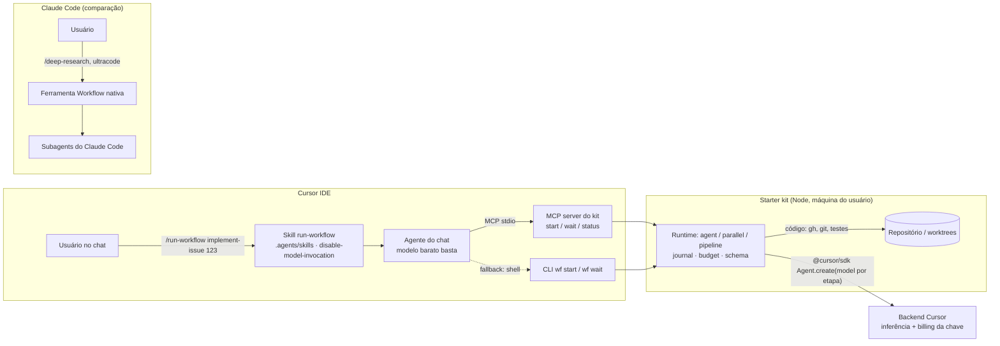

# 8.1 · Cursor SDK como motor de workflows determinísticos: relatório de pesquisa

> **Data:** 2026-11-11 · **Escopo:** Cursor SDK (`@cursor/sdk`), Cursor CLI headless, Cloud Agents. Comparação
> com os *dynamic workflows* do Claude Code. Viabilidade de um harness próprio, invocável do chat do Cursor IDE
> e usável em contexto empresarial.
>
> **Como foi feito**
> - `/deep-research`: 5 ângulos, 22 fontes, 25 afirmações e 3 votos adversariais por afirmação. 23 foram
>   confirmadas e 2 refutadas.
> - Leitura direta dos pacotes publicados: `@cursor/sdk@1.3.1`, que inclui `.d.ts` e README, e `cursor-sdk@1.3.1`
>   do PyPI.
> - Leitura dos repositórios oficiais `cursor/cookbook` (HEAD de 2026-11-09) e `cursor/sdk-bridge`.
> - Revisão independente do relatório e do starter kit contra os `.d.ts` do SDK, com as correções aplicadas.
>   Exemplo: a "detecção de fallback de modelo" foi retirada, porque os `.d.ts` não mostravam se o SDK expunha o
>   modelo efetivamente usado. O teste de 2026-11-11 mostrou que `RunResult.model` traz o ID resolvido (alias
>   `composer` → `composer-2.5`), mas com `default` (Auto) volta `default`; a substituição por política do admin não
>   foi testada [TESTE](verificacoes-locais.md).
> - Testes contra a API real em 2026-11-11, numa conta Free e depois num Premium da The X Subscription: sondas do
>   SDK, workflows de verificação e um `implement-issue` de ponta a ponta. Os resultados estão em
>   [`verificacoes-locais.md`](verificacoes-locais.md) §4–10 (o que não foi executado, em §12) e aparecem aqui com a
>   marca [TESTE].
> - Documentação oficial de workflows do Claude Code ([code.claude.com/docs/en/workflows](https://code.claude.com/docs/en/workflows)),
>   espelhada no estudo de origem em [`ai/docs/claude-code/workflows/workflows.md`](https://github.com/rodrigorjsf/ai-study-library/blob/a69f2a2/ai/docs/claude-code/workflows/workflows.md).
> - Espelhos da doc do Cursor no estudo de origem, em [`docs/cursor/`](https://github.com/rodrigorjsf/ai-study-library/tree/a69f2a2/docs/cursor) (commit `a69f2a2` do
>   [ai-study-library](https://github.com/rodrigorjsf/ai-study-library)).
>
> **Limitação:** a sessão na nuvem que escreveu este relatório não alcançava `cursor.com` (proxy 403/DNS). As
> afirmações sobre o SDK vieram do **pacote publicado** (a fonte mais forte, porque é o código que você vai
> instalar), do cookbook oficial e de espelhos locais da documentação (SDK de 2026-05-28; hooks e subagents de
> 2026-10-11). Em 2026-11-11 uma sessão local conferiu as afirmações contra a doc ao vivo do Cursor e do Claude
> Code e contra o fórum oficial do Cursor. As correções estão no texto, com link para a página conferida. As
> verificações do pacote e da instalação local ficam em [`verificacoes-locais.md`](verificacoes-locais.md).
>
> **Marcas de confiança:**
> - **[PKG]**: lido no pacote publicado.
> - **[GH]**: lido no repositório oficial.
> - **[DOC]**: doc oficial. Com link, é a página ao vivo (acesso em 2026-11-11); sem link, é o espelho local.
> - **[FÓRUM]**: relato no fórum oficial do Cursor (indica quando a equipe respondeu).
> - **[TESTE]**: medido contra a API real em 2026-11-11
>   ([8.2](verificacoes-locais.md)).
> - **[S]**: resumo de busca, ainda a confirmar.
> - **[I]**: inferência minha.

---

## Resposta curta

**Dá para fazer, mas o Cursor não entrega isso pronto.** O Claude Code tem um runtime de workflows embutido:
`/deep-research` é um deles, e `ultracode` é o gatilho que faz o Claude escrever um. O Cursor **não tem um
equivalente nativo**. Não existe ferramenta "Workflow", nem DSL `pipeline`/`phase`, nem resume por journal, nem
saída estruturada validada por schema.

O que o Cursor tem é **todas as primitivas para construir esse runtime**:

- agentes criados por código, com modelo escolhido por chamada;
- streaming, cancelamento e retomada de conversa;
- custom tools no processo e MCP;
- subagents inline;
- consulta de custo por agente.

O próprio Cursor publicou um protótipo do padrão: o `dag-task-runner` do cookbook oficial. É uma skill do Cursor
que dispara um script TypeScript, e esse script executa um DAG de agentes do SDK, escolhendo o modelo pela
complexidade de cada nó.

**Recomendação:** um *starter kit* com quatro peças.

1. Um runtime pequeno em TypeScript com a mesma forma do Workflow do Claude Code: `agent`, `parallel`,
   `pipeline`, `phase`, `budget` e journal.
2. Um MCP server, para invocar os workflows do chat do Cursor.
3. Um CLI, para terminal e CI.
4. Skills do Cursor para rodar, escrever e **converter** fluxos de skills e subagents em workflows.

[Este repositório](../../README.md) traz esse esqueleto. O typecheck passa contra o
`@cursor/sdk@1.3.1` real e há testes offline do controle de fluxo. Em 2026-11-11, num plano Premium, as sondas do
SDK e workflows de verificação rodaram contra a API real e levaram a correções no engine
[TESTE](verificacoes-locais.md). O `implement-issue` rodou de ponta a ponta uma vez, só no caminho LOW (sem plano
nem review), e abriu o PR. Nesse run, uma etapa de correção editou um arquivo fora do repositório
([`verificacoes-locais.md`](verificacoes-locais.md) §9). Os caminhos MED e HIGH seguem sem teste (§12).

---

## 1. O que é um "workflow" no Claude Code (a referência)

A doc oficial ([`workflows`](https://code.claude.com/docs/en/workflows)) define bem o que muda em relação
a skills e subagents. A diferença está em **quem decide o próximo passo**:

| | Subagents | Skills | Agent teams | Workflows |
|---|---|---|---|---|
| O que é | Um worker que o Claude cria | Instruções que o Claude segue | Um líder supervisionando pares | **Um script que o runtime executa** |
| Quem decide o que roda a seguir | Claude, turno a turno | Claude, seguindo o prompt | O líder, turno a turno | **O script** |
| Onde ficam os resultados intermediários | Contexto do Claude | Contexto do Claude | Lista de tarefas compartilhada | **Variáveis do script** |
| O que é repetível | A definição do worker | As instruções | A definição do time | **A própria orquestração** |
| Interrupção | Reinicia o turno | Reinicia o turno | Teammates continuam | **Retomável na mesma sessão** |

### 1.1 Anatomia

Um workflow é um arquivo `.js` com `export const meta = {name, description, phases}` seguido de um corpo com
`await` no nível de topo. O que segue foi lido no script do `/deep-research` que rodou nesta pesquisa e na
referência de autoria de workflows (skill `workflow-authoring` do Claude Code). `budget`, `isolation: 'worktree'`
e `workflow(name)` aparecem nessa referência, não na página pública de workflows:

- `agent(prompt, {schema, model, effort, label, phase, isolation: 'worktree', agentType})`: cria um subagent.
  - Com `schema`, o subagent é **forçado** a responder pela tool StructuredOutput, validada com até 5 tentativas.
  - Devolve `null` só se o agente for parado no meio ou bater num erro de API irrecuperável. Schema
    contraditório, saída que falha na validação após 5 tentativas e agente travado nas 6 tentativas lançam erro.
    O travado vira `null` dentro de `parallel()`/`pipeline()` e encerra o run se for aguardado direto
    [DOC](https://code.claude.com/docs/en/workflows).
- `parallel(thunks)` é uma barreira. `pipeline(items, ...stages)` não tem barreira: cada item avança sozinho.
- `phase()` e `log()` alimentam o progresso. `args` é a entrada. `budget` é o teto de tokens do turno.
- `workflow(name)` chama outro workflow, com um nível de aninhamento.
- O runtime:
  - roda o script isolado, sem filesystem, `import()`, `Date.now()` ou `Math.random()`, para garantir o resume;
  - roda até 16 agentes concorrentes por padrão (menos com poucas CPUs; `CLAUDE_CODE_WORKFLOW_MAX_CONCURRENT_AGENTS`
    ajusta de 1 a 256) e no máximo 1.000 por run;
  - grava um journal que torna o run **retomável** na mesma sessão, ou depois de `claude --resume` dela. Numa
    sessão nova, o workflow recomeça.
- Workflows salvos ficam em `.claude/workflows/` (projeto) ou `~/.claude/workflows/` (usuário) e viram `/<nome>`.
  Os de plugin vêm da pasta `workflows/` do plugin e viram `/<plugin>:<nome>`
  [DOC](https://code.claude.com/docs/en/workflows).
- `ultracode` é só o gatilho: faz o Claude escrever um workflow para a tarefa em vez de trabalhar turno a turno.

### 1.2 Por que isso resolve o problema descrito

O pedido é "garantir a execução completa sem depender de o modelo inferir quando cada passo roda, e permitir
modelos menores". No workflow, o **controle de fluxo é código**. Cada agente recebe uma tarefa pequena, fechada e
com schema, e tarefas assim são justamente as que modelos menores executam bem. O modelo grande fica só onde
agrega: planejamento difícil e revisão.

---

## 2. O que o Cursor SDK oferece (nov/2026)

### 2.1 Pacotes e runtimes

- **TypeScript:** `npm i @cursor/sdk`. Requer Node ≥ 22.13 [DOC](https://cursor.com/docs/sdk/typescript).
  Versão 1.3.1, publicada no npm em 2026-11-03 [PKG]. A doc não cita essa versão nem fala em beta: as release
  notes do SDK param na 1.0.40, sem data [DOC](https://cursor.com/docs/release-notes/sdk). A "beta pública desde
  2026-04-29" não aparece na doc ao vivo e fica sem fonte.
- **Python:** `pip install cursor-sdk`, com clientes síncrono e assíncrono [DOC](https://cursor.com/docs/sdk/python).
  Desde a 1.0.24, `cursor-sdk` e `@cursor/sdk` saem da mesma release, com o mesmo número de versão
  [DOC](https://cursor.com/docs/release-notes/sdk); a doc não fala em "mesmo commit". A wheel embute a *bridge*
  local, instalada como `cursor-sdk-bridge` no `PATH` [PKG][DOC](https://cursor.com/docs/sdk/bridge).
- **Bridge** `cursor/sdk-bridge`: servidor local que embute o SDK TypeScript e serve o pacote `sdk.v1` por
  Connect/protobuf numa porta loopback HTTP/1.1, para outras linguagens. **Não é gRPC:** gRPC clássico sobre
  HTTP/2 não conecta [DOC](https://cursor.com/docs/sdk/bridge). Há um adapter Perl de exemplo. [GH]
- **Runtimes:** `Agent.create({ local: {cwd} })` roda o loop do agente na máquina. `{ cloud: {repos} }` roda
  numa VM da Cursor, num pool self-hosted ou num worker *My Machines* (`env: { type: "pool" | "machine" }`).
  **A inferência é sempre hospedada pela Cursor**: "local" só define onde o loop roda.
  [PKG][DOC](https://cursor.com/docs/sdk/typescript)

### 2.2 API essencial [PKG]

```ts
import { Agent, Cursor } from "@cursor/sdk";

const agent = await Agent.create({
  model: { id: "composer-2.5" },            // obrigatório no local
  local: { cwd: process.cwd(), settingSources: ["project"] },
});
const run = await agent.send("Explique este projeto.", { model: { id: "default" } }); // modelo por chamada (Auto)
for await (const ev of run.stream()) { /* system | assistant | tool_call | thinking | status | usage ... */ }
const result = await run.wait();             // { status, result: string, model (ID resolvido), usage, durationMs, git }
const cost = await agent.getUsage();         // { usage: {totalTokens...}, cost: { chargedCents, rawCostCents } }
```

IDs reais de um Premium em 2026-11-11 [TESTE](verificacoes-locais.md): o Auto é `default` (alias `auto`);
`composer-2.5` (aliases `composer`, `composer-latest`) e `composer-2` existem; `auto-low` não existe. No plano
Free, o próprio `Agent.create` local lança `UnknownAgentError` `plan_required` (403, `GET /v1/models`), assim como
`Cursor.me()` e `Cursor.models.list()`. Na mesma conta Premium, `agent.getUsage()` de agente local lançou
`UnknownAgentError` `feature_unavailable` em toda chamada.

Ainda segundo o pacote [PKG]:

- **Retomar e cancelar:** `Agent.resume(id)`, `run.cancel()`, `run.steer(text)`, `agent.summarize()`.
- **Busy:** só uma run ativa por agente; uma segunda lança `AgentBusyError`.
- **Escolha de modelo:** `ModelSelection { id, params?, maxMode? }` vale em `create`, em cada `send` (e segue
  valendo nos próximos) e em cada subagent inline (`agents: { nome: { description, prompt, model } }`, com
  `"inherit"` como padrão). `Cursor.models.list()` lista os modelos da conta e do time da chave
  [DOC](https://cursor.com/docs/sdk/typescript). O `maxMode` só aparece na nota da 1.0.38
  [DOC](https://cursor.com/docs/release-notes/sdk).
- **Tools e MCP:**
  - `mcpServers` aceita stdio e http/sse com OAuth.
  - `tools` e `disallowedTools` são allowlist e denylist das tools nativas.
  - `local.customTools` são callbacks no processo, expostos como o MCP server `custom-user-tools` e **sem pedido
    de aprovação**. Regras de deny e o sandbox ainda valem para eles [DOC](https://cursor.com/docs/sdk/typescript).
  - `resourceProviderOptions` troca os executores de Read, Write, Shell e Delete.
  - `sandboxOptions` e `autoReview` também estão disponíveis.
- **Contexto do projeto é opt-in no local.** `local.settingSources: ["project","user","team","mdm","plugins","all"]`
  controla se `AGENTS.md`, `.cursor/rules`, skills e hooks entram. Na nuvem, `project`, `team` e `plugins` estão
  sempre ligados. A página do SDK só cita MCP e subagents; o resto vem do pacote e foi confirmado
  [TESTE](verificacoes-locais.md). Com `project`, a etapa recebeu o `AGENTS.md`, rodou os hooks de
  `.cursor/hooks.json` e os `PreToolUse` de `.claude/settings.json` (com o deny respeitado) e subiu o
  `.cursor/mcp.json`. Com `[]`, nada disso.
- **Sem saída estruturada documentada.** `RunResult.result` é uma `string` opcional com o texto final, e o
  `outputSchema` das custom tools só é anunciado ao modelo: "Results are not validated against it"
  [DOC](https://cursor.com/docs/sdk/typescript). A doc não traz opção que prenda a saída final a um schema, mas
  também não diz que ela não existe. É a maior lacuna em relação ao `agent({schema})` do Claude Code.
  - Contorno usado no kit: uma custom tool `submit_result` cujo `inputSchema` é o schema. O callback valida com
    Ajv e devolve erro para o modelo corrigir. Medido [TESTE](verificacoes-locais.md): o modelo chama a tool, e
    uma submissão inválida foi corrigida dentro do mesmo turno. O re-prompt do engine não chegou a ser exercitado.
  - Com a allowlist de tools, inclua `"mcp"`, senão a tool não aparece para o modelo.
- **Erros** [DOC](https://cursor.com/docs/sdk/typescript): `RateLimitError` cobre "too many requests" (limite de
  rajada) **e** "usage limits exceeded" (teto mensal de uso). `ConfigurationError` cobre `model.id` inválido e
  política do admin que bloqueia o pedido. `AuthenticationError` cobre chave ausente, inválida, expirada ou
  desativada pelo admin. A doc não liga essas classes a HTTP 429 ou 401; só expõe um campo `status` genérico.
  Medido [TESTE](verificacoes-locais.md): um ID inválido deu `ConfigurationError` no `Agent.create`
  (`Cannot use this model: <id>. Available models: ...`); a falta de franquia para um modelo de terceiro veio como run com
  `status: "error"`, não como exceção.

### 2.3 Primitivas vizinhas no ecossistema Cursor

| Peça | O que é | Papel no tema |
|---|---|---|
| `cookbook/sdk/dag-task-runner` [GH] | Skill + runner TS. O agente pai escreve um DAG em JSON e o runner executa por ranks topológicos com `Promise.all`. Cada nó tem complexidade HIGH, MED ou LOW, mapeada para um modelo (exemplos oficiais: `gpt-5.3-codex`, `composer-2`, `auto-low`; num Premium, `auto-low` não existe no catálogo e `gpt-5.3-codex` exige crédito pré-pago [TESTE](verificacoes-locais.md)). Tem timeout, cancelamento e progresso ao vivo num Canvas | **Prova do padrão.** Só que o *plano* (o DAG) continua escrito pelo modelo, e não há schema, journal nem teto de custo |
| Hooks `stop`/`subagentStop` com `followup_message` e `loop_limit` [DOC](https://cursor.com/docs/hooks) | Reenviam automaticamente uma mensagem de "continue" até um teto por script (default 5 nos hooks do Cursor; sem teto nos do Claude Code) | Determinismo **fraco** dentro do chat: força continuar, mas o modelo ainda decide o que fazer |
| `subagentStart` (allow/deny), `sessionStart`/`postToolUse` com `additional_context` [DOC](https://cursor.com/docs/hooks) | Governança e injeção de contexto. `sessionStart` não roda em cloud agents | Bloqueiam ou orientam delegações, mas não ordenam etapas |
| Cursor CLI `agent -p --model X --output-format stream-json --force` [DOC](https://cursor.com/docs/cli/reference/parameters) | Agente headless, chamável por shell | Alternativa ao SDK como motor de cada etapa, com menos controle (sem custom tools, só JSON de envelope) |
| Cloud Agents API `/v1` (beta pública) + Automations [DOC](https://cursor.com/docs/cloud-agent/api/endpoints) [DOC](https://cursor.com/docs/cloud-agent/automations) | Agentes na nuvem por REST, com gatilhos (cron, webhook, GitHub, Linear, entre outros) | Para fluxos **disparados por evento** (ex.: issue rotulada). Cobrança como cloud agent |
| Agent SDK (*agents-as-code*): hoje `@grok/agent-sdk`, antes `@cursor/bdk` [DOC](https://cursor.com/docs/agent-sdk) | Framework para definir, testar, avaliar e implantar agentes como código num projeto em `bot/` (`defineAgent`, `bot/tools/`, `bot/schedules/`). Skills, subagents e evals existem, mas os nomes das pastas não foram conferidos. Usa o harness do Cursor SDK que move o Bugbot | É o equivalente mais próximo de "agente salvo e reutilizável". É um agente implantado (hospedagem da Cursor ou sua) que atua por Slack, PRs, issue trackers e o próprio Cursor. Serve a bots de longa duração, não a motor de etapas de um workflow [I] |

---

## 3. Comparação 1:1: Workflow do Claude Code × Cursor

| Capacidade | Claude Code (nativo) | Cursor SDK (nativo) | Como o starter kit cobre |
|---|---|---|---|
| Ferramenta "Workflow" / `ultracode` | Sim | **Não** | MCP `start_workflow` + skill `/run-workflow` |
| `agent()` | Subagent com modelo, effort e tipo | `Agent.create` + `send` + `wait` | `ctx.agent()` |
| `parallel()` / `pipeline()` / `phase()` | Sim | Não; `Promise.all` manual | `ctx.parallel` / `ctx.pipeline` / `ctx.phase` |
| Modelo por etapa | `opts.model` (+ substituição pela allowlist da org) | `ModelSelection` em create/send/subagent. Um ID fora do catálogo (que é por conta e time) faz a chamada falhar com `ConfigurationError` [DOC](https://cursor.com/docs/sdk/typescript). `RunResult.model` devolve o ID **resolvido** (alias `composer` → `composer-2.5`); com `default` (Auto), volta `default`, sem a escolha do Router [TESTE](verificacoes-locais.md). Se uma substituição pelo servidor apareceria ali não foi testado | `opts.model` por etapa; ID inválido faz a etapa falhar; `step-end` traz `resolvedModel` |
| Saída estruturada | `schema` forçado e validado (5 tentativas) | **Não documentada** | Tool `submit_result` + Ajv + re-prompt na mesma conversa |
| Resume | Journal automático por prefixo | `Agent.resume` só retoma a *conversa* | Journal por hash de prompt e opções (`--resume <runId>`) |
| Isolamento de escrita | `isolation: 'worktree'` | Não (a CLI tem `-w`) | O workflow cria `git worktree` e passa em `cwd` |
| Teto de custo | `budget` (tokens do turno) + aviso "Large workflow" | `getUsage()` em centavos (num Premium, `feature_unavailable` em agentes locais [TESTE](verificacoes-locais.md)); `RateLimitError` no teto da conta | `--max-cents`, comparado com `spentCents` (soma, por tentativa, de max(`rawCostCents`, `chargedCents`)), e `--max-tokens`; aborta o run. Use os dois (ver §5) |
| Concorrência | 16 por padrão (ajustável de 1 a 256), 1.000 agentes por run [DOC](https://code.claude.com/docs/en/workflows) | Sem limite documentado de agentes simultâneos por usuário; uma run ativa por agente | Semáforo (default 4) |
| Cache de prompt | Irmãos com mesmo modelo, esforço, tipo de agente, tools, schema e cwd montam o mesmo prefixo; quem começa depois que a resposta de um irmão começou lê o cache. O runtime segura os irmãos por até `CLAUDE_CODE_WORKFLOW_PREFIX_STAGGER_MS` (5000 ms por padrão). TTL de 5 min por padrão, 1 h com `subagentPromptCacheTtl: "1h"` [DOC](https://code.claude.com/docs/en/workflows) | Automático e sem controle no SDK; só medido (`cacheReadTokens`/`cacheWriteTokens`) [PKG]. Dentro de um Project, workers e coordenador não compartilham cache: cada um paga a escrita do contexto inicial (~1% do total do worker) [FÓRUM](https://forum.cursor.com/t/173200), com resposta da equipe do Cursor. Para subagents do IDE não há fonte. Com agentes do SDK de configuração idêntica, o prefixo fixo (~4,2 mil tokens) veio do cache em todo agente novo, e o trecho variável foi reaproveitado uma vez em paralelo e nenhuma em sequência [TESTE](verificacoes-locais.md) | Mede `cacheHitRatio`; prefixo estável; contexto mínimo por etapa; **memo** entre runs para etapas de leitura |
| Aprovação | Prompt por run conforme o modo; regras `Workflow(<nome>)` e hook `PreToolUse` [DOC](https://code.claude.com/docs/en/workflows) | Local roda tools **sem aprovação** por padrão; sandbox, autoReview e hooks são opcionais [DOC](https://cursor.com/docs/sdk/typescript) | Allowlist de tools por etapa + hooks do projeto (`settingSources`) |
| Contexto do projeto | CLAUDE.md carregado por padrão nos agentes, que são subagents (Explore, Plan e `omitClaudeMd` são exceções) [DOC](https://code.claude.com/docs/en/sub-agents) | Opt-in via `settingSources` | O engine liga `["project","team","mdm"]`; instruções em `AGENTS.md` |
| Progresso | `/workflows` (TUI) | Stream de eventos | Arquivo de job + `wait_workflow` / `wf wait` |
| Salvar e distribuir | `.claude/workflows/`, `~/.claude/workflows/`, plugin `workflows/` (vira `/<plugin>:<nome>`) | — | `packages/runtime/workflows/` do kit + `.agents/workflows/` do repositório (este vence em nome repetido) |
| Script isolado (sem fs/rede) | Sim | — | **Não**: roda em Node normal, o que é mais poderoso (git, gh, testes no próprio script) e exige disciplina para o resume |

---

## 4. Como invocar de dentro do Cursor IDE



| Caminho | Como funciona | Prós | Contras |
|---|---|---|---|
| **MCP server** (recomendado) | `.cursor/mcp.json` sobe `packages/runtime/src/mcp-server.ts`. Tools `start_workflow` → `jobId`; `wait_workflow` espera ≤ 50 s por chamada | Descoberta pelo agente (`whenToUse`), sem depender do shell, funciona também no Claude Code | O job morre se o Cursor reiniciar o servidor MCP (o resume pelo journal reduz o dano). O timeout de chamada de tool MCP no IDE **não é documentado**: a doc só diz que a chamada que estoura é marcada como falha [DOC](https://cursor.com/docs/mcp). Daí o start/wait. Cada chamada MCP segue o Run Mode, como o shell: sem allowlist, cada `wait_workflow` pode pedir aprovação [DOC](https://cursor.com/docs/agent/security/run-modes) |
| **CLI pelo shell do agente** | `npm run wf -- start ...` e `wf wait <id> --timeout 240` | Processo destacado sobrevive ao chat; serve igual em CI | Timeout de ~300 s no shell do agente é relato não verificado: a doc só diz que existe um timeout, sem dar o valor [DOC](https://cursor.com/docs/release-notes); exige aprovação de comando conforme o modo |
| **Skill explícita** | `/run-workflow` com `disable-model-invocation: true` [DOC](https://cursor.com/docs/skills) | O usuário dispara; o modelo não "decide" se roda | A skill só instrui; quem executa é o MCP ou o CLI |
| **Hooks** | `stop` com `followup_message` | Sem infraestrutura | Não ordena etapas nem troca modelos: determinismo fraco |
| **Cloud / Automations** | Gatilho por label de issue → cloud agent | Sem máquina local | Cada cloud agent é um agente só; para multi-etapa, ponha o runtime numa Action/worker que chame o SDK |

> **Nota (2026-11-11, depois desta pesquisa):** a skill `run-workflow` deixou de usar `disable-model-invocation`.
> Só do usuário, ela não travava nada: o servidor MCP anuncia `start_workflow` com o `whenToUse` de cada workflow, e um
> pedido em prosa chegava à tool sem passar pela skill. A trava de um workflow pago é a aprovação de `start_workflow`
> pelo Run Mode ([2.3 §3](../usage/03-invocacao-no-cursor-ide.md#3-skill-run-workflow-e-a-trava-de-disparo)). O diagrama
> e a tabela acima ficam como estavam na pesquisa.

**Custo do polling:** cada `wait_workflow` é uma chamada de tool do agente do chat e consome tokens do modelo do
chat. Use um modelo barato no chat que dispara o workflow e esperas longas (45–50 s por chamada, ou `wf wait`
com timeout maior).

---

## 5. Autenticação e billing no contexto empresarial

| Opção | Como | Debita de quem | Observações |
|---|---|---|---|
| **Login do SDK pelo usuário** (recomendado) | `npm run wf -- login` → `Cursor.auth.login()` abre o navegador e cria uma **chave de usuário, com validade padrão de 90 dias**, em `~/.cursor/sdk/auth.json` [PKG][DOC](https://cursor.com/docs/sdk/typescript) | A conta do próprio usuário ("User API keys bill to that user's plan" [DOC](https://cursor.com/docs/sdk/typescript)) | Uma vez por máquina. O MCP server, iniciado pelo IDE como processo do usuário, lê o mesmo arquivo. **O arquivo fica em texto puro** |
| Chave de usuário do dashboard | `CURSOR_API_KEY` no ambiente ou `${env:CURSOR_API_KEY}` no `mcp.json` | A conta do usuário | Bom para quem não quer login por navegador |
| Service account (Enterprise) | Chave da conta de serviço | **O time** ("Service account API keys bill to the team that owns the service account" [DOC](https://cursor.com/docs/sdk/typescript)) | Ideal para CI e Automations. O uso fica atribuído à service account (`serviceAccountId`/`serviceAccountName` nos eventos de uso), não a uma pessoa [DOC](https://cursor.com/docs/account/teams/admin-api). `SDKUser.userId` vem indefinido [PKG] |
| Chave Team Admin | — | — | **Ainda não suportada** pelo SDK ("Team Admin API keys are not yet supported") [DOC](https://cursor.com/docs/sdk/typescript) |
| Ler o token da IDE ou da CLI | Keychain `cursor-access-token` ou `~/.cursor/auth.json` | — | **Não suportado**: o SDK não descobre credenciais de uma instalação local do Cursor [DOC](https://cursor.com/docs/sdk/typescript). Do `agent login` da CLI a doc não fala, mas a ordem de resolução (`apiKey` → `CURSOR_API_KEY` → login salvo pelo `Cursor.auth.login()`) o deixa de fora [PKG]. Esses locais só aparecem em relatos de fórum. Não use: é frágil e é ruim para segurança e conformidade. Já uma mesma chave de usuário em `CURSOR_API_KEY` serve à CLI e ao SDK |

**Como o uso conta:**

- O uso aparece com a tag **SDK** no dashboard de uso; chaves de usuário cobram o plano do usuário e as de
  service account cobram o time [DOC](https://cursor.com/docs/sdk/typescript). As páginas de uso do time têm um
  filtro SDK [DOC](https://cursor.com/docs/release-notes).
- As runs do SDK, locais ou na nuvem, seguem **as mesmas regras de preço, *request pools* e Privacy Mode** das
  runs do IDE e dos Cloud Agents [DOC](https://cursor.com/docs/sdk/typescript). Isso trata de cobrança, não do que
  o plano inclui: o plano legado Start inclui o IDE, mas não o SDK
  [DOC](https://cursor.com/docs/account/pricing/legacy-cursor-plans).
- O plano Free não dá acesso ao SDK: o `Agent.create` local, `Cursor.me()` e `Cursor.models.list()` falham com
  `UnknownAgentError` `plan_required` (403). No Premium da The X Subscription, funciona; o Plus não foi testado
  [TESTE](verificacoes-locais.md). O kit encerra o run na primeira tentativa com `plan_required`.
- `getUsage().cost` traz `chargedCents`, o valor cobrado, que é **0 para uso incluído no plano, BYOK e créditos**,
  e `rawCostCents`, o custo bruto sem descontos, que é **0 para uso cobrado por request**
  [DOC](https://cursor.com/docs/sdk/typescript). Por isso o teto `--max-cents` do kit compara com `spentCents`: a
  soma, por tentativa, de max(`rawCostCents`, `chargedCents`). Antes ele somava só `chargedCents` e nunca
  disparava com uso incluído no plano.
  - `RunOutcome`, o estado do job e `ctx.budget` também expõem `chargedCents` (só o valor cobrado).
  - Se o Cursor ainda não informou o custo de uma tentativa, o engine emite um aviso: o teto em centavos não
    contou aquela tentativa (o de tokens contou).
  - Em uso cobrado por request (planos legados e alguns Enterprise), `rawCostCents` é 0 e o teto em centavos
    fica cego. Só `--max-tokens` / `WF_MAX_TOKENS` protege. **Defina sempre os dois.**
- O `RateLimitError` do SDK cita "usage limits exceeded" (teto mensal de uso)
  [PKG][DOC](https://cursor.com/docs/sdk/typescript); a doc não o liga a HTTP 429. O kit converte o não
  retentável em falha explícita do workflow.
  A falta de franquia para um modelo de terceiro (`gpt-5.3-codex` num Premium sem crédito pré-pago) veio como run
  com `status: "error"`, não como exceção [TESTE](verificacoes-locais.md). O teto mensal da conta não foi atingido,
  então o caminho dele segue sem teste; nos dois casos a etapa falha.
- Em Teams e Enterprise, pedidos elegíveis a modelos de terceiros pagam a Cursor Token Rate de US$ 0,25/M sobre
  tokens de input, output e cache. Ficam isentos os modelos da Cursor, o modo Cost do Auto e os modelos com cache
  read estritamente abaixo de US$ 0,10/M em todas as faixas [DOC](https://cursor.com/docs/models-and-pricing).
  N agentes em paralelo custam ~N vezes os tokens. [DOC]
- Para subagents (IDE, CLI e cloud), um modelo bloqueado pelo admin ou fora do plano **cai num modelo
  compatível**, sem erro [DOC](https://cursor.com/docs/subagents). As release notes dizem que é o modelo do
  agente pai e que o resultado do subagent informa em que modelo rodou, então o agente pai fica sabendo; nenhuma
  página diz que o usuário vê um aviso [DOC](https://cursor.com/docs/release-notes). No SDK, local ou na nuvem,
  um `model.id` inválido lança `ConfigurationError`. A doc dá "Bad model name" como mensagem típica (o "Cannot use
  this model" visto no pacote não aparece nela), e o mesmo erro cobre uma política do admin que bloqueia o pedido
  [DOC](https://cursor.com/docs/sdk/typescript).
  `RunResult.model` devolve o ID resolvido (alias `composer` → `composer-2.5`; com `default`, volta `default`)
  [TESTE](verificacoes-locais.md). Se uma substituição feita pelo servidor apareceria ali não foi testado (conta
  pessoal).
- Os limites de gasto do time e por membro ficam no dashboard e na Admin API. **Pergunta em aberto:** a doc não
  diz se o limite mensal por membro vale para o uso do SDK com a chave do usuário. A página do SDK só diz que
  essa chave cobra o plano do usuário [DOC](https://cursor.com/docs/sdk/typescript), e a de preços do time
  descreve o limite por membro sem citar o SDK [DOC](https://cursor.com/docs/account/teams/pricing). Confirme
  com o admin ou empiricamente. Service accounts têm limite de gasto próprio, por conta
  [DOC](https://cursor.com/docs/account/enterprise/service-accounts).

**Governança disponível:**

- Hooks Enterprise (MDM) e Team (este só no Enterprise), além dos de projeto, usuário e plugins. Todos rodam, e
  um deny em qualquer fonte vence [DOC](https://cursor.com/docs/hooks). O cookbook traz hooks de auditoria e de
  bloqueio de modelo por repositório. [GH]
- Políticas do admin nas runs locais: a denylist de comandos do admin vale, e comandos de shell que casam com
  ela são rejeitados antes de rodar (SDK 1.0.27) [DOC](https://cursor.com/docs/release-notes/sdk). Uma política
  do admin também pode bloquear o pedido com `ConfigurationError` [DOC](https://cursor.com/docs/sdk/typescript).
  Se a allowlist de MCP e as regras de rede do admin valem nas runs locais a doc não diz: a allowlist de MCP só
  aparece para Cloud Agents e IDE/CLI, e para rede o SDK cita só os `sandbox.json` do workspace e do usuário.
- Pools self-hosted e My Machines mantêm checkout e execução de tools na sua infraestrutura [GH], mas o loop do
  agente fica na nuvem da Cursor [DOC](https://cursor.com/help/security-and-privacy/privacy). As chamadas ao
  modelo passam pelos servidores da Cursor [DOC](https://cursor.com/help/models-and-usage/api-keys) e seguem para
  modelos próprios ou de provedores como OpenAI, Anthropic e Google. Residência regional de dados só existe nos
  EUA, para Enterprise, ativada por time e com exceções listadas; UE e APAC ainda não têm
  [DOC](https://cursor.com/docs/enterprise/privacy-and-data-governance).

### 5.1 Custos e cache: o que dá para controlar

O detalhamento, com checklist, está em
[5.2 · Custos, cache e boas práticas](../operating/02-custos-e-cache.md), neste repositório. Em resumo:

- **O cache de prompt do Cursor não é configurável pelo SDK** [PKG]. Ele é automático, e cache read custa menos
  que input numa proporção que depende do modelo. O Auto não tem preço fixo por token: o modo Cost cobra como
  requisição de modelo Cursor do pool incluído, e em Teams e Enterprise com o Router os modos Balance e
  Intelligence cobram o preço de lista do modelo roteado [DOC](https://cursor.com/docs/models-and-pricing). (As
  páginas do Router e do SDK dizem que todos os modos, Cost inclusive, cobram o preço de lista do modelo roteado
  [DOC](https://cursor.com/help/models-and-usage/cursor-router) [DOC](https://cursor.com/docs/sdk/typescript).) O
  que está ao alcance do workflow é favorecê-lo:
  - instruções fixas no começo do prompt, dados no fim;
  - um agente por etapa (conversa curta);
  - re-prompts na mesma conversa.
- **A maior economia é não chamar o modelo:** decisões objetivas em código, etapas condicionais, journal no resume
  e **memo** (`memo: true`), que reaproveita o resultado de etapas de leitura entre runs enquanto o repositório não
  muda.
- **O contexto fixo é pago em toda chamada.** A camada `project` carrega descrições de skills, regras e tools do MCP
  do projeto. A camada `user` traz os subagents e skills pessoais.
  - Um usuário com mais de 60 subagents em `~/.cursor/agents` mediu 11,4 mil tokens no início de cada chat, e 1,4
    mil sem eles. Uma resposta no fórum, provavelmente da equipe do Cursor (2026-05-31), explicou: o nome e a
    descrição de cada subagent custom entram na descrição da tool Task, o contexto cresce linearmente e o catálogo
    de subagents ainda não tinha orçamento, ao contrário do de skills [FÓRUM](https://forum.cursor.com/t/162001).
  - A doc confirma que a descrição aparece nas dicas da tool Task [DOC](https://cursor.com/docs/subagents).
    Nenhuma fonte diz se os subagents embutidos (`explore`, `browser`) entram do mesmo jeito.
  - O kit permite `settingSources` e `tools` por etapa para cortar isso. Medido [TESTE](verificacoes-locais.md):
    com o mesmo prompt e as tools `shell` e `mcp`, 30,4 mil tokens de input com `project` × 25,5 mil com `[]`.
    `["team","mdm"]` tira o `AGENTS.md`, mas não as skills (58 com ele e com `project`); só `[]` as corta, e então
    os hooks do time e do MDM também saem.
- **Skills e subagents no IDE custam contexto fixo repetido.** A cada delegação, o subagent paga o contexto fixo
  de novo e roda no modelo herdado. Convertidos em workflow, viram etapas com modelo, tools e contexto mínimos. Por
  isso a `/skill-to-workflow` tem uma etapa **obrigatória** de otimização de custo, com estimativa por caminho.

### 5.2 Observabilidade: o que dá para medir

Detalhes em [5.3 · Observabilidade: custo, tokens, contexto e eficiência](../operating/03-observabilidade.md), neste repositório.

- **O SDK expõe** [PKG][DOC](https://cursor.com/docs/sdk/typescript):
  - tokens e custo por agente (`getUsage()`), com `rawCostCents` sem descontos (**0 para uso cobrado por
    request**) e `chargedCents` cobrado (**0 para uso incluído no plano, BYOK e créditos**). Em agentes locais,
    o `getUsage()` é liberado por conta, aos poucos; até lá devolve `403 feature_unavailable`, e a saída é ler os
    tokens em `run.usage` e o custo no dashboard. Nesse caso o kit soma os tokens dos eventos `turn-ended` e
    mantém o teto de tokens; o custo fica desconhecido e o teto em centavos não conta a tentativa. Num Premium,
    toda chamada deu `feature_unavailable`, inclusive o `Agent.getUsage(agentId)` estático, e o custo dos testes
    saiu só da estimativa da tabela `pricing` [TESTE](verificacoes-locais.md);
  - tokens: `inputTokens` já inclui cache read e cache write, e `totalTokens` = input + output (medido duas vezes;
    a doc Python bate, a fórmula da doc TypeScript não) [TESTE](verificacoes-locais.md);
  - grupos de uso por turno (`runs[]`);
  - pelo stream de deltas: fim de turno com uso, passos concluídos, tool calls e compactações de contexto.
- **O SDK não expõe** o tamanho da janela de cada chamada ao modelo. O uso de `turn-ended` soma todos os passos do
  turno, e um `step-completed` pode agrupar várias tools e chamadas ao modelo (medido: 4 leituras e 2 blocos de
  raciocínio num passo [TESTE](verificacoes-locais.md)). O kit usa `prompt ÷ passos` como indicador grosseiro, que
  superestima o contexto por chamada, e agrupa em faixas de 25k.
- **Faixas de preço por contexto:** o Cursor publica para o Haiku 5.5 US$ 0,10/0,50 por M (input/output) até
  100k tokens de input e 5× isso acima, US$ 0,50/2,50 [DOC](https://cursor.com/docs/models/claude-haiku-5-5).
  Se esses valores batem com a API da Anthropic não foi conferido. O plano muda a conta: nos planos legados por
  request, o Haiku 5.5 exige Max Mode (preço de API + 20%), e a residência regional de dados soma 10%
  [DOC](https://cursor.com/docs/models-and-pricing). O banco do kit mostra o salto na prática: o ¢/1k tokens do
  custo bruto por faixa de contexto.
- **No kit:**
  - SQLite local por usuário (`~/.cursor-workflows/metrics.db`) com runs, tentativas, turnos, grupos de uso e
    métricas de negócio (`ctx.metric`);
  - views de custo por entrega, eficiência por modelo e esforço, faixa de contexto, desperdício e economia;
  - `wf stats`, dashboard em localhost sem dependências, export anonimizado;
  - prompts só como hash.
- **Claude Code, para comparação:** o `/workflows` mostra o uso de tokens de cada agente durante o run
  [DOC](https://code.claude.com/docs/en/workflows). Para análise entre runs, a doc descreve o export por
  OpenTelemetry: filtrar por `workflow.run_id` reconstrói um run, e nomes de workflows do usuário saem como
  `custom` sem `OTEL_LOG_TOOL_DETAILS=1` [DOC](https://code.claude.com/docs/en/monitoring-usage). Localmente, o
  script de cada run fica em `~/.claude/projects/`, e o `/usage` atribui o uso recente a subagents. Que um
  histórico estruturado entre runs *exige* telemetria externa é inferência minha [I]. No Cursor, o kit precisou
  construir as duas coisas: acompanhamento do run e histórico.

---

## 6. Paridade Cursor × Claude Code (para um harness portátil)

| Eixo | Claude Code | Cursor | Lacuna e tratamento |
|---|---|---|---|
| Caminho de instalação | `.claude/workflows/`, `~/.claude/workflows/`, plugin `workflows/`; subagents em `.claude/agents/` | Sem pasta de workflows. Subagents em `.cursor/agents/`, com leitura também de `.claude/agents/` e `.codex/agents/` [DOC](https://cursor.com/docs/subagents); o SDK só documenta `.cursor/agents/*.md` | O kit traz `packages/runtime/workflows/` + `.agents/workflows/`, `.agents/skills/`, `.cursor/mcp.json` e `.mcp.json`. O MCP server serve aos dois |
| Eventos de hook | `PreToolUse` pode aprovar `Workflow`; agentes do workflow seguem regras de permissão [DOC](https://code.claude.com/docs/en/workflows) | `stop`, `subagentStart`, `subagentStop`, `sessionStart`, `postToolUse`, `beforeMCPExecution` etc. Hooks do Claude Code também são carregados, com `loop_limit` `null` em vez de 5 [DOC](https://cursor.com/docs/hooks). Em cloud agents hospedados pela Cursor não disparam `sessionStart`, `sessionEnd` nem `beforeMCPExecution`/`afterMCPExecution`. Em workers self-hosted (Pools e My Machines), `sessionStart` e `sessionEnd` disparam quando a sessão pega e libera o worker. Tools MCP HTTP em cloud ainda passam por `preToolUse`/`postToolUse` | Nas runs do SDK, hooks só com `settingSources` e sem `fs` [PKG]. A nota da 1.0.40 do SDK diz que um deny de `PreToolUse` vindo do `settings.json` do Claude Code bloqueia a tool call em agentes locais; antes, era ignorado [DOC](https://cursor.com/docs/release-notes/sdk). Medido numa run local com `project` [TESTE](verificacoes-locais.md): os hooks de `.cursor/hooks.json` (`beforeShellExecution`, `postToolUse`) rodaram, e um `PreToolUse` de `.claude/settings.json` com `exit 2` bloqueou o comando; com `[]`, nenhum. Se o `~/.claude/settings.json` também é lido não foi testado |
| Como o contexto chega | CLAUDE.md carregado por padrão em cada agente do workflow; Explore, Plan e `omitClaudeMd` são exceções [DOC](https://code.claude.com/docs/en/sub-agents) | `AGENTS.md` + `.cursor/rules` só com `settingSources: ["project"]`. No IDE e em cloud, o agente também lê `CLAUDE.md` como instrução de projeto; se ele é cópia ou link do `AGENTS.md`, o conteúdo chega uma vez só [DOC](https://cursor.com/docs/release-notes). Para runs locais do SDK a doc não diz. O `AGENTS.md` chegou com `project` e não chegou com `[]` nem com `["team","mdm"]` [TESTE](verificacoes-locais.md). `additional_context` via hooks | O engine liga `project`, `team` e `mdm`; instruções em `AGENTS.md` (o `CLAUDE.md` do kit só faz `@AGENTS.md`). Prompts de etapa autocontidos |
| MCP | Cada `agent()` do workflow cria um subagent [DOC](https://code.claude.com/docs/en/workflows), e subagents herdam as tools MCP da conversa principal, com filtros [DOC](https://code.claude.com/docs/en/sub-agents). A doc de workflows não trata de MCP; que os agentes do workflow alcançam o MCP da sessão é inferência [I] | `mcpServers` por create/send. Local: send → create → plugins → `.cursor/mcp.json` → `~/.cursor/mcp.json`; o primeiro nome que casar vence, e a lista do send substitui a do create (não mescla). Plugins, projeto e usuário só entram com `settingSources`. Cloud: send → create → servidores do usuário e do time em cursor.com/agents [DOC](https://cursor.com/docs/sdk/typescript). O SDK sobe os servidores do `.cursor/mcp.json` sem repassar o ambiente do processo, e um inline com o mesmo nome vence o do arquivo [TESTE](verificacoes-locais.md) | Passe `mcpServers` por etapa quando a etapa precisar. A guarda de recursão do kit usa essa ordem: um `workflows` inline sem tools encobre o do projeto |
| Saída estruturada | Nativa | Não documentada | `submit_result` (só local; custom tools não rodam em cloud) |
| Modelos | Aliases (`sonnet`, `opus`, `haiku`) + IDs | IDs do Cursor (`composer-2.5`, `composer-2`, `grok-4.7`, `default` para o Auto, modelos de terceiros) via `models.list()`; `auto-low` não existe [TESTE](verificacoes-locais.md) | Mapa de tier por ambiente (`WF_MODEL_*`, só o ID); `wf models` lista id, aliases e params |
| Pasta neutra `.agents/` | **Não lê nada** sob `.agents/`. Por padrão (v2.1.277+), lê `AGENTS.md` só se não houver `CLAUDE.md`, `.claude/CLAUDE.md` ou `CLAUDE.local.md` no diretório ou acima; o modo `claude-md-and-agents-md` lê os dois, e um `CLAUDE.md` com `@AGENTS.md` o importa [DOC](https://code.claude.com/docs/en/memory) | Skills em `.agents/skills/` e `~/.agents/skills/` são nativas [DOC](https://cursor.com/docs/skills) (`~/.agents/skills/` não vai para Cloud Agents) e também carregadas pelas runs do SDK (first-party no bundle) [PKG]. Subagents não têm `.agents/agents/` [DOC](https://cursor.com/docs/subagents) | Skills do kit em `.agents/skills/`; `scripts/link-claude-skills.sh` cria links em `.claude/skills/` para o Claude Code (a doc do Cursor não diz se ele deduplica a skill que aparece nas duas pastas). Instruções em `AGENTS.md` + `CLAUDE.md` com `@AGENTS.md` |

---

## 7. Exemplos existentes (o que há de concreto)

| Projeto | O que mostra | Observação |
|---|---|---|
| [`cursor/cookbook`](https://github.com/cursor/cookbook) `sdk/dag-task-runner` | Orquestração por código, modelo por complexidade, skill que dispara o runner | Oficial e o melhor ponto de partida conceitual |
| `cursor/cookbook` `sdk/quickstart`, `app-builder`, `agent-kanban`, `coding-agent-cli`, `hooks/` | Uso local e cloud, UI de cloud agents, hooks de auditoria e bloqueio | Oficial |
| [`cursor/sdk-bridge`](https://github.com/cursor/sdk-bridge) | Protocolo `sdk.v1` para outras linguagens | Oficial |
| [`6e6p1k/cursor-agents-mcp`](https://github.com/6e6p1k/cursor-agents-mcp) | MCP server para o **Claude Code** delegar trabalho a agentes do Cursor SDK (spawn, follow_up, steer, jobs destacados) | Terceiro. Confirma que o login do SDK é separado do login da CLI |
| [`tuannvm/cursor-demo`](https://github.com/tuannvm/cursor-demo) | GitHub Actions: issue com label `ready-to-implement` → `cursor-agent -p` → PR draft | Pequeno, arquivado e com modelo fixo. Serve de esqueleto para CI |
| `@ai-sdk/harness-cursor` (Vercel), `@traceai/cursor-sdk`, `pi-cursor-sdk` | Integrações e observabilidade | Terceiros |

Não encontrei um orquestrador de terceiros maduro que faça **roteamento de modelo por label com review
condicional** sobre o Cursor SDK. Esse é o espaço que o starter kit ocupa.

---

## 8. O que foi refutado e o que segue incerto

> Os testes contra a API real (2026-11-11, plano Free e depois Premium da The X Subscription) estão em
> [`verificacoes-locais.md`](verificacoes-locais.md) §4–10; o que não foi executado está em §12.
>
> Em 2026-11-11 as afirmações deste relatório foram conferidas de novo contra a doc ao vivo do Cursor e do Claude
> Code e contra o fórum oficial do Cursor. As correções já estão nas seções acima, com link para a página
> conferida.

**Refutado na verificação adversarial:**

- "No Cursor, o modelo pai decide sozinho se delega a um subagent; só `/nome` força." (1-2) Não use isso como
  premissa absoluta.
- "O SDK não tem nenhum controle programático de tools." (0-3) A versão 1.3.1 tem allowlist e denylist de tools,
  custom tools, troca de executores (`resourceProviderOptions`), sandbox e autoReview.

**Refutado ou corrigido pela doc ao vivo (2026-11-11):**

- O Auto não tem preço fixo por token, e o "cache read 5× mais barato que input no Auto" não vale (§5.1).
- A bridge do SDK não é gRPC: é Connect/protobuf sobre HTTP/1.1 (§2.1).
- O Cursor lê `CLAUDE.md` como instrução de projeto no IDE e em cloud (§6).
- O fallback de modelo dos subagents não é silencioso para o agente pai: o resultado diz em que modelo rodou (§5).
- A doc não liga `RateLimitError` a HTTP 429 nem `AuthenticationError` a 401 (§2.2).

**Resolvido pela doc ao vivo (saiu da lista de incertezas):**

- Política de modelo do admin nas runs do SDK: a doc lista "an admin policy blocking the request" como causa de
  `ConfigurationError`, ou seja, o pedido bloqueado falha com erro
  [DOC](https://cursor.com/docs/sdk/typescript). Uma nota de setembro de 2026 diz que follow-ups de Cloud Agent
  num modelo bloqueado agora falham na hora com "Model Blocked"; rodar noutro modelo era o comportamento antigo
  [DOC](https://cursor.com/docs/release-notes).
- Itens antes marcados [S] e agora confirmados: chave Team Admin ainda não suportada; mesmas regras de preço,
  *request pools* e Privacy Mode do IDE; Cursor Token Rate em Teams e Enterprise; deny de `PreToolUse` do Claude
  Code nas runs locais; Cloud Agents API `/v1` e Automations (§2–§6).

**Resolvido pelos testes contra a API (2026-11-11) [TESTE](verificacoes-locais.md):**

- **Plano Free:** o SDK não funciona. O `Agent.create` local falha com `UnknownAgentError` `plan_required` (403,
  `GET /v1/models` na validação local do modelo), e `Cursor.me()` e `Cursor.models.list()` também. No Premium,
  funciona. O Plus não foi testado.
- **Hooks nas runs locais:** com `settingSources: ["project"]`, os hooks de `.cursor/hooks.json` e os `PreToolUse`
  de `.claude/settings.json` rodam, e o deny (`exit 2`) bloqueia a tool call. Com `[]`, nenhum roda.
- **`RunResult.model`:** devolve o ID resolvido (`composer` → `composer-2.5`), não o pedido. Com `default` (Auto),
  volta `default`.
- **`inputTokens`:** já inclui cache read e cache write, e `totalTokens` = input + output.
- **IDs de modelo:** `auto-low` não existe; o Auto é `default` (alias `auto`). `composer-2` e `composer-2.5`
  existem. Modelos de terceiros como `gpt-5.3-codex` exigem crédito pré-pago no Premium.
- **Guarda de recursão:** o SDK sobe os servidores do `.cursor/mcp.json` sem repassar o ambiente, então
  `WF_INSIDE_WORKFLOW` não chegava e a etapa via `start_workflow`. O engine passou a encobrir o servidor
  `workflows` com um inline sem tools; no reteste, a etapa não viu as tools do kit.

**Incertezas para validar no seu ambiente antes de produção:**

1. Se o uso da chave de usuário do SDK entra no **limite individual em dólares** do membro, como o uso do IDE. A
   doc não cobre: diz só que a chave cobra o plano do usuário.
2. O timeout de uma chamada de tool MCP no Cursor IDE (o kit evita depender disso com start/wait). A doc não dá o
   valor. Os 60 s documentados valem para tools MCP stdio em workers self-hosted e para a conexão (startup) de
   MCP em runs locais do SDK, não para o IDE.
3. Se o `~/.claude/settings.json` do usuário também é lido nas runs do SDK, e se os hooks de `team` e `mdm`
   disparam nelas. O teste só cobriu `.claude/settings.json` e `.cursor/hooks.json` do projeto, numa conta pessoal.
4. Se uma política de modelo do admin gera substituição silenciosa do lado do servidor nas runs do SDK; a doc não
   documenta isso para o SDK. `RunResult.model` devolve o ID resolvido [TESTE](verificacoes-locais.md), mas não se
   sabe se uma substituição por política apareceria ali. Não dá para testar numa conta pessoal.
5. O limite prático de agentes simultâneos por usuário. Nenhuma página conferida documenta esse limite. O "por
   minuto, por time" só aparece na Admin API, e a visão geral da API (seção de rate limits) não foi conferida. A
   doc traz outros limites: uma run ativa por agente (`409 agent_busy`) e quatro streams simultâneos por service
   account [DOC](https://cursor.com/docs/cloud-agent/api/endpoints). Comece com concorrência 2–4.
6. Se o Cursor deduplica uma skill que aparece em `.agents/skills/` e em `.claude/skills/` ao mesmo tempo (relevante
   para quem usa o script de links para o Claude Code). A doc lista as pastas sem regra de precedência nem de
   deduplicação; ela só documenta precedência para subagents (`.cursor/` vence) e deduplicação entre `CLAUDE.md`
   e `AGENTS.md`.
7. Se o teto mensal de uso da conta chega como `RateLimitError` ou como run com `status: "error"`. A falta de
   franquia para um modelo de terceiro veio como `status: "error"` [TESTE](verificacoes-locais.md); o teto mensal
   não foi atingido.
8. O timeout do shell do agente. Os ~300 s são relato não verificado; a doc só diz que existe um timeout, sem
   valor.

---

## 9. Recomendação

1. **Adote o padrão "runtime em código + MCP + skill explícita"** ([este repositório](../../README.md)). É o
   único caminho que entrega, ao mesmo tempo, ordem garantida, modelo por etapa, verificação por código, teto de
   custo checado antes de cada etapa (não um gasto máximo; [2.2 §3](../usage/02-configuracao-inicial.md#3-teto-de-custo))
   e invocação pelo chat.
2. **Autenticação por `wf login` do próprio usuário.** O uso fica na conta dele, coerente com o orçamento
   individual do Enterprise (se o limite por membro vale para o SDK segue em aberto, §8). Para CI e Automations,
   use service account.
3. **Migre de forma incremental:** escolha um fluxo de skills e subagents que hoje "às vezes pula etapas" e rode
   `/skill-to-workflow` sobre ele. Compare custo e taxa de conclusão com tetos baixos (`--max-cents` e
   `--max-tokens`) antes de ampliar.
4. **Mantenha os fluxos abertos e exploratórios em skills.** Workflows servem para processos repetíveis com
   critério de pronto objetivo.

---

## Fontes

- Claude Code: *Orchestrate subagents at scale with dynamic workflows*,
  [`code.claude.com/docs/en/workflows`](https://code.claude.com/docs/en/workflows) (espelho no estudo de origem:
  [`ai/docs/claude-code/workflows/workflows.md`](https://github.com/rodrigorjsf/ai-study-library/blob/a69f2a2/ai/docs/claude-code/workflows/workflows.md)).
- `@cursor/sdk@1.3.1` (npm): README, `dist/esm/agent/options.d.ts`, `agent.d.ts`, `run.d.ts`, `errors.d.ts`,
  `auth/*.d.ts`, `agent/usage-types.d.ts`.
- `cursor-sdk@1.3.1` (PyPI).
- `github.com/cursor/cookbook` (`sdk/dag-task-runner`, `sdk/quickstart`, `hooks/`, `self-hosted-cloud-agent/`) e
  `github.com/cursor/sdk-bridge`.
- Doc oficial do Cursor. O snapshot usado pelo estudo é o espelho no ai-study-library, commit `a69f2a2`:
  - SDK: <https://cursor.com/docs/sdk/typescript> e CLI: <https://cursor.com/docs/cli/overview> (acesso em
    2026-11-11). Snapshot usado pelo estudo: [`cursor-agent-sdk-reference.md`](https://github.com/rodrigorjsf/ai-study-library/blob/a69f2a2/docs/cursor/sdk/cursor-agent-sdk-reference.md)
    e [`cursor-agent-cli-reference.md`](https://github.com/rodrigorjsf/ai-study-library/blob/a69f2a2/docs/cursor/cli/cursor-agent-cli-reference.md)
  - Hooks: <https://cursor.com/docs/hooks> (acesso em 2026-11-11). Snapshot usado pelo estudo:
    [`hooks-guide.md`](https://github.com/rodrigorjsf/ai-study-library/blob/a69f2a2/docs/cursor/hooks/hooks-guide.md)
  - Subagents: <https://cursor.com/docs/subagents> (acesso em 2026-11-11). Snapshot usado pelo estudo:
    [`subagents-guide.md`](https://github.com/rodrigorjsf/ai-study-library/blob/a69f2a2/docs/cursor/subagents/subagents-guide.md)
  - Skills: <https://cursor.com/docs/skills> (acesso em 2026-11-11). Snapshot usado pelo estudo:
    [`agent-skills-guide.md`](https://github.com/rodrigorjsf/ai-study-library/blob/a69f2a2/docs/cursor/skills/agent-skills-guide.md)
  - MCP: <https://cursor.com/docs/mcp> (acesso em 2026-11-11). Snapshot usado pelo estudo:
    [`mcp-guide.md`](https://github.com/rodrigorjsf/ai-study-library/blob/a69f2a2/docs/cursor/mcp/mcp-guide.md)
- Páginas oficiais conferidas ao vivo em 2026-11-11 (links no texto):
  - Cursor: `cursor.com/docs/sdk/typescript`, `/docs/sdk/python`, `/docs/sdk/bridge`, `/docs/release-notes/sdk`,
    `/docs/release-notes`, `/docs/agent-sdk`, `/docs/hooks`, `/docs/skills`, `/docs/subagents`, `/docs/mcp`,
    `/docs/models-and-pricing`, `/docs/models/claude-haiku-5-5`, `/docs/account/pricing/legacy-cursor-plans`,
    `/docs/account/teams/pricing`, `/docs/account/teams/admin-api`, `/docs/account/enterprise/service-accounts`,
    `/docs/cloud-agent/api/endpoints`, `/docs/cloud-agent/automations`, `/docs/cli/overview`,
    `/docs/cli/headless`, `/docs/cli/reference/parameters`, `/docs/rules`,
    `/docs/enterprise/privacy-and-data-governance`, `/help/security-and-privacy/privacy`,
    `/help/models-and-usage/api-keys`, `/help/models-and-usage/cursor-router`.
  - Claude Code: `code.claude.com/docs/en/workflows`, `/sub-agents`, `/memory`, `/monitoring-usage`, `/hooks`,
    `/mcp`, `/skills`, `/env-vars`.
  - Fórum do Cursor: `forum.cursor.com/t/162001`, `/t/173200`, `/t/151439` e `/t/173469`.
- Terceiros: `6e6p1k/cursor-agents-mcp`, `tuannvm/cursor-demo`, `fitchmultz/pi-cursor-sdk`,
  `@ai-sdk/harness-cursor`.

---

[← Anterior: 7.9 · ADR-0009: The forge is a seam: GitHub and GitLab](../adr/0009-forge-seam-github-and-gitlab.md) · [Índice](../README.md) · [Próximo: 8.2 · Verificações locais (2026-11-11) →](verificacoes-locais.md)
