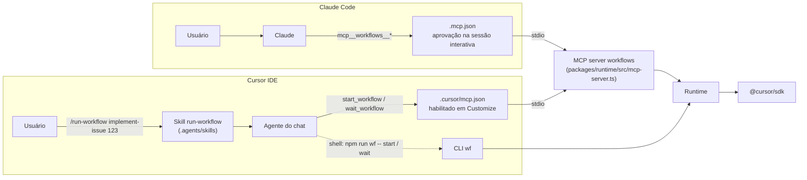

# 2.3 · Invocação no Cursor IDE (e no Claude Code)

## Caminhos de invocação



### 1. MCP server (principal)

O servidor `workflows` é registrado em `.cursor/mcp.json` (Cursor) e em `.mcp.json` (Claude Code). Ele expõe:

| Tool | Entrada | Saída |
|---|---|---|
| `list_workflows` | — | `name`, `description`, `whenToUse`, `phases`, `argsSchema` de cada workflow |
| `start_workflow` | `{ name, args, resumeRunId?, overrides? }` | `{ jobId, runId }`. O workflow roda em segundo plano, em um processo destacado: reiniciar o servidor ou o Cursor não o interrompe |
| `wait_workflow` | `{ jobId, timeoutSec ≤ 50 }` | Estado do job, projetado do log de eventos do run: `status`, `phase`, `recent` (até 20 linhas de resumo, uma linha cada, nunca texto de prompt ou de saída de agente; o custo de cada etapa é o maior entre bruto e cobrado), `result` (o que o workflow devolveu), `error`, `spentCents` (custo que o teto usa; acumula entre resumes), `chargedCents` (só o valor cobrado), `spentTokens` |
| `get_workflow_status` | `{ jobId }` | Estado, sem esperar |
| `cancel_workflow` | `{ jobId }` | Cancela o job: para os agentes ativos, desfaz a etapa que estava escrevendo e devolve o estado com `status: "cancelled"`. O run continua retomável. O agente do chat só chama quando o usuário pede para parar |

**Por que start/wait e não uma tool que bloqueia até o fim?** Um workflow de implementação leva minutos, e a
doc do Cursor não dá o timeout de uma chamada de tool MCP no IDE. O FAQ de MCP só diz que, se o servidor cai ou
estoura o tempo, a chamada é marcada como falha ([DOC](https://cursor.com/docs/mcp), acesso em 2026-11-11). Os
limites de 60 s que a doc cita valem para outros casos: tool stdio em workers self-hosted
([DOC](https://cursor.com/docs/release-notes)) e conexão de MCP em runs locais do SDK
([DOC](https://cursor.com/docs/release-notes/sdk)). O valor do IDE segue em aberto. Com start/wait, cada chamada
dura no máximo 50 s e o agente do chat repete a espera.

**Se o servidor reiniciar no meio** (por exemplo, ao reiniciar o Cursor ou ao desligar e religar o servidor em
**Customize** [DOC](https://cursor.com/docs/mcp)): o run continua, porque roda em um processo destacado
([ADR-0003](../adr/0003-detached-jobs.md)). O servidor novo o encontra pelos arquivos do job e
`wait_workflow` segue de onde parou. A doc não diz se mudar o `mcp.json` reinicia um servidor que já está rodando.

**Se o processo do job morrer** (ou parar de dar sinal de vida: o heartbeat dele fica mais de 30 s sem atualizar),
o job aparece como `failed` com o `runId`. Chame `start_workflow` com o mesmo `name` e `args` e com
`resumeRunId: "<runId>"`; as etapas já concluídas saem do journal.

**Para parar um run:** `cancel_workflow` (ou `wf cancel <jobId>`, ou Ctrl-C / `SIGTERM` no processo do run). O job
termina como `cancelled`, com o `runId` para retomar.

**Custo do polling:** cada `wait_workflow` é uma chamada de tool do agente do chat e consome tokens do modelo
que está no chat. Duas formas de reduzir:

- dispare `/run-workflow` com um modelo barato selecionado no chat (o trabalho pesado é do workflow);
- use esperas longas (`timeoutSec: 45–50`).

**Aprovação do polling:** chamadas de tool MCP seguem o mesmo Run Mode dos comandos de terminal e não ficam
isentas de aprovação ([DOC](https://cursor.com/docs/mcp), [DOC](https://cursor.com/docs/agent/security/run-modes)).
Em Auto-review, tools na allowlist rodam na hora e as demais passam pelo classificador. Em Allowlist, só o que
está na allowlist roda sem pedir. Em Run Everything, tudo roda sem pedir. Para cada `wait_workflow` não pedir
aprovação, ponha `wait_workflow` e `get_workflow_status` na allowlist. Num time Enterprise, o admin pode fixar o
Run Mode e a allowlist de MCP, e um membro não muda isso.

### 2. CLI pelo shell do agente

Fallback quando o MCP não está habilitado, e caminho preferido em CI e em runs longos:

```bash
npm run wf -- start implement-issue --args '{"issue":123}'   # processo destacado; log em .workflows/jobs/<id>.log
npm run wf -- wait <jobId> --timeout 240
npm run wf -- cancel <jobId>          # para o run (SIGTERM ao processo do job); o run continua retomável
```

`start` valida o nome do workflow e o JSON dos args **antes** de destacar o processo e grava o job (com `runId`)
na hora. A doc do Cursor não dá o timeout de um comando no shell do agente: as release notes só dizem que esse
timeout existe, sem valor ([DOC](https://cursor.com/docs/release-notes)). Os cerca de 300 s vêm de relatos não
verificados. Também há relatos, não verificados, de falhas em execuções headless (`agent -p`) iniciadas quase ao
mesmo tempo; nem a doc do CLI nem os tópicos do fórum consultados tratam disso. Os dois pontos seguem em aberto.
Por isso `wait` usa um timeout menor que 300 s, e `start` roda destacado.

### 3. Skill `run-workflow` e a trava de disparo

`skills/run-workflow/SKILL.md` (linkada em `.agents/skills/`) é invocável pelo modelo: a descrição dela fica no contexto e o agente a
carrega antes de chamar `start_workflow`, pelo `/run-workflow` ou por um pedido em prosa ("implementa a issue 7").
A skill ensina a disparar, acompanhar e repassar: tratar checkpoint, custo desconhecido e `secret-blocked`, e não
mexer nos arquivos enquanto o job roda.

Ela já foi só do usuário (`disable-model-invocation: true`), mas isso não travava nada: o servidor MCP anuncia
`start_workflow` com o `whenToUse` de cada workflow, e um pedido em prosa chegava à tool sem passar pela skill. A
trava humana de um workflow pago é a **aprovação da chamada `start_workflow`**, e ela depende do Run Mode
([DOC](https://cursor.com/docs/agent/security/run-modes)): em Allowlist, pede sempre, se `start_workflow` não estiver
na allowlist; em Auto-review, um classificador decide; em Run Everything, não pede. Ponha na allowlist só
`wait_workflow` e `get_workflow_status`. No Claude Code, a trava é o prompt de permissão da tool
`mcp__workflows__start_workflow`, que `permissions.allow` não deve liberar. Sem essa trava, sobram os tetos de custo.

### 4. Hooks (complementares, opcionais)

- `beforeMCPExecution` com `failClosed: true`: auditar ou bloquear `start_workflow` por repositório ou por
  workflow. Com `failClosed: true`, crash, timeout ou saída não zero do hook bloqueiam a chamada em vez de
  liberá-la ([DOC](https://cursor.com/docs/hooks)). Hooks distribuídos pelo dashboard do time não aceitam
  `failClosed`, e `beforeMCPExecution` não roda em cloud agents hospedados pelo Cursor.
- No Claude Code, o equivalente é um hook `PreToolUse` com `matcher: "mcp__workflows__start_workflow"`. Como só tem
  letras e `_`, o matcher vale como nome exato; o trecho do meio segue o nome do servidor no `.mcp.json`. Com `"onFailure":
  "block"` (v2.1.295+), um hook que falha bloqueia a chamada em vez de liberá-la
  ([DOC](https://code.claude.com/docs/en/hooks#match-mcp-tools),
  [DOC](https://code.claude.com/docs/en/hooks#block-the-action-when-a-hook-fails)).
- `stop` com `followup_message`: **não** é necessário aqui, porque o laço está no workflow. Ele serve apenas
  para fluxos que continuam em skill.

## Onde cada harness procura cada coisa

O kit usa `.agents/` como local neutro e mantém só o que é específico de cada harness em `.cursor/` e `.claude/`.

| Artefato | `.agents/` | `.cursor/` | `.claude/` | `.codex/` | Fonte |
|---|---|---|---|---|---|
| Skills: Cursor IDE | ✅ nativo (`.agents/skills/`, `~/.agents/skills/`) | ✅ nativo | ✅ compat. | ✅ compat. | [doc de skills do Cursor](https://cursor.com/docs/skills) [DOC] |
| Skills: runs do Cursor SDK (`settingSources: ["project"]`) | ✅ (first-party) | ✅ | ✅ (third-party) | ✅ (third-party) | bundle do `@cursor/sdk@1.3.1`. Medido em 2026-11-11: o SDK carregou as mesmas 58 skills com `["team","mdm"]` e com `"project"`, e nenhuma com `[]`; a origem delas não foi isolada ([verificações locais](../research/verificacoes-locais.md) §7) |
| Skills: Claude Code | ❌ não lê nada sob `.agents/` | ❌ | ✅ | ❌ | docs de [memória](https://code.claude.com/docs/en/memory) e de [skills](https://code.claude.com/docs/en/skills) do Claude Code [DOC] |
| Subagents: Cursor | ❌ não documentado | ✅ | ✅ compat. | ✅ compat. | [doc de subagents do Cursor](https://cursor.com/docs/subagents) [DOC] |
| Subagents: Claude Code | ❌ | ❌ | ✅ | ❌ | [doc de subagents do Claude Code](https://code.claude.com/docs/en/sub-agents) [DOC] |
| Instruções | `AGENTS.md` na raiz (o Cursor também aceita em subpastas): lido pelo Cursor e pelas runs do SDK; o Claude Code, por padrão (v2.1.277+), só o lê **se não houver `CLAUDE.md`, `.claude/CLAUDE.md` ou `CLAUDE.local.md`** na pasta ou acima, ou via `@AGENTS.md` (o modo `claude-md-and-agents-md` lê os dois) | `.cursor/rules/` | `CLAUDE.md` (o agente do Cursor IDE também o lê) | — | [rules do Cursor](https://cursor.com/docs/rules), [release notes 3.26 do Cursor](https://cursor.com/docs/release-notes), [memória do Claude Code](https://code.claude.com/docs/en/memory) [DOC] |
| MCP | — | `.cursor/mcp.json` | `.mcp.json` (raiz) | — | docs |
| Workflows deste kit | `.agents/workflows/` (lido pelo runtime) | — | — | — | este kit |

Consequências no kit:

- **Skills em `.agents/skills/`.** Funcionam no Cursor IDE, nas etapas dos workflows e no Codex.
  Para o Claude Code, `scripts/link-claude-skills.sh` cria links em `.claude/skills/`. A ressalva é que o Cursor
  também lê `.claude/skills/`, então a skill pode aparecer duas vezes no Cursor. A doc de skills lista as pastas
  sem regra de precedência ou deduplicação ([DOC](https://cursor.com/docs/skills)); essas regras só existem para
  subagents (`.cursor/` vence) e para `CLAUDE.md` × `AGENTS.md`. Fica em aberto. Rode o script só se o time usa
  Claude Code no repositório.
- **Instruções em `AGENTS.md`.** `AGENTS.md` é um link simbólico para o `CLAUDE.md`, a fonte canônica.
- **Subagents continuam em `.cursor/agents/` ou `.claude/agents/`.** Não há `.agents/agents/` documentado
  ([DOC](https://cursor.com/docs/subagents)). Para as runs do SDK, a doc só cita `.cursor/agents/*.md`
  ([DOC](https://cursor.com/docs/sdk/typescript)). Num
  fluxo convertido em workflow, os subagents viram etapas (`ctx.agent`) ou `agents` inline, então deixam de
  depender da pasta.

## Usar o kit em outros repositórios

Há duas formas.

**A. Copiar o kit para dentro do repositório** (mais simples). Os workflows ficam em `workflows/`, versionados
junto com o código.

**B. Instalar o kit uma vez e apontar cada repositório para ele.** No repositório alvo, crie
`.cursor/mcp.json`:

```json
{
  "mcpServers": {
    "workflows": {
      "command": "${userHome}/tools/cursor-workflows/node_modules/.bin/tsx",
      "args": ["${userHome}/tools/cursor-workflows/packages/runtime/src/mcp-server.ts"],
      "env": { "WF_CWD": "${workspaceFolder}", "WF_MAX_CENTS": "500", "WF_MAX_TOKENS": "2000000" }
    }
  }
}
```

`WF_MAX_CENTS` é o teto em centavos. Ele compara com `spentCents`: a soma, por tentativa, do maior entre
`rawCostCents` e `chargedCents`. O cobrado sozinho é 0 em uso incluído no plano, BYOK e créditos, e por isso não
serve de teto; `chargedCents` aparece à parte no estado do job. Se o Cursor ainda não reportou o custo de uma
tentativa, ou se o `getUsage()` falhou (por exemplo, `403 feature_unavailable` em agentes locais, o que aconteceu em
toda chamada num Premium em 2026-11-11), o engine emite
um aviso: o teto em centavos não contou essa tentativa (o de tokens, sim; na falha, pelos eventos `turn-ended`).
Em uso cobrado por request (planos legados e alguns Enterprise), `rawCostCents` vem 0 e o teto em centavos fica
cego; só `WF_MAX_TOKENS` protege. Defina sempre os dois, como no exemplo.

Depois, copie `skills/run-workflow/` para o repositório alvo. No Cursor, se o servidor não aparecer no
chat, habilite-o em **Customize**, na barra lateral. No Enterprise, o admin pode limitar quais servidores MCP os
membros rodam (servidores stdio são aprovados por padrão de comando; [DOC](https://cursor.com/docs/mcp)); com a
Team list ligada, um membro pode precisar que o admin libere o servidor antes
([DOC](https://cursor.com/docs/release-notes)). Para o Claude
Code, replique o servidor no `.mcp.json` do repositório com caminhos absolutos.

Os workflows do repositório alvo ficam em `.agents/workflows/*.ts`. O runtime carrega essa pasta automaticamente
(além dos workflows do kit) e, em nome repetido, a do repositório vence. Escreva-os sem importar o runtime por
caminho relativo: `export default { meta, defaults, async run(ctx) { ... } }`. Imports só de tipo
(`import type ...`) são apagados pelo `tsx` e não quebram. Para ter typecheck e testes, desenvolva o workflow
dentro do kit e depois copie.

> `${workspaceFolder}` é a raiz do projeto, "a pasta que contém o `.cursor/mcp.json`"
> ([DOC](https://cursor.com/docs/mcp)). Num `~/.cursor/mcp.json` global, ele não
> aponta para o projeto aberto. Por isso a forma B usa o `mcp.json` **do projeto**.

## Paridade Cursor × Claude Code

| Eixo | Cursor | Claude Code |
|---|---|---|
| Onde registrar o MCP server | `.cursor/mcp.json` (projeto) ou `~/.cursor/mcp.json` | `.mcp.json` (projeto) ou `claude mcp add`. Em sessão interativa, o servidor do `.mcp.json` pede aprovação: até lá, `claude mcp list` mostra `workflows: node_modules/.bin/tsx packages/runtime/src/mcp-server.ts - ⏸ Pending approval` (verificado em 2026-11-11). Em `claude -p`, no Agent SDK e em sessões na nuvem fora de um projeto, ele é carregado sem perguntar ([DOC](https://code.claude.com/docs/en/mcp)) |
| Trava de disparo | Aprovação de `start_workflow` pelo Run Mode (fora da allowlist) [DOC](https://cursor.com/docs/agent/security/run-modes); a skill `run-workflow` guia o agente | Prompt de permissão de `mcp__workflows__start_workflow` (fora de `permissions.allow`) [DOC](https://code.claude.com/docs/en/permissions); a skill chega via `.claude/skills/` |
| Workflow nativo | **Não existe**. Este kit preenche a lacuna | Ferramenta `Workflow`, `/deep-research`, `ultracode`, `.claude/workflows/` ([DOC](https://code.claude.com/docs/en/workflows)) |
| Como o contexto chega aos agentes das etapas | `settingSources: ["project","team","mdm"]` carrega `AGENTS.md`, `.cursor/rules`, skills, hooks e MCP do projeto. Medido em 2026-11-11: o `AGENTS.md` só chega com `"project"`, e é opt-in ([2.2 §5](02-configuracao-inicial.md#5-contexto-do-projeto-nos-agentes)) | Os agentes das etapas são do Cursor mesmo quando o Claude Code dispara. A doc não diz se as runs locais do SDK leem o `CLAUDE.md` (o agente do Cursor IDE e os cloud agents leem, segundo as release notes: [DOC](https://cursor.com/docs/release-notes)); por isso as regras ficam em `AGENTS.md` |
| Hooks que alcançam as etapas | Hooks do projeto, do time e MDM (via `settingSources`). A doc diz que o Cursor carrega hooks do Claude Code, com `loop_limit` `null` em `stop`/`subagentStop` ([DOC](https://cursor.com/docs/hooks)). Nas runs locais do SDK, a release note 1.0.40 do SDK diz que um hook `PreToolUse` de um `settings.json` do Claude Code que nega uma chamada de tool bloqueia essa chamada ([DOC](https://cursor.com/docs/release-notes/sdk)); não fala de cloud. Medido em 2026-11-11 numa run local com `"project"` ([verificações locais](../research/verificacoes-locais.md) §7): os hooks de `.cursor/hooks.json` (`beforeShellExecution`, `postToolUse`) rodaram, e um `PreToolUse` de `.claude/settings.json` (`matcher: "*"`, `exit 2`) bloqueou o comando; o hook viu os nomes `Shell` e `MCP:submit_result`. Com `[]`, nenhum rodou. Se o `~/.claude/settings.json` também é lido não foi testado. Hooks de `team` e `mdm` não foram testados (conta pessoal) | Para auditar ou bloquear o disparo, use um hook `PreToolUse` com `matcher: "mcp__workflows__start_workflow"` e `"onFailure": "block"` (v2.1.295+) ([DOC](https://code.claude.com/docs/en/hooks); ver §4). Nas etapas, o Cursor SDK roda os `PreToolUse` do `.claude/settings.json` do projeto e respeita o deny (medido, ver coluna ao lado) |
| Quem paga | A chave do Cursor usada pelo runtime | Idem: o modelo do Claude Code só paga o disparo e o polling [I] |

> Para usar o *runtime nativo* do Claude Code em vez deste kit, escreva o fluxo como workflow do Claude Code
> (`.claude/workflows/<nome>.js`). A estrutura `meta` + `agent/parallel/pipeline/phase` é praticamente a mesma,
> então um workflow deste kit converte para lá com poucas mudanças: troque `ctx.agent` por `agent`, e passe
> `git`/`gh` para uma etapa de agente, porque o sandbox do Claude Code não tem shell.

---

[← Anterior: 2.2 · Configuração inicial](02-configuracao-inicial.md) · [Índice](../README.md) · [Próximo: 3.1 · Arquitetura →](../internals/01-arquitetura.md)
