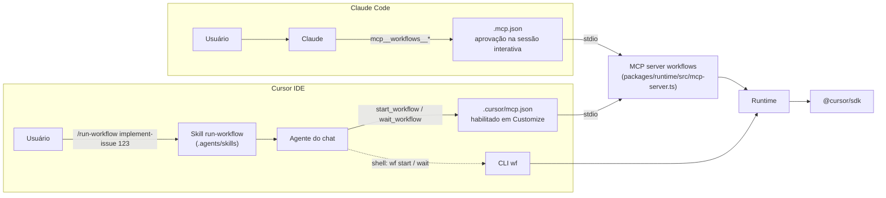

# 2.3 · Invocação no Cursor IDE (e no Claude Code)

## Caminhos de invocação



### 1. MCP server (principal)

O servidor `workflows` é registrado em `.cursor/mcp.json` (Cursor) e em `.mcp.json` (Claude Code). Ele expõe:

| Tool | Entrada | Saída |
|---|---|---|
| `list_workflows` | — | `name`, `description`, `whenToUse`, `phases`, `argsSchema` de cada workflow |
| `start_workflow` | `{ name, args, resumeRunId?, overrides? }` | `{ jobId, runId }`, mais `dashboardUrl` (o link da página do run no [dashboard](../operating/03-observabilidade.md#5-dashboard), que o `start_workflow` inicia se nada responde na porta; `dashboardWarning` traz o motivo quando não sobe, e nenhum dos dois aparece com o início automático desligado). O workflow roda em segundo plano, em um processo destacado: reiniciar o servidor ou o Cursor não o interrompe |
| `wait_workflow` | `{ jobId, timeoutSec ≤ 50 }` | Estado do job, projetado do log de eventos do run: `status`, `phase`, `recent` (até 20 linhas de resumo, uma linha cada, nunca texto de prompt ou de saída de agente; o custo de cada etapa é o maior entre bruto e cobrado), `result` (o que o workflow devolveu), `error`, `spentCents` (custo que o teto usa; acumula entre resumes), `chargedCents` (só o valor cobrado), `spentTokens` |
| `get_workflow_status` | `{ jobId }` | Estado, sem esperar |
| `cancel_workflow` | `{ jobId }` | Cancela o job: para os agentes ativos, desfaz a etapa que estava escrevendo e devolve o estado com `status: "cancelled"`. O run continua retomável. O agente do chat só chama quando o usuário pede para parar |

**Por que start/wait e não uma tool que bloqueia até o fim?** Um workflow de implementação leva minutos, e a
doc do Cursor não dá o timeout de uma chamada de tool MCP no IDE. O FAQ de MCP só diz que, se o servidor cai ou
estoura o tempo, a chamada é marcada como falha ([DOC](https://cursor.com/docs/mcp), acesso em 2026-11-11). Os
limites de 60 s que a doc cita valem para outros casos: tool stdio em workers self-hosted
([DOC](https://cursor.com/docs/release-notes)) e conexão de MCP em runs locais do SDK
([DOC](https://cursor.com/docs/release-notes/sdk)). O valor do IDE segue em aberto. Com start/wait, cada chamada
dura no máximo 50 s e o agente do chat repete a espera.

**Se o servidor reiniciar no meio** (por exemplo, ao reiniciar o Cursor ou ao desligar e religar o servidor em
**Customize** [DOC](https://cursor.com/docs/mcp)): o run continua, porque roda em um processo destacado
([ADR-0003](../adr/0003-detached-jobs.md)). O servidor novo o encontra pelos arquivos do job e
`wait_workflow` segue de onde parou. A doc não diz se mudar o `mcp.json` reinicia um servidor que já está rodando.

**Se o processo do job morrer** (ou parar de dar sinal de vida: o heartbeat dele fica mais de 30 s sem atualizar),
o job aparece como `failed` com o `runId`. Chame `start_workflow` com o mesmo `name` e `args` e com
`resumeRunId: "<runId>"`; as etapas já concluídas saem do journal.

**Para parar um run:** `cancel_workflow` (ou `wf cancel <jobId>`, ou Ctrl-C / `SIGTERM` no processo do run). O job
termina como `cancelled`, com o `runId` para retomar.

**Custo do polling:** cada `wait_workflow` é uma chamada de tool do agente do chat e consome tokens do modelo
que está no chat. Duas formas de reduzir:

- dispare `/run-workflow` com um modelo barato selecionado no chat (o trabalho pesado é do workflow);
- use esperas longas (`timeoutSec: 45–50`).

**Aprovação do polling:** chamadas de tool MCP seguem o mesmo Run Mode dos comandos de terminal e não ficam
isentas de aprovação ([DOC](https://cursor.com/docs/mcp), [DOC](https://cursor.com/docs/agent/security/run-modes)).
Em Auto-review, tools na allowlist rodam na hora e as demais passam pelo classificador. Em Allowlist, só o que
está na allowlist roda sem pedir. Em Run Everything, tudo roda sem pedir. Para cada `wait_workflow` não pedir
aprovação, ponha `wait_workflow` e `get_workflow_status` na allowlist. Num time Enterprise, o admin pode fixar o
Run Mode e a allowlist de MCP, e um membro não muda isso.

### 2. CLI pelo shell do agente

Fallback quando o MCP não está habilitado, e caminho preferido em CI e em runs longos:

```bash
wf start implement-issue --args '{"issue":123}'   # processo destacado; log em .workflows/jobs/<id>.log
wf wait <jobId> --timeout 240
wf cancel <jobId>          # para o run (SIGTERM ao processo do job); o run continua retomável
wf gc --dry-run            # mostra os worktrees e branches de runs terminados que o gc removeria
```

`start` valida o nome do workflow e o JSON dos args **antes** de destacar o processo e grava o job (com `runId`)
na hora. A doc do Cursor não dá o timeout de um comando no shell do agente: as release notes só dizem que esse
timeout existe, sem valor ([DOC](https://cursor.com/docs/release-notes)). Os cerca de 300 s vêm de relatos não
verificados. Também há relatos, não verificados, de falhas em execuções headless (`agent -p`) iniciadas quase ao
mesmo tempo; nem a doc do CLI nem os tópicos do fórum consultados tratam disso. Os dois pontos seguem em aberto.
Por isso `wait` usa um timeout menor que 300 s, e `start` roda destacado.

`wf gc` limpa o que os runs do `implement-issue` deixam no repositório (o worktree, a branch local e a branch do origin
de cada run) quando o PR do run foi mergeado ou fechado, ou quando o run falhou há mais de `gcFailedAfterDays` dias.
Também varre as branches de snapshot (`wf/cloud-snapshot/<run>/<id>`) que uma etapa na nuvem deixou no remote `cloud.remote`.
Escreve o plano no stderr antes de remover e um JSON no stdout (`remove`, `kept`, `errors`); `--dry-run` não muda nada.
Não é automático: roda quando você o chama. Detalhes e limites em [5.1](../operating/01-governanca-e-custos.md).

### 3. Skill `run-workflow` e a trava de disparo

`skills/run-workflow/SKILL.md` (linkada em `.agents/skills/`) é invocável pelo modelo: a descrição dela fica no contexto e o agente a
carrega antes de chamar `start_workflow`, pelo `/run-workflow` ou por um pedido em prosa ("implementa a issue 7").
A skill ensina a disparar, acompanhar e repassar: tratar checkpoint, custo desconhecido e `secret-blocked`, e não
mexer nos arquivos enquanto o job roda.

Ela já foi só do usuário (`disable-model-invocation: true`), mas isso não travava nada: o servidor MCP anuncia
`start_workflow` com o `whenToUse` de cada workflow, e um pedido em prosa chegava à tool sem passar pela skill. A
trava humana de um workflow pago é a **aprovação da chamada `start_workflow`**, e ela depende do Run Mode
([DOC](https://cursor.com/docs/agent/security/run-modes)): em Allowlist, pede sempre, se `start_workflow` não estiver
na allowlist; em Auto-review, um classificador decide; em Run Everything, não pede. Ponha na allowlist só
`wait_workflow` e `get_workflow_status`. No Claude Code, a trava é o prompt de permissão da tool
`mcp__workflows__start_workflow`, que `permissions.allow` não deve liberar. Sem essa trava, sobram os tetos de custo.

### 4. Hooks (complementares, opcionais)

- `beforeMCPExecution` com `failClosed: true`: auditar ou bloquear `start_workflow` por repositório ou por
  workflow. Com `failClosed: true`, crash, timeout ou saída não zero do hook bloqueiam a chamada em vez de
  liberá-la ([DOC](https://cursor.com/docs/hooks)). Hooks distribuídos pelo dashboard do time não aceitam
  `failClosed`, e `beforeMCPExecution` não roda em cloud agents hospedados pelo Cursor.
- No Claude Code, o equivalente é um hook `PreToolUse` com `matcher: "mcp__workflows__start_workflow"`. Como só tem
  letras e `_`, o matcher vale como nome exato; o trecho do meio segue o nome do servidor no `.mcp.json`. Com `"onFailure":
  "block"` (v2.1.295+), um hook que falha bloqueia a chamada em vez de liberá-la
  ([DOC](https://code.claude.com/docs/en/hooks#match-mcp-tools),
  [DOC](https://code.claude.com/docs/en/hooks#block-the-action-when-a-hook-fails)).
- `stop` com `followup_message`: **não** é necessário aqui, porque o laço está no workflow. Ele serve apenas
  para fluxos que continuam em skill.

## Onde cada harness procura cada coisa

O kit usa `.agents/` como local neutro e mantém só o que é específico de cada harness em `.cursor/` e `.claude/`.

| Artefato | `.agents/` | `.cursor/` | `.claude/` | `.codex/` | Fonte |
|---|---|---|---|---|---|
| Skills: Cursor IDE | ✅ nativo (`.agents/skills/`, `~/.agents/skills/`) | ✅ nativo | ✅ compat. | ✅ compat. | [doc de skills do Cursor](https://cursor.com/docs/skills) [DOC] |
| Skills: runs do Cursor SDK (`settingSources: ["project"]`) | ✅ (first-party) | ✅ | ✅ (third-party) | ✅ (third-party) | bundle do `@cursor/sdk@1.3.1`. Medido em 2026-11-11: o SDK carregou as mesmas 58 skills com `["team","mdm"]` e com `"project"`, e nenhuma com `[]`; a origem delas não foi isolada ([8.2 §7](../research/verificacoes-locais.md)) |
| Skills do usuário (globais) | `~/.agents/skills/` | `~/.cursor/skills/` | `~/.claude/skills/` (o Cursor também lê, por compatibilidade) | — | [doc de skills do Cursor](https://cursor.com/docs/skills) [DOC] |
| Skills: Claude Code | ❌ não lê nada sob `.agents/` | ❌ | ✅ | ❌ | docs de [memória](https://code.claude.com/docs/en/memory) e de [skills](https://code.claude.com/docs/en/skills) do Claude Code [DOC] |
| Subagents: Cursor | ❌ não documentado | ✅ | ✅ compat. | ✅ compat. | [doc de subagents do Cursor](https://cursor.com/docs/subagents) [DOC] |
| Subagents: Claude Code | ❌ | ❌ | ✅ | ❌ | [doc de subagents do Claude Code](https://code.claude.com/docs/en/sub-agents) [DOC] |
| Instruções | `AGENTS.md` na raiz (o Cursor também aceita em subpastas): lido pelo Cursor e pelas runs do SDK; o Claude Code, por padrão (v2.1.277+), só o lê **se não houver `CLAUDE.md`, `.claude/CLAUDE.md` ou `CLAUDE.local.md`** na pasta ou acima, ou via `@AGENTS.md` (o modo `claude-md-and-agents-md` lê os dois) | `.cursor/rules/` | `CLAUDE.md` (o agente do Cursor IDE também o lê) | — | [rules do Cursor](https://cursor.com/docs/rules), [release notes 3.26 do Cursor](https://cursor.com/docs/release-notes), [memória do Claude Code](https://code.claude.com/docs/en/memory) [DOC] |
| MCP | — | `.cursor/mcp.json` | `.mcp.json` (raiz) | — | docs |
| Workflows deste kit | `.agents/workflows/` (lido pelo runtime) | — | — | — | este kit |

Consequências no kit:

- **Skills do kit, instaladas.** O instalador liga cada skill de `skills/` em `~/.claude/skills/` (links simbólicos para
  o kit), então elas valem em todo repositório, no Cursor e no Claude Code, sem cópia; `wf upgrade` as mantém em dia
  ([2.1 §3](01-instalacao.md#3-instalar)). Isso resolve a duplicata do próximo item para quem usa o kit instalado.
- **Skills em `.agents/skills/`.** Funcionam no Cursor IDE, nas etapas dos workflows e no Codex.
  Para o Claude Code, `scripts/link-claude-skills.sh` cria links em `.claude/skills/`. A ressalva é que o Cursor
  também lê `.claude/skills/`, então a skill pode aparecer duas vezes no Cursor. A doc de skills lista as pastas
  sem regra de precedência ou deduplicação ([DOC](https://cursor.com/docs/skills)); essas regras só existem para
  subagents (`.cursor/` vence) e para `CLAUDE.md` × `AGENTS.md`. Fica em aberto. Rode o script só se o time usa
  Claude Code no repositório.
- **Instruções em `AGENTS.md`.** `AGENTS.md` é um link simbólico para o `CLAUDE.md`, a fonte canônica.
- **Subagents continuam em `.cursor/agents/` ou `.claude/agents/`.** Não há `.agents/agents/` documentado
  ([DOC](https://cursor.com/docs/subagents)). Para as runs do SDK, a doc só cita `.cursor/agents/*.md`
  ([DOC](https://cursor.com/docs/sdk/typescript)). Num
  fluxo convertido em workflow, os subagents viram etapas (`ctx.agent`) ou `agents` inline, então deixam de
  depender da pasta.

## Usar o kit em outros repositórios

Há duas formas.

**A. Copiar o kit para dentro do repositório** (mais simples). Os workflows ficam em `workflows/`, versionados
junto com o código.

**B. Instalar o kit uma vez e apontar cada repositório para ele.** Instale o kit ([2.1 §3](01-instalacao.md#3-instalar):
`INSTALL-AGENT.md` ou `scripts/install.sh`), que fica em `~/.cursor-workflows/kit`, e rode o `wf init` no repositório
alvo (abaixo). Escrito à mão, o `.cursor/mcp.json` é:

```json
{
  "mcpServers": {
    "workflows": {
      "command": "${userHome}/.cursor-workflows/kit/node_modules/.bin/tsx",
      "args": ["${userHome}/.cursor-workflows/kit/packages/runtime/src/mcp-server.ts"],
      "env": { "WF_CWD": "${workspaceFolder}", "WF_MAX_CENTS": "500", "WF_MAX_TOKENS": "2000000" }
    }
  }
}
```

`WF_MAX_CENTS` é o teto em centavos. Ele compara com `spentCents`: a soma, por tentativa, do maior entre
`rawCostCents` e `chargedCents`. O cobrado sozinho é 0 em uso incluído no plano, BYOK e créditos, e por isso não
serve de teto; `chargedCents` aparece à parte no estado do job. Se o Cursor ainda não reportou o custo de uma
tentativa, ou se o `getUsage()` falhou (por exemplo, `403 feature_unavailable` em agentes locais, o que aconteceu em
toda chamada num Premium em 2026-11-11), o engine emite
um aviso: o teto em centavos não contou essa tentativa (o de tokens, sim; na falha, pelos eventos `turn-ended`).
Em uso cobrado por request (planos legados e alguns Enterprise), `rawCostCents` vem 0 e o teto em centavos fica
cego; só `WF_MAX_TOKENS` protege. Defina sempre os dois, como no exemplo.

**Em vez de criar esses arquivos à mão, rode o `wf init`** (`wf init --cwd /caminho/do/repo`). Ele grava o
que a forma B precisa e imprime o diff do que mudou; não faz commit nem `git add`:

| Arquivo | O que recebe |
|---|---|
| `.cursor/mcp.json` | O servidor `workflows` apontando para o kit em `${userHome}/.cursor-workflows/kit`, com `WF_CWD=${workspaceFolder}` e sem `WF_MAX_*` (os tetos ficam na configuração, [6.2](../reference/config.md)). Não tem caminho absoluto: o mesmo arquivo vale para o time inteiro |
| `.mcp.json` | O mesmo servidor para o Claude Code, com `${HOME}` no lugar de `${userHome}` |
| `.agents/workflows/config.json` | `$schema` (autocompletar no editor) e `kit`, a faixa de versão do kit que rodou o `init` (`>=0.3.0 <0.4.0` para o kit 0.3.x). O que o arquivo já tem fica, a faixa inclusive |
| `.gitignore` | A linha `.workflows/`, a não ser que uma forma usual dela já esteja lá |
| `AGENTS.md` | Um bloco de quatro linhas entre `<!-- cursor-workflows:begin -->` e `<!-- cursor-workflows:end -->`: as regras de segurança e o link do guia de instalação. O arquivo é criado se não existir. O Claude Code lê o `CLAUDE.md`, não o `AGENTS.md` ([ADR-0004](../adr/0004-workspaces-and-claude-md-symlink.md)): quando o `CLAUDE.md` não importa o `AGENTS.md` (`@AGENTS.md`), o `init` avisa no stderr e não edita o `CLAUDE.md` |

Rodar de novo não muda nada, e um arquivo que já diz o que o `init` escreveria não é reescrito. Num `mcp.json` que já
existe, só o servidor `workflows` muda: os outros servidores e as chaves extras dele ficam. Um arquivo que não é JSON
válido, ou um bloco com `begin` e sem `end`, faz o comando falhar antes de gravar qualquer arquivo. `--no-agents-md` pula
o `AGENTS.md`; `--remove` tira só o bloco dele (e apaga o arquivo se o bloco era tudo o que havia). O servidor só sobe
quando o kit está em `~/.cursor-workflows/kit`, onde o instalador ([2.1 §3](01-instalacao.md#3-instalar)) o põe, e o
[`wf doctor`](#conferindo-o-ambiente-wf-doctor) diz, a cada falha, o que corrigir.

### Conferindo o ambiente: `wf doctor`

O servidor MCP que não sobe deixa pistas só no log do MCP do IDE. O `wf doctor` (`wf doctor --cwd
/caminho/do/repo`) roda as verificações abaixo e, a cada falha, diz o que corrigir. Sai com 1 se alguma falhar e, com
`--json`, imprime o relatório em JSON (`ok` e `checks`, cada um com `id`, `status`, `message` e, nas falhas, `hint`).

| `id` | O que confere | Falha típica |
|---|---|---|
| `node` | O `node` do PATH, que é quem o IDE usa: o comando do `mcp.json` é o `tsx` do kit, cujo shebang é `env node`. Se a entrada do `mcp.json` define `env.PATH`, vale esse PATH. Mínimo: o `engines.node` do kit (22.13) | O Node do IDE é o 22.11 |
| `dependencies` | O comando e o script que o `.cursor/mcp.json` e o `.mcp.json` mandam rodar existem | `node_modules/.bin/tsx` não existe (`ENOENT`): rode `npm ci` na pasta do kit |
| `login` | Uma chamada autenticada ao Cursor (`Cursor.me()`); o relatório mostra o nome da chave, nunca a chave nem o e-mail | Sem login: `wf login` ou `CURSOR_API_KEY` |
| `models` | Cada modelo que a configuração faz os workflows usarem (papéis, rótulos e o `defaults` do workflow) está no catálogo da conta, por id ou alias | O modelo de um papel não existe na conta: `wf models` |
| `gh` | `gh auth status` | `gh` ausente ou sem login: `gh auth login` |
| `mcp-server` | Inicia o servidor como o IDE (comando, args e env da entrada `workflows`, no repositório), pede `tools/list` e espera até 20 s (`WF_DOCTOR_TIMEOUT_MS` muda o limite, em milissegundos) | O servidor morre ao iniciar; o relatório traz o que ele escreveu no stderr |
| `config` | Os dois arquivos de configuração ([6.2](../reference/config.md)) são válidos e todos os workflows resolvem, com o caminho do campo errado | Papel desconhecido, JSON inválido |
| `kit-version` | A faixa semver `kit` do `.agents/workflows/config.json` contra o kit que roda o `wf` e contra o kit que cada servidor MCP diz ser (a versão que ele devolve no `initialize`): é este o que o `start_workflow` recusa, e nem sempre é o primeiro | Kit fora da faixa |

O `PATH` que o `wf doctor` vê é o do terminal onde ele roda. Um IDE aberto pelo menu do sistema pode ter outro `PATH`
que o de um terminal (um gerenciador de versões, como o mise ou o nvm, costuma ativar o Node só no shell): rode o
`wf doctor` num terminal aberto pelo próprio IDE. Se o Node que roda o próprio `wf` for mais antigo que o mínimo, nada
mais do kit carrega nele: o relatório (em texto ou em `--json`) traz só a verificação `node`, com falha e a dica. Todo o
relatório passa pela mesma redação de segredos dos logs de run (`[REDACTED]`), inclusive o stderr do servidor.

**A faixa de versão do kit.** O `kit` do `.agents/workflows/config.json` (o `wf init` escreve a do kit que o rodou, como
`>=0.3.0 <0.4.0`) aceita qualquer faixa semver, como `^0.3.0`. O `wf doctor`, o `wf run`, o `wf start` e o
`start_workflow` do MCP recusam um kit fora dela, antes de iniciar o que for, dizendo a versão do kit, a faixa e se o kit é mais
antigo ou mais novo; um kit mais antigo que a faixa se atualiza com `wf upgrade` ([2.1 §3](01-instalacao.md#atualizar-wf-upgrade)). Os comandos que só leem (`wf list`, `wf config show`) continuam funcionando. Um repositório sem
`kit` aceita qualquer versão.

As skills do kit já valem no repositório alvo: o instalador as liga em `~/.claude/skills/`, e não há nada a copiar.
No Cursor, se o servidor não aparecer no chat, habilite-o em **Customize**, na barra lateral. No Enterprise, o admin pode limitar quais servidores MCP os
membros rodam (servidores stdio são aprovados por padrão de comando; [DOC](https://cursor.com/docs/mcp)); com a
Team list ligada, um membro pode precisar que o admin libere o servidor antes
([DOC](https://cursor.com/docs/release-notes)). Para o Claude
Code, o `wf init` já escreve o `.mcp.json` do repositório, com `${HOME}` no lugar de um caminho absoluto.

Os workflows do repositório alvo ficam em `.agents/workflows/*.ts`. O runtime carrega essa pasta automaticamente
(além dos workflows do kit) e, em nome repetido, a do repositório vence. Escreva-os sem importar o runtime por
caminho relativo: `export default { meta, defaults, async run(ctx) { ... } }`. Imports só de tipo
(`import type ...`) são apagados pelo `tsx` e não quebram. Para ter typecheck e testes, desenvolva o workflow
dentro do kit e depois copie.

> `${workspaceFolder}` é a raiz do projeto, "a pasta que contém o `.cursor/mcp.json`"
> ([DOC](https://cursor.com/docs/mcp)). Num `~/.cursor/mcp.json` global, ele não
> aponta para o projeto aberto. Por isso a forma B usa o `mcp.json` **do projeto**.

## Validar no Cursor IDE

"Funciona no Cursor IDE" é um critério com evidência: sete cenários passam no IDE de verdade, na máquina de quem vai
usar o kit. O kit traz o que torna isso repetível: um workflow barato, o `smoke`, e um assistente guiado.

**O `smoke`** é o workflow mais barato que prova o caminho inteiro (chat → MCP → job destacado → SDK → resultado
estruturado): uma etapa, sem tools e sem contexto do projeto, no `composer-2.5`, com teto de 50 mil tokens. O agente
tem de chamar `submit_result` com `answer: "pong"`, e o esquema recusa qualquer outro valor: um run que termina passou
pelo SDK e voltou. Medido em 2026-11-12 contra a API real: 21.628 tokens, cerca de 25 s, `status: finished`. Numa conta
em que o `composer-2.5` não está incluído, troque o modelo do papel `ping` (`workflows.smoke.roles.ping.model` na
configuração, [6.2](../reference/config.md), ou `WF_MODEL_PING`). Rode com `/run-workflow smoke` no chat ou `wf run smoke`.

**O assistente** é o [`scripts/verify/validate-cursor-ide.sh`](../../scripts/verify/validate-cursor-ide.sh) (no kit
instalado, `~/.cursor-workflows/kit/scripts/verify/validate-cursor-ide.sh`). Rode-o no terminal do próprio Cursor: o
cenário 1 só vale ali, porque o IDE escolhe o próprio Node e PATH. Ele:

1. confere a máquina (`wf`, `gh` logado, dependências do kit) e pergunta a versão do Cursor;
2. cria um repositório privado descartável no GitHub, com três issues `complexity:low`, reaproveitando o
   [`setup-sandbox-repo.sh`](../../scripts/verify/setup-sandbox-repo.sh), e roda `wf init` nele. Pede confirmação antes de criar, e se parar no meio retoma de onde parou, sem criar duas vezes o repositório nem as issues;
3. roda o `wf doctor` no repositório (cenário 1) e, para cada um dos outros seis, diz exatamente o que digitar no chat (ou o que olhar, no 7)
   e pergunta o resultado (`pass`, `fail` ou `skip`) e uma nota de uma linha;
4. escreve o `validation-report.json`, mostra o corpo da issue e só a abre no repositório do kit depois que você confirma.

| # | Cenário | O que você digita no chat | Passa quando |
|---|---|---|---|
| 1 | O `wf doctor` está verde no ambiente do IDE | nada: o assistente roda o `wf doctor` no terminal do Cursor | sai com 0 |
| 2 | O servidor MCP está visível e habilitado | nada: abra a lista de MCP (Customize) | `workflows` ligado, com as cinco tools |
| 3 | O `smoke` termina | `/run-workflow smoke` | o job termina com `answer: "pong"` |
| 4 | O `implement-issue` LOW abre um PR no repositório descartável | `/run-workflow implement-issue 1`, pedindo para abrir o PR (`openPr: true`; sem isso o workflow não abre PR) | o job termina e o PR existe |
| 5 | O run sobrevive ao reinício do Cursor | `/run-workflow implement-issue 2`; com o job rodando, feche o Cursor por completo e abra de novo | o job termina mesmo com o Cursor reiniciado no meio (um job ainda rodando não é um `pass`: espere); ou falhou com `runId` e o resume termina sem repetir etapas |
| 6 | O run cancela pelo chat | `/run-workflow implement-issue 3`; com o job rodando, peça ao chat para cancelar | o job termina `cancelled`, com o `runId` para retomar |
| 7 | O dashboard mostra o run ao vivo | `/run-workflow smoke`; o chat abre o link do dashboard no navegador embutido do Cursor | no navegador embutido: o cartão do run está na coluna Ping do quadro do `smoke` e vai sozinho para Done, sem recarregar; o clique no cartão abre o grafo, com a etapa `ping` que pisca e fica verde; passar o mouse na etapa mostra modelo, tokens, custo e duração; clicar nela abre o log (prompt, o que o agente disse, chamadas de tool) |

Depois do 7, o assistente pergunta se você quer rodar o **cenário 8, opcional**: uma etapa de leitura num cloud agent da Cursor. Ele manda o código do repositório descartável para uma VM, então exige um plano com Cloud Agents e o repositório numa conta do GitHub à qual a Cursor está conectada, e só você pode liberá-lo: o assistente mostra as chaves para mesclar no `~/.cursor-workflows/config.json` (`caps.allowedLocations` com `cloud` e `workflows.smoke.roles.ping.location: "cloud"`) e não escreve nada na sua configuração. Depois você digita `/run-workflow smoke`. Passa quando o job termina com `answer: "pong"`, o log do run tem um evento `cloud-agent` com um id `bc-…` e o repositório descartável não ficou com nenhuma branch `wf/cloud-snapshot/*` no remote (o assistente mostra as duas coisas). Vale olhar também a página do run no dashboard: a etapa `ping` tem o selo de nuvem e, ao passar o mouse, o link do agente na Cursor e o custo (não conta para o resultado). O relatório lista o 8 como opcional, e o critério de release continua sendo os sete.

No cenário 5, fechar o Cursor fecha o terminal dele e, com ele, o assistente. As respostas ficam em
`~/.cursor-workflows/validation/progress.env`: reabra o Cursor, rode o assistente de novo e ele segue do cenário 5, com
as respostas dos anteriores mantidas (Enter confirma cada uma). Os cenários 3 a 6 rodam workflows e gastam cerca de 800
mil tokens, em modelos que os planos incluem (o `implement-issue` LOW mediu 339 mil;
[8.2 §13](../research/verificacoes-locais.md)). O cenário 7 roda também o `smoke`, que não entrou nessa medição, e o 8 também (o mesmo `smoke`, na nuvem).

O relatório tem, por cenário, o resultado (`pass`, `fail` ou `skipped`) e a nota, mais os fatos do ambiente (SO, Node,
versão do kit e do Cursor, se o terminal era o do IDE) e o resultado do `wf doctor`. Caminhos locais, o nome do
repositório descartável, a conta e a máquina viram marcadores (`~`, `<sandbox-dir>`, `<kit>`, `<sandbox-repo>`, `<owner>`, `<user>`, `<host>`, `<email>`, `<path>`), e
formatos conhecidos de segredo viram `[REDACTED]`. O critério de release (`releaseCriterionMet`) vale só com os sete em
`pass`; o cenário 8, quando rodou, aparece na tabela como opcional e não entra na conta. `WF_KIT_REPO=dono/repo` abre a issue em outro repositório que não o de origem do kit.

## Paridade Cursor × Claude Code

| Eixo | Cursor | Claude Code |
|---|---|---|
| Onde registrar o MCP server | `.cursor/mcp.json` (projeto) ou `~/.cursor/mcp.json` | `.mcp.json` (projeto) ou `claude mcp add`. Em sessão interativa, o servidor do `.mcp.json` pede aprovação: até lá, `claude mcp list` mostra `workflows: node_modules/.bin/tsx packages/runtime/src/mcp-server.ts - ⏸ Pending approval` (verificado em 2026-11-11). Em `claude -p`, no Agent SDK e em sessões na nuvem fora de um projeto, ele é carregado sem perguntar ([DOC](https://code.claude.com/docs/en/mcp)) |
| Trava de disparo | Aprovação de `start_workflow` pelo Run Mode (fora da allowlist) [DOC](https://cursor.com/docs/agent/security/run-modes); a skill `run-workflow` guia o agente | Prompt de permissão de `mcp__workflows__start_workflow` (fora de `permissions.allow`) [DOC](https://code.claude.com/docs/en/permissions); a skill chega via `.claude/skills/` |
| Workflow nativo | **Não existe**. Este kit preenche a lacuna | Ferramenta `Workflow`, `/deep-research`, `ultracode`, `.claude/workflows/` ([DOC](https://code.claude.com/docs/en/workflows)) |
| Como o contexto chega aos agentes das etapas | `settingSources: ["project","team","mdm"]` carrega `AGENTS.md`, `.cursor/rules`, skills, hooks e MCP do projeto. Medido em 2026-11-11: o `AGENTS.md` só chega com `"project"`, e é opt-in ([2.2 §5](02-configuracao-inicial.md#5-contexto-do-projeto-nos-agentes)) | Os agentes das etapas são do Cursor mesmo quando o Claude Code dispara. A doc não diz se as runs locais do SDK leem o `CLAUDE.md` (o agente do Cursor IDE e os cloud agents leem, segundo as release notes: [DOC](https://cursor.com/docs/release-notes)); por isso as regras ficam em `AGENTS.md` |
| Hooks que alcançam as etapas | Hooks do projeto, do time e MDM (via `settingSources`). A doc diz que o Cursor carrega hooks do Claude Code, com `loop_limit` `null` em `stop`/`subagentStop` ([DOC](https://cursor.com/docs/hooks)). Nas runs locais do SDK, a release note 1.0.40 do SDK diz que um hook `PreToolUse` de um `settings.json` do Claude Code que nega uma chamada de tool bloqueia essa chamada ([DOC](https://cursor.com/docs/release-notes/sdk)); não fala de cloud. Medido em 2026-11-11 numa run local com `"project"` ([8.2 §7](../research/verificacoes-locais.md)): os hooks de `.cursor/hooks.json` (`beforeShellExecution`, `postToolUse`) rodaram, e um `PreToolUse` de `.claude/settings.json` (`matcher: "*"`, `exit 2`) bloqueou o comando; o hook viu os nomes `Shell` e `MCP:submit_result`. Com `[]`, nenhum rodou. Se o `~/.claude/settings.json` também é lido não foi testado. Hooks de `team` e `mdm` não foram testados (conta pessoal) | Para auditar ou bloquear o disparo, use um hook `PreToolUse` com `matcher: "mcp__workflows__start_workflow"` e `"onFailure": "block"` (v2.1.295+) ([DOC](https://code.claude.com/docs/en/hooks); ver §4). Nas etapas, o Cursor SDK roda os `PreToolUse` do `.claude/settings.json` do projeto e respeita o deny (medido, ver coluna ao lado) |
| Quem paga | A chave do Cursor usada pelo runtime | Idem: o modelo do Claude Code só paga o disparo e o polling [I] |

> Para usar o *runtime nativo* do Claude Code em vez deste kit, escreva o fluxo como workflow do Claude Code
> (`.claude/workflows/<nome>.js`). A estrutura `meta` + `agent/parallel/pipeline/phase` é praticamente a mesma,
> então um workflow deste kit converte para lá com poucas mudanças: troque `ctx.agent` por `agent`, e passe
> `git`/`gh` para uma etapa de agente, porque o sandbox do Claude Code não tem shell.

---

[← Anterior: 2.2 · Configuração inicial](02-configuracao-inicial.md) · [Índice](../README.md) · [Próximo: 3.1 · Arquitetura →](../internals/01-arquitetura.md)
