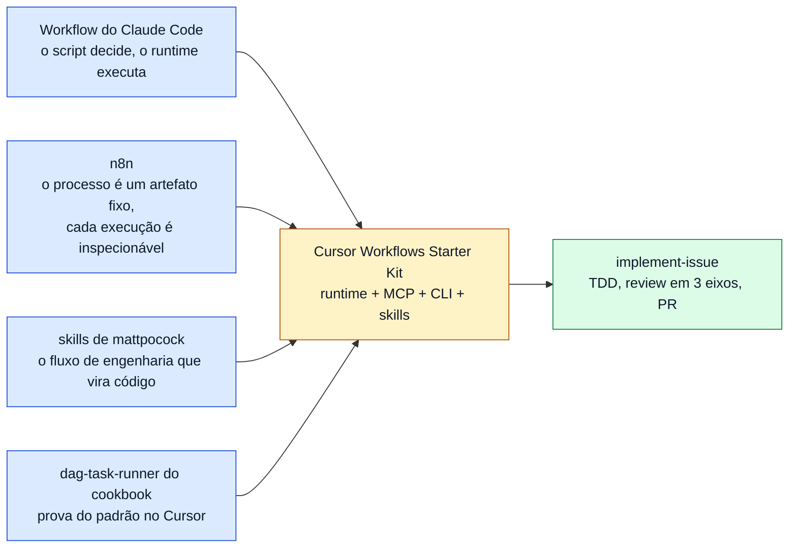

# 1.2 · A ideia e as referências

A ideia do kit cabe em uma frase: **o código decide o processo, e o modelo executa etapas pequenas**. Este capítulo
desdobra a frase, diz de quem o kit tomou cada peça (o Workflow do Claude Code, o n8n, as skills de mattpocock) e
registra de onde o repositório veio e a quem se deve cada parte. Os termos do kit (workflow, etapa, run, job...) têm
definição em [1.3](03-conceitos.md).

## A ideia

Um workflow é um arquivo TypeScript. Nele, o código, e não o modelo, decide:

- a **ordem** das etapas, os ramos e os laços;
- o **modelo** de cada etapa, e quando vale gastar um maior (planejamento difícil, revisão);
- **quando revisar** e **quando parar**: o teto de custo é checado pelo código, antes de cada tentativa.

Cada etapa é um agente novo do Cursor com uma tarefa pequena, fechada, e uma saída validada por schema. As verificações
objetivas (rodar os testes, ler o diff, procurar segredos) ficam no código, fora do modelo. O fluxo termina por inteiro
ou falha de forma explícita: nunca "pula" uma etapa em silêncio. O que terminou fica no journal, e um run interrompido
retoma de onde parou.

O determinismo está no *processo*, não no modelo: dois runs podem gerar código diferente, mas passam pelas mesmas etapas,
na mesma ordem, com as mesmas verificações ([3.1](../internals/01-arquitetura.md#o-que-ele-não-garante)).

## As referências

### O Workflow do Claude Code

A [doc de workflows do Claude Code](https://code.claude.com/docs/en/workflows) (acesso em 2026-11-11) separa os workflows
das skills e dos subagents pela pergunta *quem decide o que roda a seguir*: nos workflows, é um script que o runtime
executa. É o modelo do kit. O kit copia a superfície (`agent`, `parallel`, `pipeline`, `phase`, `args`, o journal para
retomar) e diverge de propósito em quatro pontos: o script roda em Node completo, a chave de resume é um hash, um
`agent()` que falha lança erro, e a concorrência padrão é 4. A tabela das diferenças e o porquê de cada uma estão em
[3.1](../internals/01-arquitetura.md#diferenças-deliberadas-em-relação-ao-claude-code), e a comparação capacidade a
capacidade com o Cursor, em [8.1 §3](../research/relatorio-pesquisa.md).

### O n8n

O [n8n](https://n8n.io) é uma plataforma de automação em que um workflow é "a collection of nodes connected together to
automate a process": um gatilho dispara, os nós rodam em sequência, e cada rodada é uma execução que se pode ver, filtrar
e depurar ([DOC](https://docs.n8n.io/workflows/), acesso em 2026-11-12). O kit toma duas ideias dele:

- **o processo é um artefato fixado por quem o escreve**, fora de qualquer modelo, e por isso pode ser versionado,
  revisado e testado;
- **cada rodada é uma execução inspecionável**, não uma conversa: no kit, essa é a função do
  log de eventos ([1.3](03-conceitos.md)) e do [ADR-0002](../adr/0002-event-log-source-of-truth.md).

E difere em duas: o n8n desenha o processo como um grafo de nós numa tela; o kit o escreve em TypeScript, e por isso
ramos, laços, tentativas e verificações são código comum. E os nós do kit não são conectores genéricos, são sempre
agentes do Cursor com um schema de saída. A ligação com o n8n é uma analogia nossa, de modelo mental: o kit não o usa nem
se integra a ele.

### As skills de mattpocock

O [mattpocock/skills](https://github.com/mattpocock/skills) é um conjunto de skills de engenharia (TDD em fatias
verticais, desenho de módulos profundos, review em dois eixos, corpo de PR com evidência), pensadas para o modelo seguir
numa conversa. O `implement-issue`, o workflow de exemplo do kit, é a conversão de quatro delas em código: o que a
skill pede ao modelo (combinar as seams antes dos testes, red antes de green, não misturar os eixos do review), o
workflow confere. Isso é também o exemplo de referência da conversão ([4.2](../authoring/02-convertendo-skills-e-subagents.md)).
Este repositório é mantido com as mesmas skills: specs e tickets viram issues do GitHub
([`docs/agents/`](../agents/issue-tracker.md)) e as decisões difíceis de reverter viram [ADRs](../adr/0001-layered-config-with-hard-caps.md).

### O `dag-task-runner` do cookbook do Cursor

O `cookbook/sdk/dag-task-runner` do Cursor é uma skill que dispara um script TypeScript, e o script executa um DAG de
agentes do SDK, escolhendo o modelo pela complexidade de cada nó. Prova que o padrão funciona no Cursor. A diferença é
quem escreve o plano: ali, o agente pai escreve o DAG; no kit, o autor do workflow o escreve em código, e há schema,
journal e teto de custo ([8.1 §2.3](../research/relatorio-pesquisa.md)).

## Créditos

O workflow de exemplo `implement-issue` segue, em código, os fluxos de skills de outras pessoas. As instruções das
etapas ficam em [`packages/runtime/workflows/implement-issue/prompts.ts`](../../packages/runtime/workflows/implement-issue/prompts.ts)
e são paráfrases em pt-BR, não cópias. Ao converter uma skill de terceiros em workflow, acrescente uma linha a esta
tabela.

| Origem | Autor | Licença | O que o workflow usa |
|---|---|---|---|
| [`tdd`](https://github.com/mattpocock/skills) (mattpocock/skills 1.3.1) | Matt Pocock | MIT | Seams combinadas antes dos testes; fatias verticais; red antes de green; teste pela interface pública; anti-padrões (acoplado à implementação, tautológico, fatiamento horizontal); refactor fora do laço |
| [`codebase-design`](https://github.com/mattpocock/skills) (idem) | Matt Pocock | MIT | Vocabulário de módulo profundo, interface, seam e adapter; "Design it twice" com três restrições para o tier HIGH |
| [`code-review`](https://github.com/mattpocock/skills) (idem) | Matt Pocock | MIT | Eixos Standards e Spec em paralelo, sem misturar nem reordenar; baseline de code smells de Fowler como julgamento |
| [`pr`](https://github.com/mattpocock/skills) (idem) | Matt Pocock | MIT | Template do corpo do PR: Summary, Evidence (antes e depois), Merge Danger (porta e raio de impacto) |
| [`show-me`](https://github.com/humanlayer/skills) (humanlayer/skills), via `pr` | Dex Horthy | MIT | Menu de visuais do Summary (pseudocódigo, árvore de chamadas, árvore de arquivos, Mermaid, diff) |

A baseline de smells vem de Martin Fowler, *Refactoring* (cap. 3), citada pela skill `code-review`. O eixo de
Segurança do review e o controle do laço TDD pelo código (snapshots, testes rodados entre as etapas, progresso por
fatia) são deste kit.

## Proveniência

Este repositório nasceu de um estudo no [ai-study-library](https://github.com/rodrigorjsf/ai-study-library), na pasta
`ai/study/cursor-agent-sdk-workflows/`. O kit foi escrito numa sessão na nuvem, sem acesso a cursor.com nem a uma
conta Cursor. Depois foi verificado e corrigido numa sessão local, com a documentação ao vivo e a API real.

### Commits de origem (ai-study-library)

| Commit | Data | O que entrou |
|---|---|---|
| [`f3dd5ee`](https://github.com/rodrigorjsf/ai-study-library/commit/f3dd5eefcadabf64848595460bf50a718396c908) | 2026-11-11 | Espelho da doc de *dynamic workflows* do Claude Code |
| [`6640d40`](https://github.com/rodrigorjsf/ai-study-library/commit/6640d40252900648f02674d8f9c25d40f0e66c8c) | 2026-11-11 | Plano do estudo |
| [`e444790`](https://github.com/rodrigorjsf/ai-study-library/commit/e444790a3b936bbd6af918e5c434e138aa6c787c) | 2026-11-11 | Relatório de pesquisa e primeira versão do kit |
| [`9a6b24f`](https://github.com/rodrigorjsf/ai-study-library/commit/9a6b24fbb4d4eeea1a67f59afc6634840f4735f9) | 2026-11-11 | Revisão independente aplicada; layout `.agents/` |
| [`1774f87`](https://github.com/rodrigorjsf/ai-study-library/commit/1774f87fad3d52f4b92578bdd859fa45abac0df8) | 2026-11-11 | Custos e cache |
| [`9855bda`](https://github.com/rodrigorjsf/ai-study-library/commit/9855bdae0b2de5076b73732808c35344f409b862) | 2026-11-11 | Plano da observabilidade V1 |
| [`a69f2a2`](https://github.com/rodrigorjsf/ai-study-library/commit/a69f2a21a78b7d5689fb21b6ed3c89d6890019db) | 2026-11-11 | Observabilidade V1: **estado do kit que serviu de base** |
| [`81d7356`](https://github.com/rodrigorjsf/ai-study-library/commit/81d7356c86be3c4429c42fbc79f2818a39111585) | 2026-11-11 | Prompt que conduziu a verificação local e esta publicação |
| [`4aaa4f8`](https://github.com/rodrigorjsf/ai-study-library/commit/4aaa4f8b0f3d670ce00e00552373f60585646ade) | 2026-11-11 | Espelhos atualizados da doc do Cursor usados como evidência na verificação |

O conteúdo do kit em `81d7356` é idêntico ao de `a69f2a2`
(`git diff --stat a69f2a2 81d7356 -- ai/study/cursor-agent-sdk-workflows/starter-kit` não lista nada).

### Sessões

| Sessão | Ambiente | Papel |
|---|---|---|
| <https://claude.ai/code/session_01FoetnbEHq7GuDkLCZpYC7f> | Nuvem (Claude Code), sem acesso a cursor.com nem conta Cursor | Pesquisa, relatório, kit, revisões |
| <https://claude.ai/code/session_01FoetnZWeHSTocfBFv51gxV> | Local (Claude Code no WSL2), com conta Cursor (Free e depois Premium) | Verificação contra a doc ao vivo e a API real, correções, montagem deste repositório |

### O que mudou entre `a69f2a2` e a versão 0.1.0

Veja o [CHANGELOG](../../CHANGELOG.md) e, com a evidência de cada item,
[8.2](../research/verificacoes-locais.md).

### Fontes primárias

Consultadas em 2026-11-11. As páginas não são reproduzidas aqui: os docs citam a URL oficial e, quando cabe, a linha da
página em Markdown naquela data.

- Cursor: <https://cursor.com/docs/sdk/typescript>, <https://cursor.com/docs/sdk/python>,
  <https://cursor.com/docs/sdk/bridge>, <https://cursor.com/docs/release-notes/sdk>, <https://cursor.com/docs/hooks>,
  <https://cursor.com/docs/subagents>, <https://cursor.com/docs/skills>, <https://cursor.com/docs/mcp>,
  <https://cursor.com/docs/rules>, <https://cursor.com/docs/cli/overview>, <https://cursor.com/docs/models-and-pricing>,
  <https://cursor.com/help/account-and-billing/pricing>, <https://cursor.com/docs/account/enterprise/service-accounts>.
  Índice: <https://cursor.com/llms.txt>.
- Claude Code: <https://code.claude.com/docs/en/workflows>, <https://code.claude.com/docs/en/memory>,
  <https://code.claude.com/docs/en/skills>, <https://code.claude.com/docs/en/mcp>,
  <https://code.claude.com/docs/en/hooks>, <https://code.claude.com/docs/en/sub-agents>.
- n8n: <https://docs.n8n.io/workflows/> (acesso em 2026-11-12).
- Pacote `@cursor/sdk@1.3.1` no npm (tipos `.d.ts` e README).
- Fórum oficial do Cursor (<https://forum.cursor.com>), citado como relato de usuário quando não há doc.
- Testes contra a API real: [8.2](../research/verificacoes-locais.md) e os
  workflows de [`scripts/verify/`](../../scripts/verify/README.md).

Cópias dessas páginas, feitas na mesma data, ficam no estudo de origem
([`ai/docs/cursor/`](https://github.com/rodrigorjsf/ai-study-library/tree/main/ai/docs/cursor)) e não neste repositório.

---

[← Anterior: 1.1 · O problema](01-o-problema.md) · [Índice](../README.md) · [Próximo: 1.3 · Conceitos →](03-conceitos.md)
