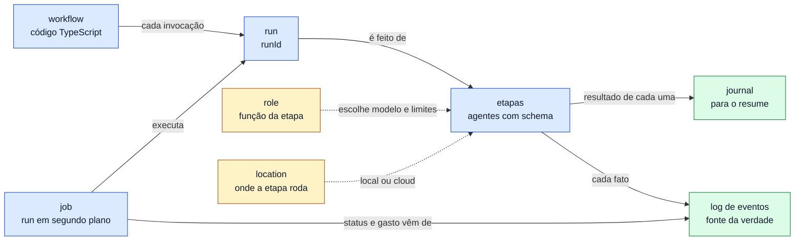

# 1.3 · Conceitos

O vocabulário do kit. O livro e o código usam estes termos com estes sentidos. Onde existe um sinônimo que confunde, a
linha _Evite_ diz qual não usar. Cada definição diz o que o conceito *é*; o que ele faz está nos capítulos que ela cita.

> **Em construção.** O *role* e o *heartbeat* do job são decisões da [spec de fundação (#2)](https://github.com/rodrigorjsf/cursor-workflows-starter/issues/2)
> que ainda não estão todos no código, e o status do job como projeção do log de eventos também não. As definições abaixo
> descrevem o desenho decidido; o que falta está nos tickets da spec.

## Os conceitos

**Workflow**:
Arquivo TypeScript que exporta `defineWorkflow(...)`: nome, descrição, schema dos `args` e uma função `run` em que o
código decide a ordem das etapas, os ramos e os laços. É o que se versiona, revisa e testa. Os embutidos ficam em
`packages/runtime/workflows/`; os do repositório, em `.agents/workflows/`.
_Evite_: fluxo (genérico demais), agente (um workflow não é um agente).

**Etapa** (*step*):
Uma chamada de `ctx.agent`: um agente novo do Cursor, com uma tarefa pequena, um modelo, uma allowlist de tools e, se
houver `schema`, uma saída validada. Cada tentativa gera eventos, e a etapa que termina vai para o journal. Os fluxos
`parallel` e `pipeline` agrupam etapas.
_Evite_: nó, tarefa, agente (o agente é o meio de executar a etapa, não a unidade do workflow).

**Role**:
O nome que o workflow dá à função de uma etapa (`classify`, `implement.med`, `review`). O autor declara os roles nos
metadados do workflow, e a configuração escolhe modelo, timeouts, tentativas e limites por role, sem tocar no código.
Um role que o workflow não declarou é um erro; uma etapa fora de qualquer role só se ajusta por glob de rótulo. Cada
role declara também se pode rodar na nuvem (veja *location*). Decisão em [ADR-0001](../adr/0001-layered-config-with-hard-caps.md).
_Evite_: tier (é o nível de complexidade da issue no `implement-issue`, outra coisa), tipo.

**Run**:
Uma invocação de um workflow, com um `runId`, os seus `args`, o diretório `.workflows/runs/<runId>/` e o seu teto de
custo. Um run pode ser interrompido e retomado (`--resume <runId>`, `resumeRunId`): retomar continua o mesmo run, não
abre outro, e cada passada de um processo sobre ele é uma *execução*. Um run tem no máximo um processo executando por
vez (`run.lock`).
_Evite_: sessão.

**Execução** (*execution*):
Uma passada de um processo sobre um run, do `run-start` que ela escreve no log de eventos ao seu `run-end` (uma execução
que caiu não chega ao `run-end`). Um resume é uma execução nova, e um job novo, do mesmo run. O gasto, as tentativas e
as métricas contam por execução; o status e os tetos de custo valem para o run.
_Evite_: run (o run é o que as execuções continuam), sessão.

**Job**:
O run em segundo plano que `start_workflow` (MCP) ou `wf start` (CLI) disparam, em um processo destacado que sobrevive ao
MCP server e ao Cursor. Tem identidade própria (job id, run id, pid, heartbeat; o registro guarda também o que o log não pode guardar: os args do start, o motivo de uma recusa e a marca de um cancelamento que matou o processo, [ADR-0008](../adr/0008-job-record-keeps-what-the-log-cannot.md)), e o que `wait_workflow` e
`get_workflow_status` respondem é uma projeção do log de eventos do run. Um job termina `finished`, `failed` ou
`cancelled` (`cancel_workflow`, `wf cancel`, Ctrl-C): cancelar um job em execução não é falhar (um job travado ou já
terminado continua `failed`), e o run continua retomável.
Retomar um run abre outro job sobre o mesmo run. Decisão em [ADR-0003](../adr/0003-detached-jobs.md).
_Evite_: tarefa, processo.

**Travado** (*frozen*):
O job cujo processo está vivo, é o do job, segura o lock do run (`run.lock`) e parou de mandar heartbeat. Aparece como
`failed`, mas ainda executa o run: um cancelamento o mata com SIGKILL. Só esse caso é travado (`isFrozen`, em
`packages/runtime/src/runtime/job-state.ts`).
_Evite_: terminado (o processo de um job travado ainda está lá), morto.

**Terminado** (*ended*):
O job cujo heartbeat parou e cujo processo não está mais lá: o pid morreu, ou é agora de outro processo (reusado), ou
não segura o lock do run. O processo caiu ou acabou; um job terminado nunca é travado, e um cancelamento não manda sinal
a ele.
_Evite_: travado.

**Journal**:
O `journal.jsonl` do run: o resultado de cada etapa que terminou, com a chave `hash(prompt + opções) + ocorrência`. É
o que faz o resume pular as etapas prontas. Não registra o que aconteceu, só o que está pronto: isso é o log de eventos.
_Evite_: histórico, log.

**Log de eventos** (*event log*):
O `events.jsonl` do run: cada fato do run, em ordem. Todo evento leva a versão do schema, o horário e o `runId`, e os
das etapas levam também `stepId`, `parentId` e `groupId`. É a fonte da verdade do status, das linhas recentes e do gasto
de um run, e a base de qualquer visão futura (kanban, DAG, replay). Decisão em
[ADR-0008](../adr/0008-job-record-keeps-what-the-log-cannot.md); campos em [6.1](../reference/events.md).
_Evite_: log (sozinho), progresso.

**Location**:
Onde uma etapa roda: `local` (o loop do agente roda na máquina do usuário, o padrão) ou `cloud` (numa VM da Cursor). Em
ambos a inferência é hospedada pela Cursor; a location só define onde o loop roda e onde o código fica. A configuração
escolhe a location por role, o teto global `allowedLocations` a permite ou não (sem ele, só `local`), e o workflow declara
a capacidade de cada role. Uma etapa pode rodar em `cloud` contra um snapshot do worktree: a de leitura devolve só o resultado, e a que
escreve commita na branch de snapshot e o motor avança o worktree até o trabalho dela (um fast-forward, ou a etapa falha). A decisão é o [ADR-0006](../adr/0006-cloud-steps-as-built.md), substituído pelo [ADR-0007](../adr/0007-cancel-stops-cloud-agents.md).
_Evite_: ambiente, runtime.

## Onde cada coisa mora no disco

| Conceito | Onde |
|---|---|
| Workflow | `packages/runtime/workflows/*.ts` (embutidos) e `.agents/workflows/*.ts` (do repositório) |
| Run | `<repo>/.workflows/runs/<runId>/`: `events.jsonl`, `journal.jsonl` e `run.lock` |
| Job | `<repo>/.workflows/jobs/<jobId>.json` e `<jobId>.log` |
| Índice global de runs | `~/.cursor-workflows/runs.jsonl`: uma linha por run, de todos os repositórios |
| Métricas | `~/.cursor-workflows/metrics.db`, um banco SQLite por usuário ([5.3](../operating/03-observabilidade.md)) |

---

[← Anterior: 1.2 · A ideia e as referências](02-a-ideia-e-as-referencias.md) · [Índice](../README.md) · [Próximo: 2.1 · Instalação →](../usage/01-instalacao.md)
